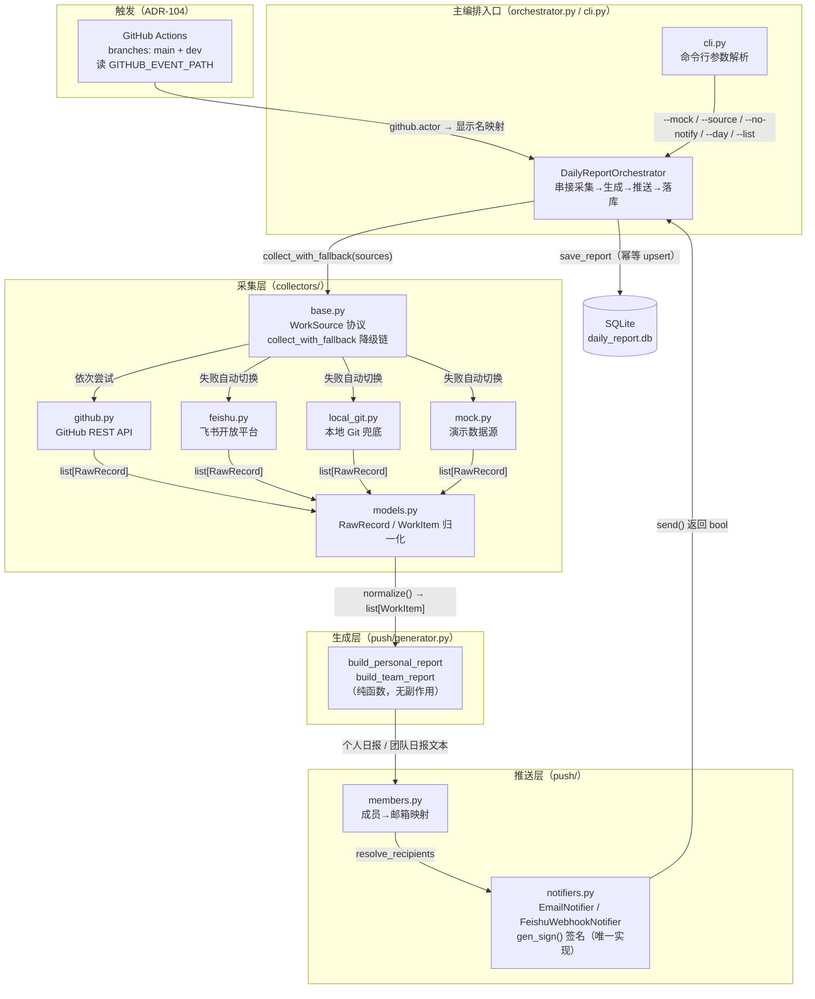

# design.md —— 智能日报生成器（Smart Daily Report Generator）

> 状态：**0.2 初稿（含触发链路实测约束）** · 依据 `specs/proposal.md` 0.2、`docs/技术栈候选清单.md`（第 1 周候选收集）、`docs/采集层交接说明.md`（可执行契约参考）与 `src/smart_daily/` 当前工程实况撰写。
> 写法约定：**已有实现的部分照实描述（每条注明出处）**；尚未实现、由本文档首次约定的部分标【本期约定】，须随 tasks.md 评审确认。
> ADR 结论均为本组自行论证，格式参照教材 ADR-001（httpx 选型）/ ADR-002（SQLite 选型），不照抄结论。编号自 101 起，避开教材编号。

---

## 1. 总体架构

### 1.1 分层架构图

整个系统按「**采集层 → 生成层 → 推送层 → 主编排入口**」四层构建（指导书第一部分）。依赖方向自上而下单向：主编排依赖下三层，下三层之间互不感知对方存在——生成层只认识 `WorkItem`，不知道数据来自 GitHub 还是飞书；推送层只认识文本和收件人，不知道日报怎么生成的。



### 1.2 分层职责一览

| 层 | 模块 | 职责 | 不做什么 |
| --- | --- | --- | --- |
| **采集层** | `collectors/base.py` | 定义 `WorkSource` 协议与降级入口 `collect_with_fallback` | 不关心任何具体数据源的实现细节 |
| | `collectors/models.py` | 三种原始记录（Commit/Message/Task）+ 统一 `WorkItem` 归一化 + 本地日历归属 | 不发任何网络请求 |
| | `collectors/github.py` | GitHub REST API 采集提交记录，细分 409/401/403/404 错误语义，手动翻页 | 不做写操作（只用 GET） |
| | `collectors/feishu.py` | 飞书任务/群消息/通讯录/群列表四组接口，自管 `tenant_access_token` 缓存（过期前 300 秒刷新） | 不缓存业务数据，只缓存凭证 |
| | `collectors/local_git.py` | 读取本地仓库的提交记录，作前两者凭证未就绪时的兜底 | 不访问网络 |
| | `collectors/mock.py` | 无凭证演示数据源，保证主流程永远可跑 | 不参与降级链自动挂载（仅 `--mock` 显式指定） |
| **生成层** | `push/generator.py` | `WorkItem 列表 → 个人日报 / 团队日报文本`，**纯函数、零副作用** | 不碰网络、不读文件、不做 AI 摘要（本期范围排除，proposal N1） |
| **推送层** | `push/notifiers.py` | `Notifier` 协议 + SMTP 邮件 / 飞书 Webhook（HMAC 签名）两个实现；`gen_sign()` 是签名算法的**唯一实现** | 推送失败只返回 False，**不抛异常、不阻断主流程** |
| | `push/members.py` | 成员 → 收件邮箱映射（环境变量配置，精确/前缀/后缀三段匹配） | 未知成员不报错，只跳过并记日志 |
| **主编排入口** | `orchestrator.py` | 串接四层：采集 → 分组 → 生成 → 落库 → 推送；管理 SQLite 读写 | 不实现任何采集/渲染/推送细节 |
| | `cli.py` | argparse 参数解析、历史查询（`--list`）模式 | 不含业务逻辑 |

### 1.3 三条固化的数据流契约（实测驱动，出处：采集层交接说明）

1. **空列表是合法返回值**——源可用但窗口内无数据返回 `[]`，降级链据此**停止**而非继续切换（否则"今天没提交"会被误判为"源坏了"）。
2. **异常必须显式抛出**——源不可用抛 `SourceUnavailableError`，降级链据此**继续**切下一个源。反面教材：飞书采集器曾吞异常返回空列表，导致跳过 local-git 兜底、产出 0 条空日报（已修复并加断言 [9][10]）。
3. **日期按本地日历归属**——用 `local_date(ts)`（`ts.astimezone().date()`）而非 `ts.date()`。采集层拿到的是 UTC 时间戳，直接取 `.date()` 在东八区会让日报标题差一天（已修复并加断言 [12]）。

---

## 2. 数据模型

### 2.1 实体关系

```
DailyReport（日报实体）          WorkItem（工作痕迹条目）
┌──────────────────────┐ 1    * ┌─────────────────────────┐
│ report_date  日期     │────────│ member    归属成员        │
│ member       成员     │        │ timestamp 事件时间（UTC） │
│ content     日报全文  │        │ title     做了什么        │
│ item_count  条目数    │        │ source    commit|message|task
│ source_name 生效数据源 │        │ detail/url/metrics        │
│ created_at  写入时间   │        └─────────────────────────┘
└──────────────────────┘           ↑ normalize()
                                RawRecord = CommitEntry | MessageEntry | TaskEntry
```

一份日报 = **(report_date, member) 唯一确定的条目集合的文本渲染**。原始记录先归一化为 `WorkItem`，按成员分组（`group_by_member`）后逐人生成个人日报；全组合集渲染为团队日报。

### 2.2 内存实体（dataclass，出处：`collectors/models.py`）

**RawRecord 三型**（采集器返回值，frozen dataclass，采集完成即不可变）：

| 类型 | 关键字段 | 事件时间字段 | 来源 |
| --- | --- | --- | --- |
| `CommitEntry` | sha, author_login/author_name, message, repo, url, additions/deletions/changed_files, files | `timestamp` | github.py / local_git.py |
| `MessageEntry` | message_id, chat_id, sender_id/sender_name, text, msg_type, mentions, thread_id | `timestamp` | feishu.py（群消息） |
| `TaskEntry` | task_id, summary, description, creator_id/creator_name, created_at, completed_at, completed, members, due | `created_at` | feishu.py（任务） |

> 设计要点：`TaskEntry` 同时保留 `created_at` 与 `completed_at`，日报关心"当天有什么进展"，用哪个时间做归属由归一化规则统一决定（当前取 `created_at`，见 `WorkItem.from_task`）。

**WorkItem（归一化统一视图，生成层唯一输入）**：

| 字段 | 类型 | 说明 |
| --- | --- | --- |
| `member` | str | 归属成员（author_name / sender_name / creator_name，经 `MEMBER_DISPLAY_NAMES` 显示名映射归并多账号身份） |
| `timestamp` | datetime | 事件时间（统一自三种原始记录的时间字段收敛，见 `record_timestamp()`） |
| `title` | str | 做了什么（提交 message / 消息前 60 字 / 任务 summary） |
| `source` | `"commit" \| "message" \| "task"` | 来源类型，生成层据此加中文标签 |
| `detail` | str | 补充说明（含变更统计 / 消息全文 / 任务描述） |
| `url` | str | 关联链接 |
| `record_id` | str | 源平台唯一 ID（sha / message_id / task_id），**未来去重与对账的键** |
| `metrics` | dict | 各源特有指标（repo、增删行数、chat_id、completed 等） |

**成员归属的键选择**（ADR-104 实测约束）：凡由 GitHub 触发链路（Actions 工作流）决定的归属，一律以 `github.actor`（事件文件中的平台登录名）查 `MEMBER_DISPLAY_NAMES` 得到显示名；**禁止**用 `commits[].author.name`（git 本地配置的自由文本，同一人实测出现过 `fh` / `20233046方赫` 两种写法，无法稳定映射——proposal 痛点④的根源）。采集器内部的 `author_login` 字段保持为登录名，与本规则同源。

【本期约定】第 2 周协作成果归属（proposal S5/G3）将引入"一条提交归属多名贡献者"的展开规则：在 `normalize()` 之后、`group_by_member()` 之前增加 `attribute_collaboration(items) -> list[WorkItem]` 纯函数，按 `metrics.members` 与 `MEMBER_DISPLAY_NAMES` 反查展开成员，**不改 WorkItem 结构**，保证生成层零改动。

### 2.3 SQLite 表结构（已实现，出处：`orchestrator.py::_ensure_db`）

```sql
CREATE TABLE IF NOT EXISTS daily_reports (
    id           INTEGER PRIMARY KEY AUTOINCREMENT,
    report_date  TEXT NOT NULL,          -- ISO 日期 YYYY-MM-DD（本地日历日）
    member       TEXT NOT NULL,          -- 成员显示名（与 WorkItem.member 同源）
    content      TEXT NOT NULL,          -- 日报全文（Markdown 文本）
    item_count   INTEGER NOT NULL DEFAULT 0,
    source_name  TEXT,                   -- 实际生效的数据源名（github/feishu/local-git/mock）
    created_at   TEXT NOT NULL,          -- 写入时间（UTC ISO 格式）
    UNIQUE (report_date, member)         -- 幂等键：同日同人唯一
);
```

**幂等策略**（对应 proposal C5）：写入用 `INSERT ... ON CONFLICT(report_date, member) DO UPDATE SET content/item_count/source_name/created_at = excluded.*`——同日同人重复执行**覆盖而非追加**，重复跑不会产生重复记录，也天然保留最后一次（信息最全）的结果。

**查询接口**：`list_reports(day=None)` 按日期倒序返回元数据（不含全文），支撑 CLI `--list` 历史查询（proposal 隐含需求 I7 的最小实现）。

【本期约定】`record_id` 目前只存在于 `WorkItem` 内存态、未落库。若第 2 周需要条目级对账（proposal 痛点③"漏一条 = 采集缺陷（可测试）"），增补 `work_items` 表：

```sql
CREATE TABLE IF NOT EXISTS work_items (
    report_date TEXT NOT NULL,
    member      TEXT NOT NULL,
    record_id   TEXT NOT NULL,           -- sha / message_id / task_id
    source      TEXT NOT NULL,
    title       TEXT NOT NULL,
    timestamp   TEXT NOT NULL,
    PRIMARY KEY (report_date, record_id) -- 条目级幂等
);
```

是否引入取决于对账测试的粒度要求，**本期默认不建**，避免过度设计。

---

## 3. 接口契约

> 以下契约与代码一一对应，34 项断言（`scripts/verify_collectors.py`）可作证据。每条函数给出签名、行为约束与异常语义。

### 3.1 采集层

```python
class WorkSource(Protocol):
    name: str   # 数据源名，用于日志与降级提示

    def collect(self, *, since: datetime | None = None,
                until: datetime | None = None,
                author: str | None = None) -> list[RawRecord]: ...
```

**`collect()` 行为约束**（每条有对应断言编号）：

| 约束 | 断言 |
| --- | --- |
| 返回记录按时间**倒序** | [1][4] |
| 时间窗口为**闭区间**（since、until 均含） | [1] |
| 源可用但无数据 → 返回 `[]`，**不抛异常** | [8] |
| 源不可用（凭证缺失/网络失败/仓库为空）→ 抛 `SourceUnavailableError` | [2][5][10] |
| 仓库地址未配置 → 判定不可用，**不误打 API** | [3] |

**降级入口**：

```python
def collect_with_fallback(sources: list[WorkSource], *, since=None, until=None,
                          author=None) -> tuple[list[WorkItem], str]:
    """按列表顺序依次尝试；返回 (归一化条目, 生效数据源名)。
    遇空列表 → 停止（返回空结果 + 该源名）；遇异常 → 继续下一个源。
    全部失败 → 抛 SourceUnavailableError，聚合各源错误信息。
    """
```

> 注意：`collect_with_fallback` 内部已完成 `normalize()`，编排层**不可二次归一化**。降级顺序 GitHub → 飞书 → local-git → mock 由编排层注入 `sources` 列表决定（见 ADR-003）。

**各采集器工厂**（统一模式：`from_env()` 读环境变量，缺凭证即抛 `SourceUnavailableError`）：

| 函数 | 环境变量 | 说明 |
| --- | --- | --- |
| `GitHubCollector.from_env(owner=None, repo=None)` | `GITHUB_TOKEN`、`GITHUB_REPO_OWNER/NAME` | httpx.Client 封装认证头 + `X-GitHub-Api-Version: 2022-11-28`，timeout 15s；`collect_commits(owner/repo, since, until)` 手动翻页 |
| `FeishuCollector.from_env()` | `FEISHU_APP_ID/APP_SECRET` | 自管 `tenant_access_token`（过期前 300 秒刷新）；任务/群消息/通讯录/群列表四组接口；飞书错误码（如 21001 租户资质）转中文提示 |
| `LocalGitCollector(repo_path)` | 无（构造参数传本地路径） | 只读本地 `.git`，永远可挂载，排降级链尾 |
| `MockCollector()` | 无 | 内置四人样例数据，`--mock` 显式指定 |

**归一化工具函数**：

| 函数 | 契约 |
| --- | --- |
| `normalize(entries) -> list[WorkItem]` | 接受三型任意混合；已是 `WorkItem` 的**原样放行**（可幂等二次调用）；不认识的类型抛 `TypeError`；输出按时间倒序 |
| `local_date(ts) -> date` | 按本地日历归属日期（时区坑，见 1.3 契约 3） |
| `record_timestamp(entry) -> datetime` | 收敛三型不同的时间字段名；不支持的类型抛 `TypeError` |

### 3.2 生成层

```python
def group_by_member(items) -> dict[str, list[WorkItem]]      # 按成员分组，组内时间倒序
def format_item(item: WorkItem) -> str                        # 单条 → "- [HH:MM] （标签）标题 —— 详情"
def build_personal_report(member: str, items, day=None) -> str
def build_team_report(groups: dict[str, list[WorkItem]], day=None) -> str
```

**行为约束**：纯函数，无网络、无文件、无全局状态——相同输入必得相同输出（proposal G4"格式统一"可测的根基）。`day=None` 时由编排层用 `local_date()` 决定归属日。本期**不做 AI 摘要**（proposal N1）；将来 AI 是这层外面的可选实现，不改这层（generator.py 模块注释原文）。

### 3.3 推送层

```python
class Notifier(Protocol):
    name: str
    def send(self, subject: str, body: str, recipients: list[str]) -> bool: ...
    # True=成功；False=失败。**不抛异常** —— 推送失败不阻断主流程
```

| 实现 | 通道 | 承载内容 | 凭证（环境变量） |
| --- | --- | --- | --- |
| `EmailNotifier.from_env()` | SMTP | **个人日报**（每人只收自己的那份） | SMTP_HOST/PORT/USER/PASS 等 |
| `FeishuWebhookNotifier.from_env()` | 飞书自定义机器人 Webhook | **团队日报**（群渠道） | 飞书 Webhook URL + 签名密钥 |

**分发规则**（重要，曾出过回归 bug——旧实现给邮件通道传空收件人导致邮件"从未真正工作过"）：

| 日报类型 | 通道 | 收件人来源 |
| --- | --- | --- |
| 个人日报 | 仅邮件 | `resolve_recipients(member, load_member_emails())` |
| 团队日报 | 仅群渠道 | Webhook 无需收件人列表（传 `[]`） |

**飞书 Webhook 两条硬性约束**（组内实测）：

1. **消息文本必须包含「日报」二字**。群机器人若启用关键词安全设置，不含关键词的消息被飞书直接拒绝并返回 **19024**；发送前须校验文本含关键词。标题模板"团队日报 YYYY-MM-DD"天然满足，但任何绕过生成层直接拼消息体的路径（如 Actions 工作流脚本）必须自行保证这一点。
2. **签名必须复用 `push/notifiers.py::gen_sign()`**，任何触发路径（含 GitHub Actions 工作流脚本）**不得重复实现**签名算法——同一算法两处实现必然漂移（如时间戳单位、编码差异），漂移后报错还难以定位。

**签名算法**（`gen_sign(timestamp, secret)`）：按飞书官方算法 `base64(hmac_sha256(f"{timestamp}\n{secret}"))`，时间戳距当前不得超过 1 小时。

**成员映射**（`members.py`）：

```python
def load_member_emails() -> dict[str, list[str]]
    # 解析 MEMBER_EMAILS="成员:邮箱1;邮箱2,..."；未配置返回 {}（映射可选）
def resolve_recipients(member, mapping=None) -> list[str]
    # 三段匹配：精确 → 邮箱前缀（GitHub 登录名常是前缀）→ 配置键前缀反查
    # 未命中返回 []，调用方跳过该成员（未知成员不报错）
```

### 3.4 主编排入口

```python
class DailyReportOrchestrator:
    def __init__(self, sources=None, notifiers=None, db_path=DB_PATH)
    def run(self, since=None, until=None, day=None, notify=True) -> dict
    # 返回 {date, source, members, items, saved_reports, pushed, push_detail, team_report}

    def collect(self, since=None, until=None) -> tuple[list[WorkItem], str]
    def save_report(self, member, content, item_count, day, source) -> None   # 幂等 upsert
    def list_reports(self, day=None) -> list[dict]                            # 历史查询
```

**主流程顺序**（`run()`）：采集（降级链）→ 确定归属日（无数据则 `date.today()`）→ `group_by_member` → 生成团队日报 → 逐人生成个人日报并落库 → 推送（个人走邮件、团队走群渠道）→ 汇总推送明细。**任何推送失败不影响落库结果**。

**CLI 契约**（`cli.py`，argparse）：

| 参数 | 行为 |
| --- | --- |
| （无） | 正常跑：自动降级链采集 → 生成 → 落库 → 推送 |
| `--mock` | 强制演示数据源（不依赖任何凭证） |
| `--source mock\|local-git` | 指定单一数据源，跳过降级链 |
| `--no-notify` | 只生成落库，不推送 |
| `--day YYYY-MM-DD` | 指定报告日期 |
| `--list` | 只查历史，不采集 |

---

## 4. 架构决策记录（ADR）

> 格式参照教材 ADR-001（httpx 选型）/ ADR-002（SQLite 选型）；背景与论证为本组基于**当前工程实测**自行得出，候选事实来自 `docs/技术栈候选清单.md`（该文档只列不定，结论在此做出）。

### ADR-101：HTTP 客户端维持 httpx 直连 REST，不引入 SDK

| 项 | 内容 |
| --- | --- |
| **状态** | 已接受（2026-11-09） |
| **背景** | 采集层需访问 GitHub REST API 与飞书开放平台两套 HTTP 服务；候选为 httpx 直连（现状）、PyGithub、gh CLI 子进程（GitHub 侧）、lark-oapi 官方 SDK（飞书侧）。httpx 是仓库当前**唯一运行依赖**（pyproject.toml），github.py 已封装认证头、API 版本头、409/401/403/404 细分错误语义与手动翻页；feishu.py 已自管 token 缓存与页码翻页。 |
| **决策** | 采集与推送的全部 HTTP 调用统一走 httpx；不引入任何 SDK 或第二套 HTTP 栈。 |
| **论证** | ①**错误语义可控**：409=空仓库、401/403=凭证失效这类**项目自定义**降级语义，SDK 并不感知——换 SDK 必须为降级契约重写一层错误翻译，收益为负。②**依赖单一**：PyGithub 会引入 requests 系传递依赖，与 httpx 并存两套 HTTP 栈，违背"依赖最小化"（proposal 技术约束）。③**契约可保留**：WorkSource 协议外壳不变，未来若扩采 PR 评审等字段，直连改造成本低于 SDK 适配。④**飞书 token 自管已验证**：过期前 300 秒刷新的缓存逻辑已被实测覆盖，SDK 在此环节无增量价值（user_access_token 授权链路 SDK 是否覆盖未核实——见技术栈清单证据缺口 3，不作为决策依据）。⑤**国内可用性**：GitHub API 可达性波动是已识别风险（docs/GitHub访问诊断报告），但它是**网络问题不是客户端问题**，换 SDK 不解决。 |
| **后果** | 正面：零新增依赖；降级语义与代码同层、可测；错误信息直白。负面：翻页、重试、字段映射自行维护；飞书接口变更需跟官方文档手工适配。 |
| **触发重议的条件** | 需要采集的字段 SDK 才有现成支持且自研成本显著；或 httpx 停止维护。 |

### ADR-102：存储采用标准库 sqlite3，以 UNIQUE 约束实现幂等

| 项 | 内容 |
| --- | --- |
| **状态** | 已接受（2026-11-09） |
| **背景** | 需要持久化日报历史（proposal S8）并保证"同日重复执行不重复记录"（C5 幂等）。候选：SQLite（标准库 sqlite3）、JSON 文件、服务端数据库。部署形态是**单机命令行工具**（`uv run --env-file .env smart-daily`），无服务器、无并发写。 |
| **决策** | 用标准库 `sqlite3`，单文件库（路径经 `DB_PATH` 环境变量配置，默认 `data/daily_report.db`）；幂等靠表约束 `UNIQUE(report_date, member)` + `ON CONFLICT ... DO UPDATE` upsert，不靠应用层先查后写。 |
| **论证** | ①**幂等放数据库层最可靠**：先 SELECT 再 INSERT 在两次运行并发时有竞态；`INSERT ... ON CONFLICT` 是原子操作，幂等性不依赖调用方自觉。②**零部署成本**：标准库随 Python 3.13 分发，组员 `uv sync` 后即可跑，与"凭证未就绪不阻塞进度"的小组处境匹配；MySQL/PostgreSQL 需要额外搭建与连接配置，对单机 CLI 是过度设计。③**JSON 文件否决理由**：无查询能力（`--list` 按日期/成员过滤要自己实现）、无约束（重复写入要靠应用层防）、并发写会互相覆盖。④**可迁移性**：SQL 是标准接口，若 v1.1 演化为多人共享服务，表结构可平移到服务端数据库。 |
| **后果** | 正面：零依赖、原子幂等、有查询能力、可按 (日期, 成员) 精确回溯（隐含需求 I7）。负面：单文件不利于多人同时写（本期无此场景）；日报全文存 TEXT，条目级统计需应用层解析（条目级对账表见 2.3【本期约定】，默认不建）。 |
| **触发重议的条件** | 出现多机并发写入需求；或条目级对账成为硬性测试要求。 |

### ADR-103：采集容错采用"异常驱动降级"，采集器内不做重试

| 项 | 内容 |
| --- | --- |
| **状态** | 已接受（2026-11-09） |
| **背景** | 凭证失效、租户资质卡审、网络波动是本项目**常态**而非异常（proposal I1、C2、C8；指导书 FAQ 明示"凭证申请不下来不必阻塞进度"）。问题：源失败后系统该重试、该跳过、还是该中断？"今天没提交"和"源坏了"如何区分？ |
| **决策** | 三条规则：①源不可用**显式抛** `SourceUnavailableError`，严禁吞异常返回 `[]`；②降级链**异常驱动**——捕获异常即切下一个源，遇空列表即停止；③**采集器内不做重试**，单源一次尝试，失败直接降级；重试（若做）只放在推送层。 |
| **论证** | ①**实测教训**：飞书采集器曾吞异常返回空列表，降级链误判"成功"跳过 local-git 兜底，产出 0 条空日报（断言 [9][10] 固化此教训）。②**空列表与异常的区分是语义必需**：把"没数据"报成异常会导致无提交的日子（缺勤/纯会议日，隐含需求 I5）误触发降级，浪费配额且日志失真。③**采集侧不重试的理由**：采集源失败多为确定性故障（凭证缺失、资质未过、仓库地址错），重试同样失败，只会拖慢主流程；降级到下一个源本身就是最好的"重试"。而推送失败多为瞬时故障（网络抖动），值得重试——但本期推送层只返回 False 留痕，重试列入 v1.1（见第 5 节）。④**全失败必须显式报错**（C8）：降级链耗尽抛聚合了各源错误的 `SourceUnavailableError`，禁止静默产出空日报。 |
| **后果** | 正面：主流程在任一单点故障下不中断（G5）；故障原因留痕（errors 聚合）；语义可测（34 项断言中 8 项覆盖此契约）。负面：瞬时网络抖动会直接降级到低质量源（如 local-git 只有本机克隆的仓库），产出可能不全——接受此代价，换取行为确定性；缓解手段是 `--source` 显式指定源重跑（幂等覆盖，无脏数据）。 |
| **触发重议的条件** | 推送重试落地后实测仍有明显数据缺口；或新增的采集源失败模式不再以确定性故障为主。 |

### ADR-104：推送触发采用 GitHub Actions，成员归属以事件文件的 github.actor 为准

| 项 | 内容 |
| --- | --- |
| **状态** | 已接受（2026-11-09，组内实测约束） |
| **背景** | 定时触发落点是技术栈清单开放问题 7 的未决项（本机计划任务 vs GitHub Actions vs 常驻服务）。组内把日报推送接进飞书群机器人实测时踩到五个坑，直接约束了工作流与归属设计。 |
| **决策** | 五条：①触发采用 **GitHub Actions**（push / schedule 事件）；②workflow 的 `branches` 过滤**只保留 `main` 与 `dev`**——不过滤时每个 PR 分支（`docs/xxx` 等）的推送都会触发一次，把群消息刷成流水账（实测教训）；③成员归属**读 `GITHUB_EVENT_PATH` 事件文件**，取 `github.actor`（触发本次推送的 GitHub 登录名）查 `MEMBER_DISPLAY_NAMES` 得显示名，**禁止**以 `commits[].author.name` 做归属键；④飞书 Webhook 消息体必须含「日报」关键词，否则 19024（见 3.3）；⑤Webhook 签名复用 `push/notifiers.py::gen_sign()`，不在工作流脚本里重复实现（见 3.3）。 |
| **论证** | ①**归属键的稳定性**：`github.actor` 是平台侧登录名，与 `MEMBER_DISPLAY_NAMES` 的键（GitHub 登录名）同源，映射一一对应；而 `commits[].author.name` 来自提交者本地 git config 的自由文本，同一人实测出现过 `fh` / `20233046方赫` 两种写法（proposal 痛点④），拿它查映射必漏。②**branches 过滤是防刷群的唯一闸门**：Actions 对 push 事件默认全分支触发，而本组工作流（每人各推 `docs/xxx` 分支）推送频繁，不过滤等于把群消息频道交给 git 事件流。③**事件文件零成本**：`GITHUB_EVENT_PATH` 是 Actions 官方注入的本地 JSON 文件，读文件不增加任何 API 调用、不消耗频率配额（呼应 5.1）；而另查 commits API 既多打请求，又拿不到"这次是谁触发的"这层语义。④**关键词与签名复用**：19024 报错只报错误码不指明原因，排查成本高，发送前校验把失败拦在本机；签名算法单点实现是"同一逻辑只写一遍"的通用纪律（与降级链收敛在 `collect_with_fallback` 同理）。 |
| **后果** | 正面：零本机开机依赖；触发与运行记录在仓库 workflow 留痕；归属稳定可复现。负面：Actions runner 境外访问飞书开放平台的连通性未实测（技术栈清单证据缺口 5）；凭证须配成 Actions Secrets（5.2）；本机调试路径（`--mock` / `--source local-git`）与线上触发路径不同，须各自验证；关键词约束对"绕过生成层的自定义消息"构成限制。 |
| **触发重议的条件** | runner 到飞书连通性实测不可用 → 回退本机计划任务（技术栈清单 3.9 候选 A，`uv run --env-file .env smart-daily` 一行对接，零代码改动）。 |

---

## 5. 非功能性约束

### 5.1 采集频率限制

| 平台 | 限制（平台公开规则） | 本组对策 |
| --- | --- | --- |
| GitHub REST | 认证请求 5,000 次/小时/账号；未认证 60 次/小时/IP | ①只用认证请求（`GITHUB_TOKEN` 必配，未配即抛 `SourceUnavailableError` 不误打）；②一次运行 = 一个时间窗口一次翻页拉取，不做轮询（proposal N5 已排除实时刷新）；③单成员 100 条提交 < 30s（C6），串行翻页即可满足，不并发打接口；④Actions 触发路径读 `GITHUB_EVENT_PATH` 事件文件取归属信息，**不额外消耗 API 配额**（ADR-104） |
| 飞书开放平台 | 各接口设有频率限制（以官方文档为准，本组未实测具体阈值） | ①`tenant_access_token` 内存缓存、过期前 300 秒刷新——**每次运行最多取一次 token**，不为每个请求取；②同上按窗口一次拉取；③21001 等错误码显式转译，频控报错不会被误判为"无数据" |
| 飞书 Webhook | 关键词安全设置 + 签名校验 | 消息含「日报」关键词（否则 19024）；签名复用 `gen_sign()` 单一实现（见 3.3） |
| SMTP | 邮件服务商按账号限频（QQ/163 每日发信上限，具体以服务商为准） | 个人日报逐人串行发送；单人单日一封，量级极小 |

**总原则**：本系统按自然日聚合（N5），单日运行一次的调用次数天然远低于任何平台限额；不实现自适应限速。

### 5.2 密钥与配置管理（红线约束）

配置按敏感度**分两级**管理：

| 级别 | 变量 | 存放位置 | 规则 |
| --- | --- | --- | --- |
| **秘密级（绝不进仓库）** | `GITHUB_TOKEN`、`FEISHU_APP_ID/APP_SECRET`、飞书 Webhook 签名密钥、SMTP 授权码、**`MEMBER_EMAILS`（成员真实邮箱属个人信息）** | 本地 `.env`（`.gitignore` 保护）/ GitHub Actions Secrets | 严禁写入代码、严禁提交仓库；推送前执行敏感信息扫描；仓库内示例一律用 `example.com` 占位（members.py 已践行） |
| **可入库级** | `MEMBER_DISPLAY_NAMES`（GitHub 登录名 → 显示名映射） | 可随仓库分发（含 Actions 工作流读取） | 不含任何敏感信息，入库反而保证 Actions 与全员环境读到同一份映射，避免各机漂移 |

其余纪律：

1. **凭证缺失 = 源不可用，不是程序错误**：`from_env()` 工厂读到空值即抛 `SourceUnavailableError`，由降级链接手——凭证问题永远不会以崩溃栈的形式暴露给使用者。
2. **最小权限**：GitHub 用只读 PAT；飞书采集与推送是两条独立通道（推 Webhook 无需租户资质，读接口需要），能力分开申请。
3. **日志脱敏**：日志只打数据源名与错误摘要，不打 token、不打完整 Webhook URL。
4. **Actions 场景**：秘密级变量配成 Actions Secrets 注入环境，与本地 `.env` 同名同语义；工作流脚本不落任何明文凭证。

### 5.3 异常与重试策略

| 环节 | 失败语义 | 重试 |
| --- | --- | --- |
| 采集（单源） | 抛 `SourceUnavailableError`，信息含根因（凭证缺失/409 空仓库/飞书错误码） | **不重试**（ADR-103：确定性故障重试无意义） |
| 采集（降级链） | 逐源切换，errors 聚合各源失败原因；全失败抛聚合异常，**禁止静默空日报**（C8） | 降级即重试的替代 |
| 生成 | 纯函数，确定性输入输出；不认识的记录类型抛 `TypeError`（fail-fast，属程序 bug 不容降级） | 不适用 |
| 落库 | sqlite 原子 upsert；DB 路径不可写属环境错误，抛出并中断（此时日报文本仍会打印到终端，不丢失） | 不适用 |
| 推送 | `send()` 返回 False / 捕获一切异常记入 `push_detail`，**不抛出** | 本期不重试，推送明细留痕；指数退避重试列为 v1.1【本期约定】 |
| 飞书 Webhook 关键词校验 | 发送前本地校验文本含「日报」，不含则拒发并留痕——比 19024 报错后排查便宜 | 不适用（确定性错误） |
| 整体超时 | httpx Client timeout 15s（github.py）；飞书请求同层超时 | 单源超时即视为失败，走降级 |

### 5.4 其他约束

| 约束 | 内容 | 依据 |
| --- | --- | --- |
| 性能 | 单成员 100 条提交采集 < 30s（计时断言待补，proposal C6/G2） | 串行翻页 + httpx 连接复用（`httpx.Client` 单例）即可满足，不做并发 |
| 可观测性 | 统一 `[source]` / `[push]` 前缀 print；推送结果明细含通道名、范围、成败；CLI 汇总面板。logging 文件化列入 v1.1（技术栈清单 3.6 候选 B，定时任务落地时一并做） | 现状 + 开放问题 7 |
| 时区正确性 | 一切日期归属走 `local_date()`，禁止直接 `.date()`（契约 3，断言 [12]） | 实测教训 |
| 平台可迁移 | 代码不依赖 Windows 特性，可迁移 Linux（proposal 技术约束）；路径用 `pathlib` | proposal |
| 启动纪律 | 必须经 `uv run --env-file .env` 启动——直接 `python -m` 不读 .env 会**静默降级**（README 已警示） | proposal 技术约束 |

---

## 6. 未决问题（承接技术栈清单第六节，随 tasks.md 评审收敛）

1. ~~定时触发落点~~ → **已决**：GitHub Actions（ADR-104）。遗留一条：runner 到飞书开放平台的连通性实测（技术栈清单证据缺口 5），实测不通则回退本机计划任务。
2. 推送重试是否引入指数退避 → 影响推送层契约（3.3，当前"返回 False 不抛"已为重试留出实现空间）。
3. 条目级对账表 `work_items` 是否建表 → 见 2.3【本期约定】。
4. 协作归属函数 `attribute_collaboration()` 的规则细节 → 见 2.2【本期约定】，待 G3 的构造数据集定义后评审。

---

## 变更记录

| 日期 | 版本 | 变更内容 | 撰写 |
| --- | --- | --- | --- |
| 2026-11-09 | 0.1 | 初稿：四层架构图与职责、数据模型与 SQLite 表、函数级接口契约（含 34 项断言对照）、ADR-101/102/103、非功能性约束 | AI 起草，待架构评审签字 |
| 2026-11-09 | 0.2 | 并入推送链路实测约束：新增 ADR-104（Actions 触发 / branches 过滤 main+dev / github.actor 归属 / 关键词 19024 / gen_sign 单点复用）；5.2 配置分两级（MEMBER_DISPLAY_NAMES 可入库、MEMBER_EMAILS 绝不进）；2.2 增补归属键选择；未决问题 1 关闭 | AI 起草，待架构评审签字 |
