# 同类竞品调研记录 · 智能日报生成器

> 依据：指导书第 1 周任务 3（调研 2–3 个同类日报/周报自动化方案，覆盖功能模块、UI 与交互、核心流程）。
> 调研方式：**本人到真实产品页面/仓库页面实操截图** + **开源仓库代码阅读**（Aiscribe 全量源码本地阅读，gh-daily-report 仓库页面阅读）+ **官方 README/官网介绍**。
> 三源核验：所有关键结论执行三源核验（开源项目：GitHub 仓库 + 仓库提交历史 + 第三方提及；商业产品：官网 + 第三方媒体/代理商报道），来源清单见文末「三源核验记录」；检索不到第三源的**如实标注，不凑数**。
> 截图：全文 15 张截图均为本人亲手截取，仓库层截图进「功能模块/核心流程」，产品界面截图进「UI 与交互」，每张图下配图注说明其证明的事实。

---

## 方案一：Aiscribe（开源 AI 工具）

**定位**：本机优先、隐私优先的开源 Python 工具——读本地各 AI 工具（TRAE、Claude Code、Cursor 等）的会话记录，聚合成日报/周报；走「本地多源采集 + 统一数据模型 + 客户端 AI 归纳（MCP）」的技术路线。

### 功能模块

- **17 个数据源连接器**：16 个 AI 工具（TRAE/CodeBuddy/Codex/Claude Code/Gemini CLI/Cline/Cursor/豆包/WorkBuddy/Kimi 等）+ Windows「最近文件」，直接读各家工具自己的本地文件（SQLite/JSONL/IndexedDB），只读本机不联网
- **统一数据模型 UnifiedRecord**：所有连接器输出归一化为同一格式（source/session_id/title/project/status/起止时间戳/摘要），时间戳统一为 epoch 秒
- **L2 索引层**：多源合并、去重、项目归类（规则文件 projects.json 可外置，关键词→标题关键词→目录名三级兜底）、按北京时间过滤（只收当天+跨夜≤1天的会话）
- **L3 报告生成**：程序强制排版——报告标题、项目分节数量顺序、条目位置全由程序决定，只渲染当天真实有记录的项目
- **可选 AI 归纳**：LLM 非必需，不配也能出报告（模板直出）；配了走 MCP 协议把素材交给客户端 AI 归纳（作者明说这是方案的关键），也支持 DeepSeek 或本机 Ollama
- **多格式输出**：Markdown / Word（纯标准库手写 WordprocessingML，连 python-docx 都不用）/ 自包含 HTML
- **MCP 服务**：stdio / 本地 HTTP 两种暴露方式，任何 AI 客户端可来取素材
- **钉钉推送**：仓库内 dingtalk_config 模板 + 定时任务示例 automation_example.json，走钉钉企业内部应用 API 创建日报
- **本地 Web 引导页**：127.0.0.1 四步向导，另有历史会话浏览页

仓库根目录与 ai_report/ 内部结构如下两张截图所示。

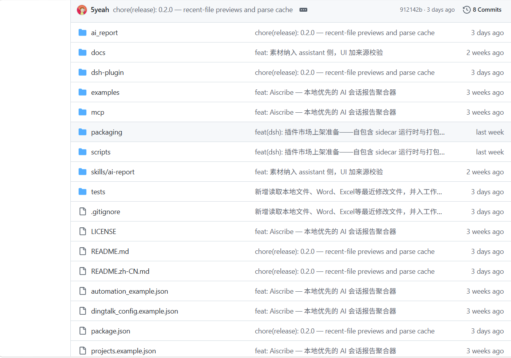

*图：仓库根目录——ai_report/（内核）、mcp/、skills/、automation_example.json（定时任务示例）、dingtalk_config.example.json（钉钉推送配置）并列，证明「采集+生成+MCP+推送」各模块是仓库内真实交付物；最新提交为 0.2.0 release，共 8 Commits。*

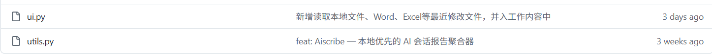

*图：ai_report/ 目录下半页（ui.py、utils.py）——与上文的 cli/generator/index/llm/mcp_server/models 等合起来共 19 个模块文件，证明架构分层不是 README 宣传语，而是逐文件落地的实现。*

### 核心流程

```
17 个本地连接器（AI 工具会话 / 最近文件） → UnifiedRecord 归一化 →
L2 索引（合并 / 去重 / 项目归类 / 北京时间窗口过滤） → L3 模板排版（程序定骨架+槽位） →
可选 AI 归纳（MCP 交客户端 AI，或 DeepSeek / Ollama；格式校验不过退回模板） →
Markdown / Word / HTML 输出 → （可选）钉钉日报 API 推送
```

三步实现要点：**采集侧**，每个连接器只需实现 `available()`（本地数据文件是否存在）和 `read()`（归一化输出）两个方法，再往 registry 注册表追加一行即完成接入，官方称加一个新数据源只要约 15 行代码；**索引侧**，index.py 做合并去重与项目归类，时间窗口外的素材在数据层直接丢弃（AI 根本拿不到，而不是靠提示词求 AI 别写）；**生成侧**，generator.py 先构建报告骨架，归纳器（llm.py）只被允许改写条目的标题/正文两段文字，改写结果还要过 `check_outline` 结构与格式校验，不过就退回程序渲染的模板草稿——排版不会漂移，条目也不可能被 AI 增删或编造。降级链完整：zstd 未安装→只读元数据；LLM 无 Key 或请求失败→退回模板并如实记 last_error，绝不中断流程。

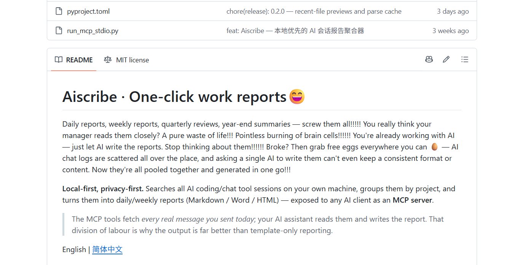

*图：仓库 README——"Local-first, privacy-first"、"exposed to any AI client as an MCP server"、Markdown/Word/HTML 三种输出格式，与上述定位和流程声明逐条对应。*

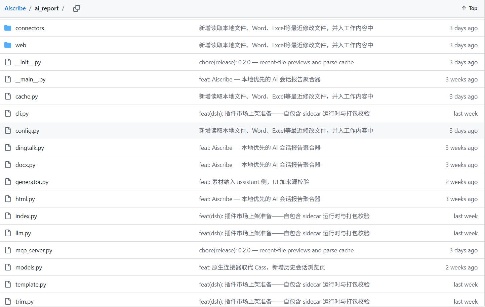

*图：GitHub 上 ai_report/ 目录页——connectors/ 独立成目录，generator.py、index.py、llm.py、models.py、mcp_server.py、dingtalk.py 分文件并存，证明「连接器层 / 索引层 / 生成层 / 归纳层」分层与统一数据模型有对应代码实体。*

### UI 与交互

有本地 Web 图形界面：`aireport ui` 启动后只监听 127.0.0.1，浏览器打开一个四步引导向导（选工具→定时间窗→挑素材→定排版输出），全程点选、零命令行门槛，面向「想让 AI 替自己写日报」的普通开发者；同时保留 CLI 子命令（daily/weekly/range/sources/mcp 等）给脚本化用户。四步界面如下：

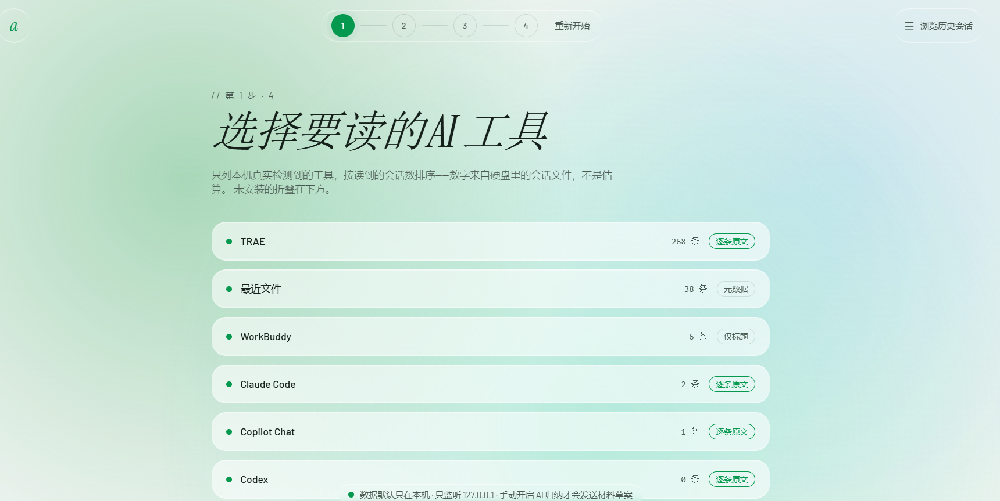

*图：第 1 步实测列出本机检测到的数据源（TRAE 268 条·逐条原文 / 最近文件 38 条·元数据 / WorkBuddy 6 条·仅标题），证明「数据质量分级明示、缺了不报错」的设计与隐私声明（底部：数据默认只在本机，只监听 127.0.0.1）。*

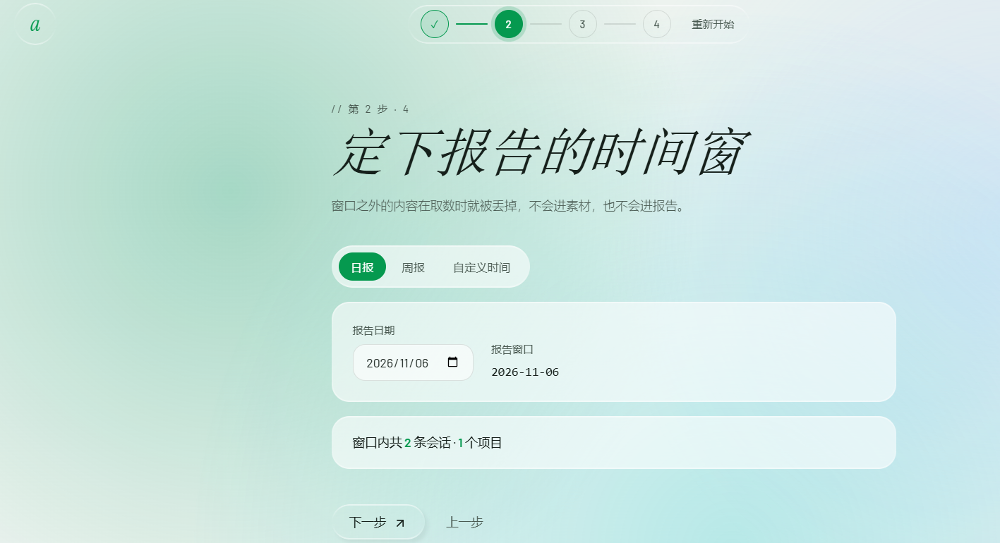

*图：第 2 步选日报/周报/自定义时间，页面明示「窗口之外的内容在取数时就被丢弃，不会进素材，也不会进报告」——证明时间过滤在数据层执行而非提示词层面。*


*图：第 3 步逐条勾选素材、每条可设起止时间（剪刀按钮），「取消勾选的记录不会出现在素材里，AI 也就不会写进报告」——证明素材粒度由用户最终把控。*

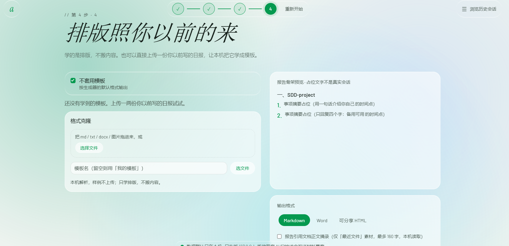

*图：第 4 步支持上传旧日报做「格式克隆」（只学排版不搬内容），右侧实时预览报告骨架，输出格式三选一（Markdown/Word/可分享 HTML）——证明输出层能力。*

### 对我们的参考价值

**可借鉴点**：
- ✅ **UnifiedRecord 统一数据模型**：各家数据格式不同但出口统一，可直接对应本项目 GitHub 提交/飞书任务/群消息三种源的归一化设计
- ✅ **连接器插件机制**（available()/read() 两方法 + 注册表一行）：本项目采集层加新数据源照此模式扩展
- ✅ **「AI 只改条目文字、程序管排版 + 格式校验退回」**：对本项目生成层防 AI 跑偏有直接参考价值
- ✅ **时间窗口在数据层丢弃**：日报只收当天素材的质量控制思路可复用
- ✅ **优雅降级三连**（依赖缺失退元数据 / LLM 失败退模板 / 断网不白屏）：对应本项目采集与生成各环节的兜底策略
- ✅ **钉钉推送 + 定时任务示例**：与本项目「飞书推送 + 定时生成」是同类实现，企业应用 API 换取凭证→创建消息的流程可对照
- ✅ **数据质量分级明示**（逐条原文/仅标题/元数据）：本项目多源采集也会遇到源能力强弱不齐，UI 明示比静默缺失好

**差异点/不足**：
- ⚠️ 数据源是**本机 AI 工具会话**，不采代码提交、群消息、任务系统——与本项目「多源外部痕迹采集」方向不同
- ⚠️ 纯个人工具（本机单用户数据），**无团队日报汇总**维度——正是本项目的差异化点
- ⚠️ 无状态不落库，每次运行重读原始文件；本项目指导书钦定 SQLite 存记录，两派取舍值得在报告中讨论
- ⚠️ 推送走钉钉生态；本项目目标是飞书，推送层需自行实现

---

## 方案二：gh-daily-report（开源 CLI）

**定位**：单文件 Bash 脚本的开源命令行工具——实时查询 GitHub API，把「你当天开的 PR / 评审过的 / 评论过的 / 提交的」拼成一份 Markdown 日报，**纯规则处理、完全无 AI**。

### 功能模块

- **GitHub 活动采集**：用 gh CLI（GitHub 官方命令行）按当前认证用户收集四类活动——我创建的 PR、我提交正式评审的 PR、我只评论的 PR、日期范围内的我的 commit
- **历史提交兜底**：已合并 PR 的历史提交也能捞回来，防止分支删除后丢工作量记录
- **跨栏目去重**：同一 PR 在多个栏目出现时只保留一次
- **工单号提取**：从分支名、PR 标题、commit 标题与正文里用正则抠出 `CHE-1234` 风格的 Linear 工单号
- **可选 Linear 集成**：`--resolve-linear` 把工单号解析成带标题的 Markdown 链接（调 Linear GraphQL API）——外部系统集成是可选增强，不装也能跑
- **固定模板输出**：按三节拼装 Markdown（开的 PR / 评审与评论 / 提交与合并）
- **剪贴板交付**：有 pbcopy 时自动复制报告，方便直接贴进 Slack
- **工作日日期逻辑**：不带参数默认报「上一个工作日」，周一自动报周五，周末有扩展规则
- **独立测试脚本**：test-github-daily-report.sh + test-data/ 测试数据

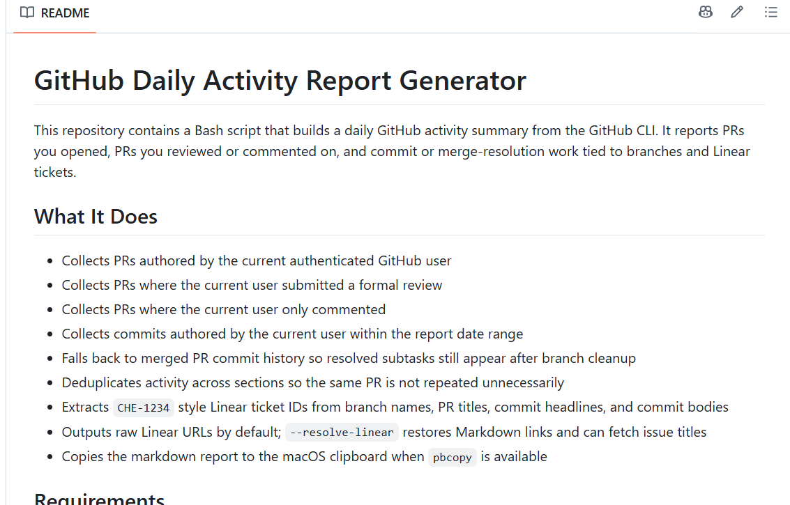

*图：仓库 README「What It Does」九条功能列表——四类活动采集、merged PR 提交兜底、去重、工单号提取、--resolve-linear、剪贴板复制逐条可查，与上述功能模块一一对应。*

### 核心流程

```
gh CLI 调 GitHub API（PR / 评审 / 评论 / commit） → 正则提取工单号 →
跨栏目去重 → （可选）Linear GraphQL 补工单标题链接 →
固定模板拼装 Markdown（三节） → 复制到剪贴板 → 手动贴进 Slack
```

实现要点：**无数据库、无状态**——每次运行实时查 GitHub API，用完即走；配置全靠环境变量（GITHUB_REPOS 仓库清单 / LOOKBACK_DAYS 回看天数 / LINEAR_API_KEY）；日期逻辑独立在 lib/date-utils.sh 函数库里并配了专门测试。整条流水线没有任何模型调用：查数据→抠工单号→套模板，是「规则式自动化」的典型形态。

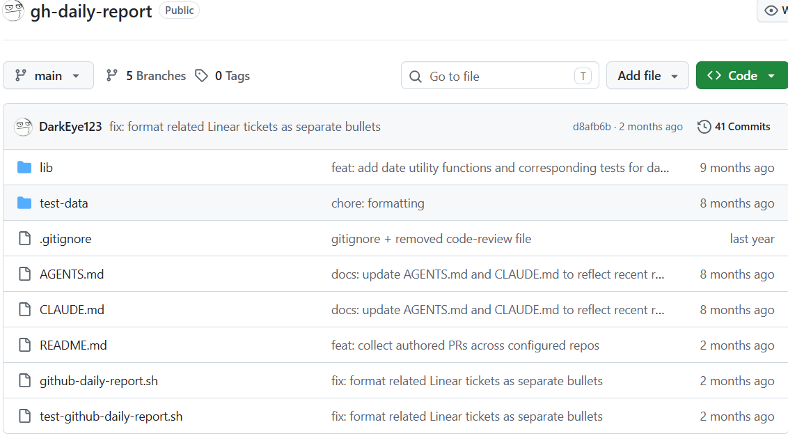

*图：仓库根目录——github-daily-report.sh（主脚本）、lib/（函数库）、test-data/ 与 test-github-daily-report.sh（测试）、AGENTS.md/CLAUDE.md（AI 协作说明，作者自称 "vibe-coded"）并存，共 41 Commits、5 Branches；最新提交为修复 Linear 工单格式。*

### UI 与交互

**纯 CLI，无图形界面**——交互即命令行参数与环境变量：`./github-daily-report.sh [日期] [--resolve-linear]`，另配 GITHUB_REPOS 等环境变量控制仓库清单与回看天数。无任何点选界面，上手门槛对开发者是零（装好 gh + jq 即可），对非技术用户则不可用。以主脚本源码页作为本方案的「界面」截图：

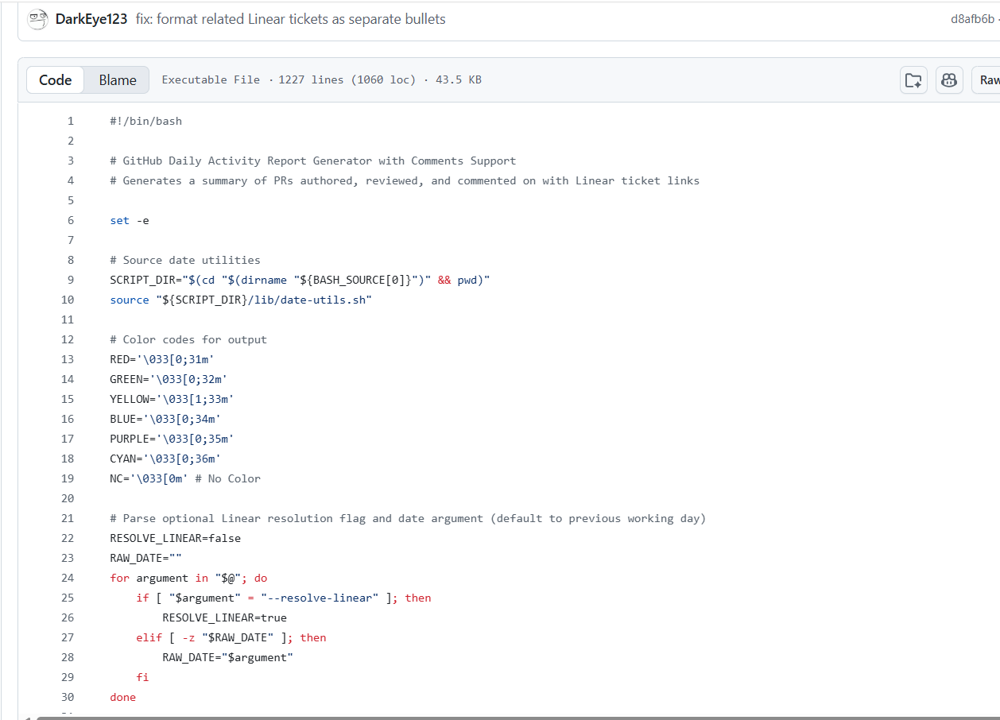

*图：github-daily-report.sh 源码页——单文件 1227 行（1060 loc），开头即 set -e、source lib/date-utils.sh、--resolve-linear 与日期参数的解析循环，证明「无图形界面、交互即 CLI 参数」且日期/集成逻辑内聚在脚本里。*

### 对我们的参考价值

**可借鉴点**：
- ✅ **与本项目同构的最小流水线**（采集→处理→生成→输出）：可用它校准本项目各环节的最简实现
- ✅ **工单号正则提取**：从 commit/PR 文本里关联任务线索的思路，可用于本项目把 GitHub 提交与飞书任务做关联
- ✅ **跨栏目去重规则**：本项目三源归集时同一事件（如一次提交既在 PR 又在群消息出现）需要同类去重
- ✅ **工作日日期逻辑**（周一自动报周五）：本项目日报回看窗口的直接参考
- ✅ **独立测试脚本 + 测试数据**：采集与格式化逻辑可以脱离真实 API 做回归测试
- ✅ **读 GitHub 数据的两条路**：它走 gh CLI，本项目直接调 GitHub REST API——技术栈候选对照

**差异点/不足**：
- ⚠️ **无 AI**：只有罗列没有归纳，条目是原始标题拼接，读起来仍是流水账——反衬本项目 AI 生成环节的价值
- ⚠️ 单一数据源（GitHub），无任务系统、无群聊
- ⚠️ 无推送集成：止步于剪贴板，靠人手动贴 Slack——半自动
- ⚠️ 个人维度，无团队汇总、无存储（无状态），历史数据无法回溯分析

---

## 方案三：Teambition AI 智能周报（商业 SaaS）

**定位**：钉钉（阿里）旗下项目管理 SaaS「钉钉项目 Teambition」内置的 AI 周报能力——**商业成品路线**的代表；闭源 SaaS，架构层面只能从产品功能行为观察（可确认的 AI 底座是通义千问 + DeepSeek 双模型，支持多模型切换）。

### 功能模块

- **项目管理底座**：任务看板（未完成/已完成等状态列）、任务字段（负责人待认领、开始/截止时间、优先级、标签、富文本备注、公开模式）、自动化与自定义字段、多项目模板（敏捷开发/缺陷管理/IT 系统实施等）
- **AI 智能周报**：自动生成个人周报，从**任务动态摘要、评论摘要、执行建议、风险评估**四方面生成
- **风险预判**：从项目数据自动识别潜在风险，在周报中标注风险点与改进建议
- **统计报表**：概览报表（总数/已完成/未完成/已逾期/待认领）、项目进展走势图、任务按执行者分布等；深度分析为旗舰版能力
- **AI 周边能力**：智能模板推荐、从会议纪要/邮件/聊天记录识别并批量创建任务、任务执行建议（六顶思考帽）、自然语言提问生成数据分析报告（图表呈现）
- **分享与生态**：生成的周报可保存为钉钉文档分享；与钉钉群聊/文档/审批深度打通

以任务创建表单截图佐证任务数据源的字段粒度（AI 周报的原料即来自这些结构化字段）：

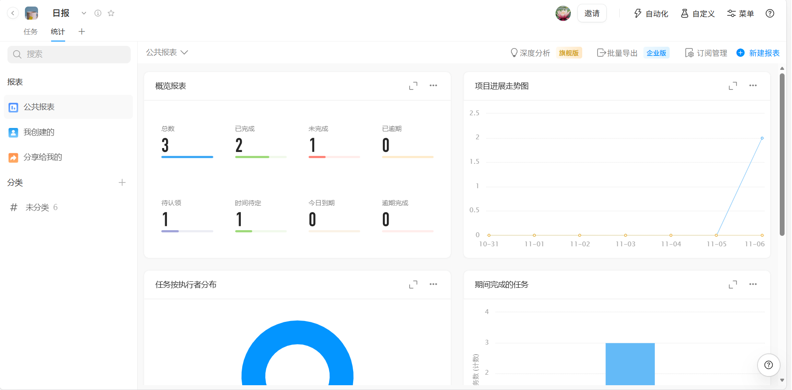

*图：创建任务弹窗——待认领、开始/截止时间、优先级、标签、富文本备注、公开模式等字段齐备，证明其 AI 周报的数据源是自家系统内结构化、闭环的任务数据。*

### 核心流程

```
项目内任务数据（创建 / 流转 / 评论，闭环于 Teambition 自家系统） →
AI 生成（通义千问 + DeepSeek 双模型；四维：任务动态摘要 / 评论摘要 / 执行建议 / 风险评估） →
周报草稿（可在产品内编辑确认） → 保存为钉钉文档分享
```

说明：数据采集这一步对用户不可见——它不采集外部系统数据，只用自家项目内的任务与评论记录，因此整条流程是「自家数据 → 自家 AI → 自家文档」的闭环；这也是闭源 SaaS 与开源方案在可观察性上的本质区别：内部如何取数、如何拼提示词、如何校验格式均无法验证，只能从官方介绍与产品行为推断。

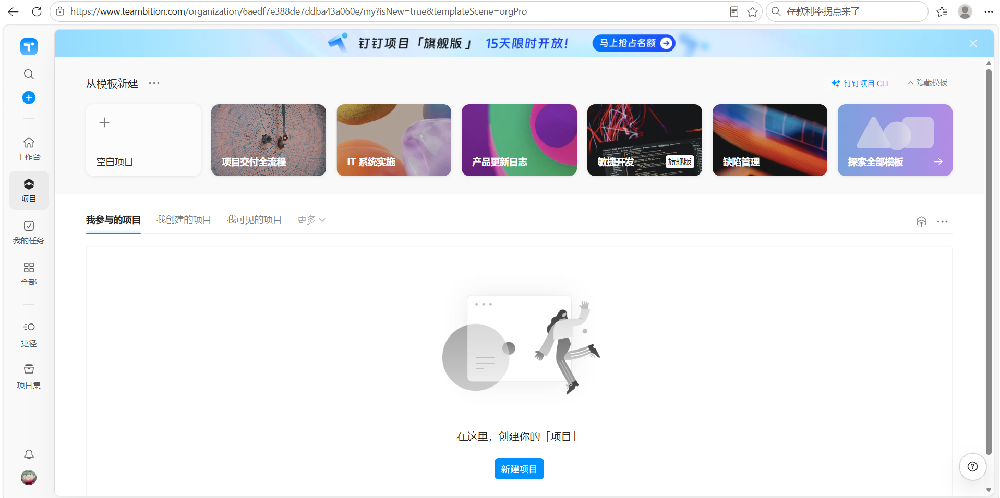

*图：teambition.com 实址页面——「从模板新建」（敏捷开发·旗舰版、缺陷管理等）与顶部「钉钉项目旗舰版」横幅，证明其为钉钉生态内的商业 SaaS 产品形态与任务管理入口。*

### UI 与交互

完整 SaaS 网页产品（并已深度整合进钉钉客户端），图形界面、表单与点选交互，开箱即用，上手门槛三者中最低，面向企业团队全员而非仅开发者；高级能力（深度分析、批量导出）按旗舰版/企业版分级付费。两张核心界面如下：

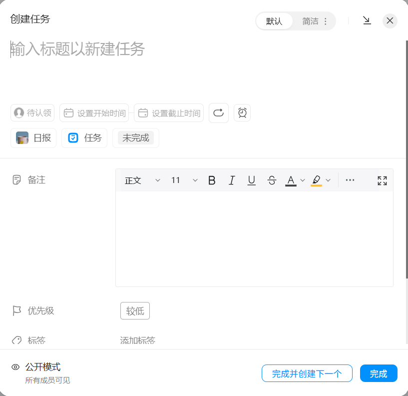

*图：「日报」项目的任务看板——未完成/已完成两列拖拽流转，顶部有自动化、自定义入口；任务卡片即周报素材来源，证明「任务流转数据 → 报告」的数据链路起点。*

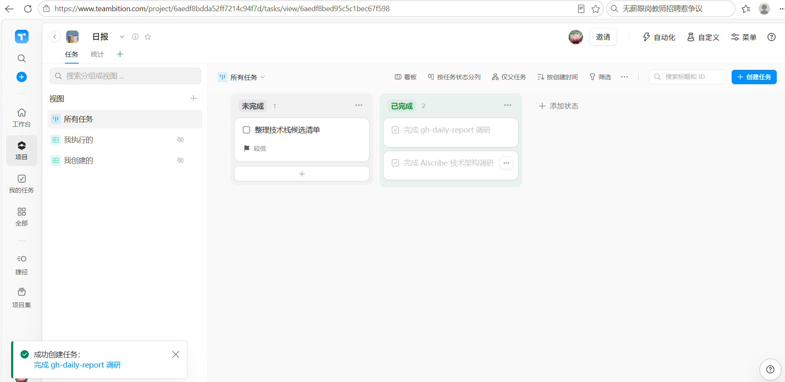

*图：项目「统计」页——概览报表（总数/已完成/未完成/已逾期/待认领）、项目进展走势图、任务按执行者分布，右上角深度分析（旗舰版）、批量导出（企业版）——证明其数据统计与团队维度能力，是本项目团队汇总页面的对标形态。*

### 对我们的参考价值

**可借鉴点**：
- ✅ **验证市场需求真实性**：商业公司已把「AI 自动生成报告 + 风险预判」做成付费功能，说明方向成立
- ✅ **统计报表形态**（概览指标 + 走势 + 分布）：本项目团队日报汇总视图可对标此设计
- ✅ **报告输出为在线文档分享**：对应本项目「生成飞书文档/群消息推送」的交付形态
- ✅ **风险标注**：AI 不只罗列还给出风险点与改进建议——本项目 AI 日报可引入同类「风险/阻塞」栏目

**差异点/不足**：
- ⚠️ **数据锁定在自家生态**：只用 Teambition 任务数据，**不采集代码提交**——研发团队的真实工作量（代码）在报告里反而看不到，这是商业成品 vs 本项目的核心差异
- ⚠️ **黑盒不可配置**：用户无法定义采集范围和条目粒度；本项目的开源 + 可配置是直接差异点
- ⚠️ **闭源 SaaS**：架构、AI 提示词、数据流均无法验证，出问题难排查；且周报粒度（非日报）、依赖钉钉生态绑定

---

## 三方案横向对比

| 维度 | Aiscribe（开源 AI 工具） | gh-daily-report（开源 CLI） | Teambition AI 智能周报（商业 SaaS） |
| --- | --- | --- | --- |
| 数据源 | ✅ 本机 17 源（16 个 AI 工具会话 + 最近文件），只读本地 | ✅ GitHub 单源（gh CLI 实时查询） | ⚠️ 仅自家任务系统，闭源闭环 |
| AI 摘要方式 | ✅ 可插拔：MCP 交客户端 AI / DeepSeek / Ollama，可关闭退模板 | ❌ 无 AI，纯规则拼装 | ✅ 商业黑盒（通义千问 + DeepSeek 双模型） |
| 团队日报汇总 | ❌ 个人本机数据，无团队维度 | ❌ 个人维度 | ✅ 项目维度（成员/风险/统计） |
| 推送渠道 | ✅ 钉钉日报 API（可选） | ⚠️ 剪贴板复制，手动贴 Slack | ✅ 保存为钉钉文档分享 |
| 代码提交纳入 | ❌ 采 AI 会话，不采 git 提交 | ✅ PR / 评审 / commit 全收 | ❌ 无代码数据 |
| 开源可配置 | ✅ MIT，连接器/分类规则/模板全可配 | ✅ 开源脚本，环境变量配置 | ❌ 闭源黑盒 |
| 上手门槛 | 低（零 pip 依赖，引导页点选） | 低（开发者；需 gh + jq） | 最低（SaaS 开箱即用，按版本付费） |

**读表结论**：三者在「自动化程度」上构成清晰梯度——gh-daily-report 是**规则式自动**（采集和排版自动化，理解靠人），Aiscribe 是**开源 AI 归纳**（加入可插拔 AI 层，但数据源限于本机会话、个人维度），Teambition 是**商业 AI 周报**（数据、AI、分享全生态闭环，但闭源不可配置、不采代码）。值得注意的是三者恰好各缺一块：gh-daily-report 缺 AI 与推送，Aiscribe 缺团队维度与代码提交，Teambition 缺开源可配置与代码提交——**没有任何一个同时做到「代码提交 + 任务 + 群消息多源采集、AI 生成日报、团队汇总、IM 推送」**。

---

## 三源核验记录

| 结论 | 来源 1 | 来源 2 | 来源 3 |
| --- | --- | --- | --- |
| Aiscribe 定位与功能（17 连接器 / MCP / 三格式输出 / 钉钉推送 / 零依赖） | GitHub 仓库 github.com/5yeah/Aiscribe 的 README.zh-CN.md（含 "Local-first, privacy-first"、MCP server 声明，见本文 Aiscribe-README 截图） | 仓库提交历史与目录结构：8 Commits，最新提交 chore(release): 0.2.0，ai_report/ 共 19 个模块文件（见本文 Aiscribe-仓库目录、核心模块代码页截图）；并经本地全量源码逐文件阅读印证（connectors/registry.py 注册 17 个连接器、models.py 的 UnifiedRecord、generator.py 的 check_outline 校验退回、llm.py 的降级注释、dingtalk.py 的 get_token/create_report） | **暂缺**——WebSearch 检索 "5yeah Aiscribe" 无任何结果；检索到的 "aiscribe.dev / aiscribe-mcp" 为同名但技术栈不符（TypeScript）的无关项目，不采信。项目发布约 3 周，尚无第三方报道；以本地源码全文可验证替代第三源，如实标注 |
| gh-daily-report 定位与功能（gh CLI 采集 / 工单号提取 / 去重 / Linear 集成 / 剪贴板） | GitHub 仓库 github.com/DarkEye123/gh-daily-report 的 README.md「What It Does」九条功能列表（见本文 README 截图）；WebSearch 确认该仓库公开存在及描述 | 仓库提交历史：41 Commits、5 Branches，最新提交 d8afb6b "fix: format related Linear tickets as separate bullets"（2 个月前）；主脚本 1227 行源码页佐证参数与日期逻辑（见本文仓库目录、主脚本代码页截图） | **暂缺**——检索到的第三方结果为**不同作者的同名项目**（dmhendricks/gh-daily-report）及泛化的教程聚合，均不指向本仓库，不构成第三方印证，如实标注 |
| Teambition 为钉钉旗下 SaaS、AI 智能周报四维生成、通义千问底座、统计报表能力 | Teambition 官网 teambition.com 及 AI 介绍页（teambition.com/ai）——本人实际浏览并截图（见本文项目模板首页、任务看板、统计报表截图） | 钉钉官方公众号文章对 AI 能力的介绍（含智能周报总结章节）——本人阅读记录 | 第三方代理商/媒体：合智互联等产品解读页面——本人阅读记录；另经 WebSearch 交叉确认背景事实（Teambition 2019 年被阿里收购、以「钉钉项目」名义提供服务、智能周报自动汇总任务进展/逾期/风险、底座为通义千问大模型） |
| 对比表中「团队汇总/推送/代码提交纳入/开源可配置」等判断 | 各仓库 README 与源码（功能有无的直接证据，见上两行） | Teambition 官网与产品截图（统计报表页含团队维度指标；全站无代码相关数据源） | 横向推理由上述两列来源直接支撑，无额外独立第三源（如实说明：此行结论为前两行证据的组合推导） |

> 注：**开源项目**以 GitHub 仓库为一手来源（代码与 README 可本地复现验证，属最强证据），提交历史佐证活跃度与功能演进；**商业产品**无法读源码，采用「官网 + 官方渠道文章 + 第三方媒体/代理商」交叉验证，架构层面只能从产品功能行为观察。两个开源竞品均为小体量新项目，第三方独立报道检索不到，按诚实性要求如实标注缺失而非凑数。

---

## 共性结论

三个竞品在「自动化程度光谱」上依次排开：**gh-daily-report（无 AI，规则式自动）→ Aiscribe（开源 AI 归纳，数据源为本机 AI 会话）→ Teambition（商业 AI 周报，数据闭环在自家生态）**。它们的共同点是都验证了「自动归集 + 模板/生成 + 交付」这条流水线成立；不同点在三个关键维度上互补地留白——数据源（AI 会话 / GitHub / 自家任务）、智能层（无 / 可插拔 / 黑盒）、协作维度（均为个人或项目内，无跨源团队日报）。

对照本项目「**多源采集（GitHub 提交 + 飞书任务 + 群消息）+ AI 日报 + 飞书推送**」的定位：Aiscribe 证明了统一数据模型 + 连接器插件 + AI 归纳带校验退回的架构可行，gh-daily-report 提供了无 AI 规则式兜底与工单关联的朴素参照，Teambition 验证了团队维度与风险标注的市场价值——而「三源外部痕迹采集 + AI 生成 + 团队汇总 + 飞书推送」的组合，三者无一覆盖，这就是本项目的定位空间。
