# 智能日报生成器业务调研报告（初稿）

> 课程名称：软件工程职业技能实践（SDD 与 AI 编程工具版）
> 阶段：第 1 周 · 阶段一 规范驱动开发（SDD）
> 角色：需求分析师　｜　姓名：杨佳莹　｜　日期：2026-11-09
> 编写依据：指导书第 14 页第 1 周任务 3、任务 5；第八部分（第 22、24 页）交付物内容要求
> 一致性声明：本报告的业务结论与本组 `specs/proposal.md`（0.4，2026-11-09 定稿，提交 `f1d728f`）第 2、3、4、5、6 章保持一致；出现两处不一致时以 `specs/` 为准并走规范变更流程。

## 目录

- [第1章 调研大纲](#第1章-调研大纲)
- [第2章 调研目标分析](#第2章-调研目标分析)
- [第3章 调研内容分析](#第3章-调研内容分析)
- [第4章 调研结论分析](#第4章-调研结论分析)
- [第5章 技术调研分析](#第5章-技术调研分析)
- [第6章 结论](#第6章-结论)
- 附录 A　引用资料清单
- 附录 B　图表索引
- 附录 C　竞品截图全量索引（15 张）

## 第1章 调研大纲

### 1.1 调研目标

本次调研服务于第 1 周「需求定义」阶段，目标不是罗列竞品功能，而是为 `proposal.md` 的范围界定与差异化定位提供可核验的实证依据，具体回答三个问题：

1. 同类日报／周报自动化方案已经解决了用户的哪些问题，分别止步于哪里；
2. 这些方案在数据源、智能层、协作维度上留下了什么共同空白，本项目是否值得做；
3. 空白如何转译成本期可验证的需求边界（做 S1–S9、不做 N1–N9）与成功标准（C1–C10）。

依据指导书第八部分，业务调研报告是课程目标 1「确定设计目标、完成业务调研与需求规范」的直接证据，与 `proposal.md`、隐含需求清单共同构成证据链。

### 1.2 调研对象与行业定位

按任务 3 要求选取 3 个同类方案，覆盖开源工具、开源脚本与商业 SaaS 三种形态，构成「自动化程度光谱」：

| 编号 | 方案 | 形态 | 行业定位 |
| --- | --- | --- | --- |
| A | Aiscribe | 开源 Python 工具（MIT），本机优先、隐私优先 | 开源 AI 归纳：读本机各 AI 工具会话记录，聚合成个人日报／周报 |
| B | gh-daily-report | 开源单文件 Bash CLI | 规则式自动：实时查 GitHub API，把当天 PR／评审／评论／提交拼成 Markdown 日报，完全无 AI |
| C | Teambition AI 智能周报 | 钉钉旗下商业 SaaS（闭源） | 商业 AI 周报：任务数据、AI 生成、文档分享全在自家生态闭环 |

三者依次对应「无 AI 的规则式自动 → 可插拔的开源 AI 归纳 → 黑盒商业 AI 报告」，正好覆盖本项目的三种替代路线。

### 1.3 调研方法与资料来源

任务 3 的一手实证材料由本组架构师于悦于 2026-11-07 完成并归档：本人到真实产品页面／仓库页面实操截取 15 张截图、全量阅读 Aiscribe 本地源码、阅读 gh-daily-report 仓库页面，并对所有关键结论执行三源核验（文末附「三源核验记录」，检索不到第三源的如实标注、不凑数）。本报告在该一手材料基础上，按需求分析师的业务视角重新组织与归纳，不重复采集，不改写其结论。

本报告引用的资料清单见附录 A，主要来源为：

1. 于悦《同类竞品调研记录》（2026-11-07，`docs/同类竞品调研记录.md`）——第 3、4 章的功能模块、界面、流程、截图与横向对比；
2. 于悦《技术栈候选清单》（2026-11-07，`docs/技术栈候选清单.md`）——第 5 章的候选技术对照；
3. 方赫《同类 Agentic CLI 方案易用性对比测试记录》（2026-11-03 至 11-09，`docs/testing/usability-comparison.md`，`main` 分支）——第 4 章工具选型侧的易用性参照；
4. 本组 `specs/proposal.md` 0.4 与 `docs/需求澄清问答记录.md`（Q1–Q21、I1–I28）——第 2、6 章的需求侧事实；
5. 课程指导书第一部分（五个痛点）、第 14 页（任务 3／5）、第 22、24 页（报告要求）。

> 边界说明：方赫的易用性测试对象是 Agentic CLI 工具（Claude Code、Codex CLI），属于「开发工具选型」维度，与「同类日报方案的产品易用性」不是同一维度。本报告只把它作为工具链可用性的旁证，不与 A／B／C 三方案的产品上手门槛混算，避免口径串用。

### 1.4 报告结构与规范一致性

报告按指导书第八部分建议的六章结构展开，章节要点完整覆盖：调研大纲、调研目标分析、调研内容分析（配截图）、调研结论分析（易用性对比、优缺点）、技术调研分析、结论，并附结论三源核验。全文图表统一编号并在正文中引用，引用资料逐项注明出处，规范内容与 `specs/` 一致。

## 第2章 调研目标分析

### 2.1 解决的用户的什么问题

指导书第一部分列出下班写日报的五个真实痛点。本报告逐条对照本项目的解法，解法均取自 `proposal.md` §3 与需求澄清问答 Q1–Q15，均有对应实现或明确范围决策，见表 2-1。

表 2-1　五个痛点与本项目的对应解法

| 编号 | 用户痛点 | 本项目解法 | 可验证依据 |
| --- | --- | --- | --- |
| ① | 下班靠回忆翻找「今天干了什么」 | 采集层按东八区自然日归集当日全部痕迹，日报从数据中自动长出 | `proposal.md` S1–S3、G1 |
| ② | 痕迹散落 GitHub／飞书任务／群消息，逐个复制粘贴 | 三源采集归一化为统一数据模型，一处配置全量归集 | S1–S4、I1 |
| ③ | 忙起来必有遗漏，写进去的是「记得住的」不是「做了的」 | 条目与原始记录严格 1:1，不聚合、不做语义过滤；漏一条即采集缺陷 | G1、C1、I7 |
| ④ | 协作成果经常谁都没写进日报 | 成员身份映射把同一人的多个平台账号归并为一人一份日报；多人协作归属本期不验收 | S5、G3、C3、I9 |
| ⑤ | 每人格式不一，组长还要手工汇总 | 同一模板生成全组个人日报并汇总为团队日报，统计头与贡献降序自动生成 | S6、C4、G4 |

### 2.2 采用的架构与流程

本项目按「采集层 → 生成层 → 推送层 → 主编排入口」四层构建（`proposal.md` §5、于悦《技术栈候选清单》第二节既定约束）。本期实际流程为：

1. 每天 22:00 由本机手动触发 `uv run --env-file .env python -m smart_daily.cli`；
2. 采集 GitHub 提交（单仓 `onetwothree-go/smart-daily` 的 `main` 分支）、飞书任务、指定单一团队群的群消息；本地 git 仅在 GitHub 失败时降级兜底，mock 仅用于演示与测试；
3. 归一化为工作项，条目与原始记录 1:1，按「代码提交 → 任务进展 → 群内消息」分组、组内时间倒序；
4. 生成 4 份个人日报与 1 份团队日报，个人日报走邮件只发本人，团队日报走飞书群且不发邮件；
5. SQLite 只存日报成品快照，按（日期，成员）唯一覆盖更新；
6. 另有实时提交通知（S9）：`main`／`dev` 上的 push 由 GitHub Actions 合并成 1 条飞书群消息，只作提醒，不落库、不进 G1 计数、不拼进日报正文。

第 6 步与 22:00 汇总是两条独立通道，这一边界来自范围变更问答 Q16–Q21 与 I20–I28，是本期重要的范围决策。

### 2.3 带来的好处与可度量指标

好处必须能转成测试，故 `proposal.md` §2、§6 把每条好处写成可观测输出，摘要见表 2-2。

表 2-2　目标与成功标准摘要（与 `proposal.md` 一致）

| 目标 | 可度量判据 | 对应成功标准 |
| --- | --- | --- |
| G1 零手工、1:1 | 个人日报条目数＝当日提交数＋任务数＋消息数，人工新增条目数为 0；实时提醒不计数 | C1 |
| G2 采集性能 | 单成员 100 条提交采集 < 30s（本期降为性能观察项，不进硬验收） | C6 |
| G3 身份归并 | 构造多账号数据集，归并准确率 100%，不串人 | C3 |
| G4 格式统一 | 团队日报与个人日报模板骨架逐字一致，截止时间前送达 | C4、C7 |
| G5 故障不中断 | 构造假 token 注入后降级并留痕；实时通道失败亮红灯但不影响主流程 | C2、C5、C8、C10 |

### 2.4 与同类方案的目标差异

A 方案面向「个人把本机 AI 会话整理成报告」，B 方案面向「开发者把当天 GitHub 活动列成清单」，C 方案面向「企业团队把项目任务汇总成周报」。三者都不以「跨 GitHub 提交、飞书任务、群消息三源外部痕迹，自动生成全组团队日报并推送到 IM」为目标，这构成本项目的问题空间，详见第 4、6 章。

## 第3章 调研内容分析

### 3.1 受众用户对比

| 方案 | 受众 | 使用门槛 | 本项目对照 |
| --- | --- | --- | --- |
| A | 想让 AI 替自己写日报的普通开发者，本机单用户 | 低：四步引导页点选，零 pip 依赖 | 本项目面向 4 人学生小组、按五个角色履职，需团队维度 |
| B | 熟悉命令行的开发者 | 低（开发者）：装 gh 与 jq 即可；非技术用户不可用 | 本项目本期同为 CLI，但不面向外部用户，且排除 Web 界面（N2） |
| C | 企业团队全员 | 最低：SaaS 开箱即用，高级能力按版本付费 | 本项目为课程仿真项目，不付费、不依赖商业生态 |

### 3.2 核心功能模块

A 方案含 17 个数据源连接器、UnifiedRecord 统一数据模型、L2 索引层（合并／去重／项目归类／北京时间窗口过滤）、L3 程序强制排版、可选 AI 归纳（MCP／DeepSeek／Ollama，格式校验不过退回模板）、Markdown／Word／HTML 三种输出、MCP 服务、钉钉推送与本地 Web 四步引导页。其仓库结构截图见图 3-1，核心模块代码页见图 3-2，均可核对「连接器层／索引层／生成层／归纳层」确有代码实体，而非 README 宣传语。

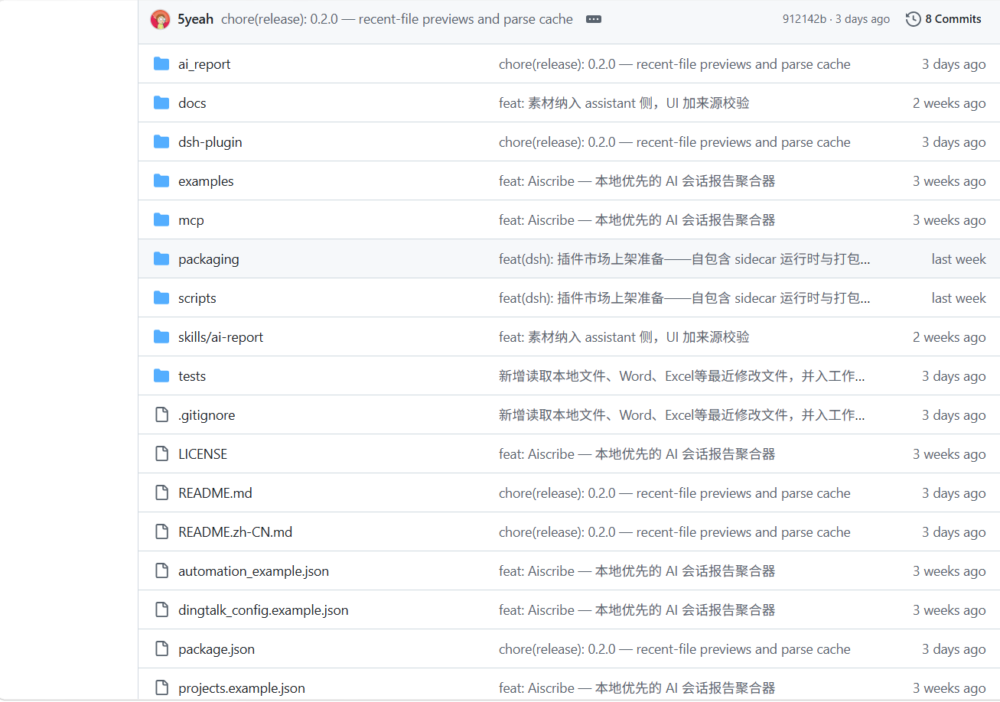

图 3-1　Aiscribe 仓库根目录：`ai_report/`（内核）、`mcp/`、`skills/`、定时任务示例与钉钉配置并列，证明「采集＋生成＋MCP＋推送」是仓库内真实交付物。（引自于悦《同类竞品调研记录》，截图由于悦本人采集）

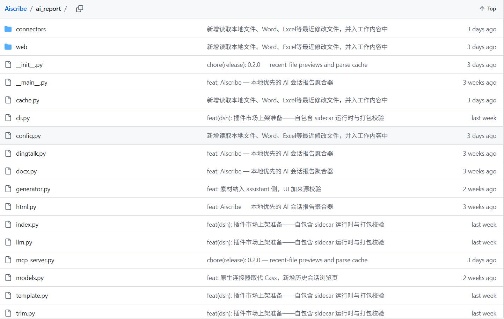

图 3-2　Aiscribe 核心模块代码页：`connectors/` 独立成目录，`generator.py`、`index.py`、`llm.py`、`models.py`、`dingtalk.py` 分文件并存。（引自于悦《同类竞品调研记录》，截图由于悦本人采集）

B 方案的九条功能见其 README「What It Does」，截图见图 3-3：四类 GitHub 活动采集、已合并 PR 的历史提交兜底、跨栏目去重、工单号正则提取、可选 Linear 集成、固定三节模板、剪贴板交付、工作日日期逻辑、独立测试脚本。主脚本 1227 行、无图形界面，交互即命令行参数与环境变量。

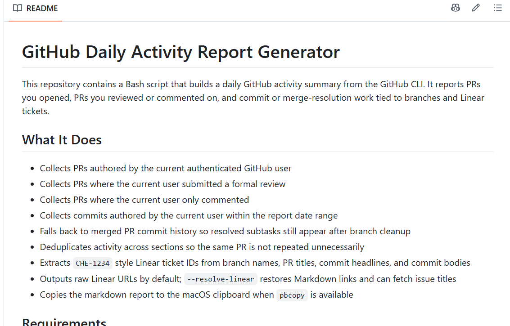

图 3-3　gh-daily-report README 的九条功能列表，与上述模块一一对应。（引自于悦《同类竞品调研记录》，截图由于悦本人采集）

C 方案以项目管理底座（任务看板、字段、自动化、多项目模板）为原料，AI 智能周报从任务动态摘要、评论摘要、执行建议、风险评估四方面生成，另有风险预判、统计报表与钉钉文档分享；其任务看板与统计报表分别见图 3-4、图 3-5。

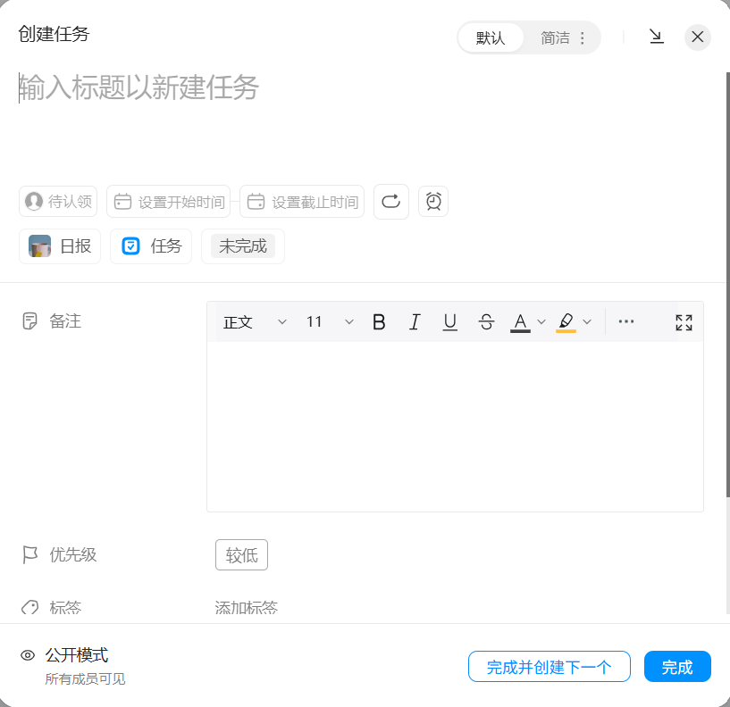

图 3-4　Teambition 任务看板：未完成／已完成两列拖拽流转，任务卡片即周报素材来源。（引自于悦《同类竞品调研记录》，截图由于悦本人采集）

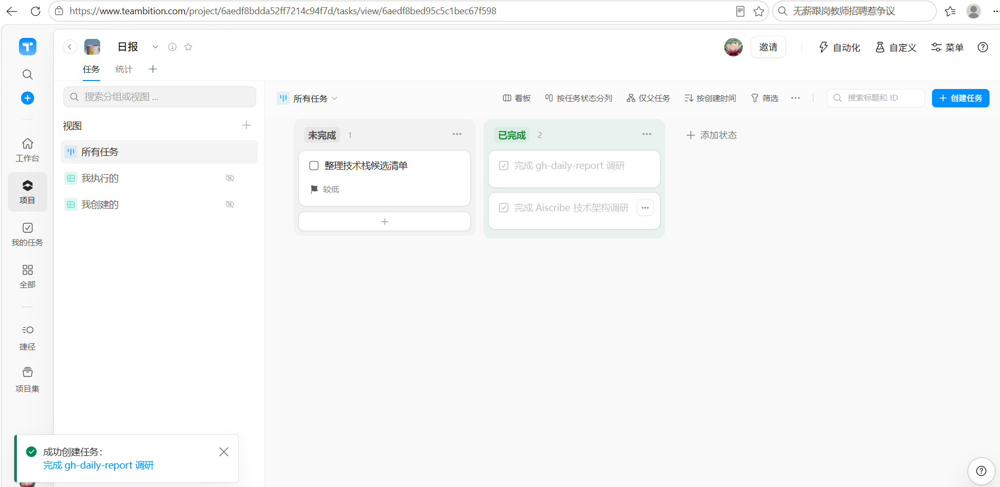

图 3-5　Teambition 统计报表页：概览指标、项目进展走势、成员分布，是本项目团队汇总视图的对标形态。（引自于悦《同类竞品调研记录》，截图由于悦本人采集）

本项目对照：不做智能摘要（N1）、不做 Web 界面（N2）、不做自动内容过滤与跨源去重（N7），只做三源采集、1:1 生成、身份归并、团队汇总与双通道推送；功能模块清单以 `proposal.md` §4.1 S1–S9 为准。

### 3.3 UI 风格与交互

A 方案有本地 Web 四步引导页（选工具 → 定时间窗 → 挑素材 → 定排版输出），只监听 127.0.0.1，图 3-6 为第 1 步实测界面，页面明示各数据源的数据质量分级与隐私声明；第 2 步在时间窗页面写明「窗口之外的内容在取数时就被丢弃」，第 3 步允许逐条勾选素材，第 4 步支持上传旧日报做「格式克隆」。其设计要点是「素材粒度由用户最终把控、时间过滤在数据层而非提示词层执行」。

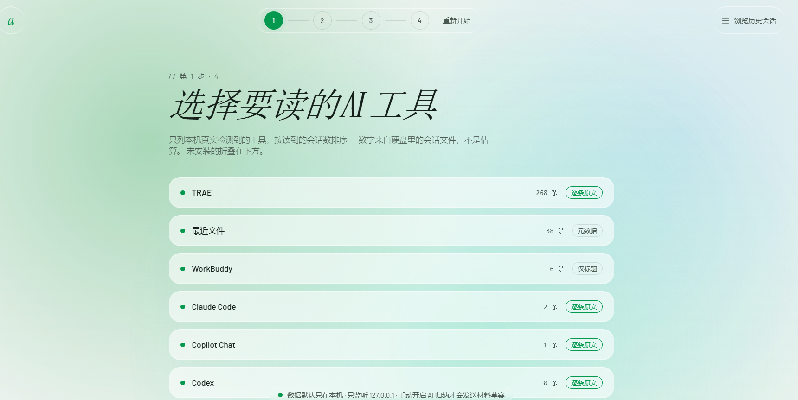

图 3-6　Aiscribe 引导页第 1 步：列出本机检测到的数据源及条数，底部声明数据默认只在本机。（引自于悦《同类竞品调研记录》，截图由于悦本人采集）

B 方案纯 CLI，无图形界面；C 方案为完整 SaaS 网页并深度整合钉钉客户端，图形界面与点选交互，上手门槛三者最低。本项目本期无图形界面，交付形态是「CLI 生成的日报文本 + 邮件 + 飞书群消息」，这是 N2 明确排除 Web 界面后的结果，不是能力缺失。

### 3.4 核心流程对照

表 3-1　三个同类方案与本项目的核心流程对照

| 方案 | 输入 | 处理 | 输出与交付 |
| --- | --- | --- | --- |
| A | 本机 17 个 AI 工具会话与最近文件 | 连接器 → UnifiedRecord → L2 索引（去重／归类／时间窗） → L3 模板排版 → 可选 AI 归纳（校验退回） | Markdown／Word／HTML，可选钉钉日报 API 推送 |
| B | gh CLI 查 GitHub API 的四类活动 | 正则提工单号 → 跨栏目去重 → 可选 Linear 补标题 → 固定三节模板 | 剪贴板复制，人工贴进 Slack |
| C | Teambition 自家任务／评论（闭环） | 黑盒 AI（通义千问＋DeepSeek）四维生成 | 周报草稿，保存为钉钉文档分享 |
| 本项目 | GitHub 提交＋飞书任务＋飞书群消息（三源） | 归一化 1:1 → 身份归并 → 同模板生成个人与团队日报 | 个人邮件 4 封＋飞书群 1 条（22:00）；另有 main／dev push 实时提醒 |

差异集中在三点：A 的数据源是本机会话、不采代码提交且无团队维度；B 单一数据源、无 AI、止步于剪贴板；C 数据锁定自家生态、粒度是周报、架构不可验证。

### 3.5 上手门槛

按于悦横向对比表的「上手门槛」一行：A 低（零 pip 依赖、引导页点选），B 低但限开发者（需 gh＋jq），C 最低（SaaS 开箱即用、按版本付费）。本项目为课程仿真项目，运行者需本机具备 Python 3.13、uv 与一份 `.env`，其余成员试跑用 `--no-notify` 只生成不推送（Q15、N9）；这一门槛由「本期单机 CLI 开发态」的范围决策解释，不与服务化路线比较。

## 第4章 调研结论分析

### 4.1 易用性对比

产品侧易用性按「安装配置 → 首次成功出报告 → 日常维护」三步比较：A 在首次出报告环节最友好（四步引导页），但需先理解「哪些本机会话会被读取」；B 安装最简单、日常零维护，但报告可读性差、需人工粘贴；C 无需安装、即开即用，但用户无法定义采集范围与条目粒度。

工具侧另有方赫的 Agentic CLI 实测：在统一任务清单下，Claude Code 接国产模型兼容端点（DeepSeek-V3.2、硅基流动）安装约 2 分钟、国内直连、成本接近零，关键卡点在官方订阅登录（403 地区限制）不可用，故国产兼容端点是必选项；Codex CLI 因需 ChatGPT 订阅未通过。该结论服务于本组的 AI 工具选型，已在 `docs/ai-usage-log.md` 与凭证就绪登记中留痕，不参与 A／B／C 三方案的产品易用性评分（见 1.3 边界说明）。

### 4.2 各方案优缺点

A 方案优点：统一数据模型、连接器插件机制（新增数据源约 15 行代码）、「AI 只改条目文字、程序管排版并校验退回」、时间窗在数据层丢弃、优雅降级三连、数据质量分级明示。不足：数据源为本机 AI 会话，不采代码提交、群消息、任务系统；纯个人工具、无团队日报汇总；无状态不落库；推送绑定钉钉生态。

B 方案优点：与本项目同构的最小流水线，可校准各环节最简实现；工单号正则提取、跨栏目去重、独立测试脚本与测试数据均有借鉴价值。不足：无 AI，只有罗列没有归纳；单一数据源；无推送集成（止步于剪贴板）；个人维度、无团队汇总、无存储。

C 方案优点：验证市场需求真实（商业公司已把 AI 报告＋风险预判做成付费功能）；统计报表形态、在线文档分享、风险标注可对标。不足：数据锁定自家生态、不采集代码提交；黑盒不可配置；闭源，架构与提示词无法验证；周报粒度、依赖钉钉生态。

### 4.3 横向对比表

表 4-1　三方案横向对比（引用于悦《同类竞品调研记录》，结论按业务视角转述）

| 维度 | Aiscribe | gh-daily-report | Teambition AI 周报 |
| --- | --- | --- | --- |
| 数据源 | 本机 17 源（AI 工具会话＋最近文件），只读本地 | GitHub 单源（gh CLI 实时查询） | 仅自家任务系统，闭源闭环 |
| AI 摘要方式 | 可插拔：MCP／DeepSeek／Ollama，可关闭退模板 | 无 AI，纯规则拼装 | 商业黑盒（通义千问＋DeepSeek 双模型） |
| 团队日报汇总 | 无（个人本机数据） | 无（个人维度） | 有（项目维度，含成员／风险／统计） |
| 推送渠道 | 钉钉日报 API（可选） | 剪贴板复制，手动贴 Slack | 保存为钉钉文档分享 |
| 代码提交纳入 | 否（采 AI 会话） | 是（PR／评审／commit 全收） | 否（无代码数据） |
| 开源可配置 | 是（MIT，连接器／规则／模板可配） | 是（环境变量配置） | 否（闭源黑盒） |
| 上手门槛 | 低（零 pip 依赖、引导页点选） | 低（开发者，需 gh＋jq） | 最低（SaaS 开箱即用，按版本付费） |

### 4.4 空白点与差异化空间

读表结论：三者在自动化程度上构成梯度，且恰好各缺一块——B 缺 AI 与推送，A 缺团队维度与代码提交，C 缺开源可配置与代码提交。**没有任何一个同时做到「代码提交＋任务＋群消息多源采集、AI 生成日报、团队汇总、IM 推送」**。这一空白是本项目的立项依据，也是 `proposal.md` §3「差异化定位」要回填的核心结论。

## 第5章 技术调研分析

### 5.1 同类系统技术栈介绍与对比

表 5-1　同类系统技术栈与本项目对照

| 方案 | 语言与运行形态 | 数据获取 | 生成层 | 存储 | 交付／推送 |
| --- | --- | --- | --- | --- | --- |
| Aiscribe | Python，本机 CLI＋本地 Web 引导页，内核零三方依赖 | 直接读各工具本地 SQLite／JSONL／IndexedDB | 程序定骨架＋可选 LLM（MCP／DeepSeek／Ollama），`check_outline` 校验退回 | 无状态，不落库 | Markdown／Word（手写 WordprocessingML）／自包含 HTML；钉钉日报 API |
| gh-daily-report | Bash 单文件脚本（1227 行）＋lib 函数库 | gh CLI 调 GitHub API | 正则＋固定三节模板，无模型 | 无 | 剪贴板（pbcopy） |
| Teambition | 闭源 SaaS（Web＋钉钉客户端） | 自家项目内任务与评论 | 通义千问＋DeepSeek 双模型，四维生成 | 自家云端 | 钉钉文档分享 |
| 本项目 | Python 3.13＋uv，单机 CLI，四层架构 | httpx 直连 GitHub REST／飞书开放平台，降级链 GitHub → 飞书 → local-git → mock | `push/generator.py` 模板固定，本期排除智能摘要 | SQLite 存成品快照，按（日期，成员）唯一 | SMTP 个人邮件＋飞书 Webhook（HMAC-SHA256 签名）；GitHub Actions 实时提醒 |

### 5.2 本组技术候选

于悦《技术栈候选清单》按 10 个关注点各列 2–3 个候选（CLI 参数、GitHub 采集、飞书采集、LLM 调用、报告渲染、配置密钥、日志输出、测试、定时触发、分发安装），每个候选固定六项客观描述（是什么与维护方、与现有代码契合、上手成本、AI 辅助生成友好度、依赖体积、国内可用性与中文文档），并附一行竞品做法；全文不出现「推荐采用」「最终选择」，所有选型结论留到第 2 周 ADR。本报告不代替该清单，也不提前做选型。

其中与本报告结论直接相关的两点：一是 GitHub Actions 作为定时／事件触发候选，赵蕊已于 2026-11-09 用 `72155d0` 完成最小连通性实测（HTTP 200、飞书 `code=0`、约 2 秒），消除了「境外 runner 出网到飞书开放平台」的可用性疑问，故 Q21「实测完全不通则退回仅 22:00 汇总」的兜底分支不触发；二是生成层明确排除智能摘要（N1），故 `push/generator.py` 保持模板直出，将来若要加 AI 摘要须走规范变更流程。

### 5.3 技术约束对需求范围的影响

`proposal.md` §5 的既定约束（Python ≥3.13、uv、SQLite、httpx、凭证一律环境变量、单机 CLI 开发态）直接决定了本期三条范围决策：真实推送仅限持有 `.env` 的运行者（Q15、N9）；实时提醒由 GitHub 托管 runner 承担、只需两条 Webhook 凭证进 Actions Secrets、不需要 GitHub token（Q21、I27）；凭证与四人邮箱映射绝不进仓库。这些约束使「多机部署、四人各自推送」在本期不可行，故写入 N9 而非当作缺陷。

## 第6章 结论

### 6.1 主要结论

1. 「自动归集＋模板／生成＋交付」这条流水线已被三类方案分别验证可行，方向不需要重新论证；
2. 三者互补地留白：数据源（本机会话／GitHub／自家任务）、智能层（无／可插拔／黑盒）、协作维度（均为个人或项目内，无跨源团队日报）；
3. 「三源外部痕迹采集＋AI 生成＋团队汇总＋IM 推送」的组合无一覆盖，构成本项目的差异化空间；
4. 本项目应坚持零手工、1:1 可追溯与可度量验收，因此排除智能摘要、Web 界面、自动过滤与跨源去重等环节（N1、N2、N7），而不是向竞品的「更智能」看齐；
5. 22:00 汇总与 push 实时提醒是两条独立通道，实时提醒只作告知、不进日报条目与统计体系（I20–I28）。

### 6.2 差异化定位（回填 `proposal.md` §3）

面向 4 人学生小组的课程仿真场景，本项目以 GitHub 提交、飞书任务、飞书群消息三处真实工作痕迹为唯一正式数据源，按自然日 0:00 至生成那一刻全量归集，条目与原始记录严格 1:1、原样呈现，按成员身份归并后以同一模板生成个人日报并汇总为团队日报，经邮件与飞书群推送，SQLite 只存成品快照。与 Aiscribe 的差异是「外部多源＋团队汇总＋代码提交」，与 gh-daily-report 的差异是「多源＋团队汇总＋自动推送」，与 Teambition 的差异是「开源可配置＋采集代码提交＋日报粒度」。本期明确不做智能摘要、Web 界面、考勤数据、人工后编辑、历史补采、自动重试与服务化。

该段与 `proposal.md` §3「差异化定位（待补）」、§4.1 S1–S9、§4.2 N1–N9 逐条对应，可直接回填。

### 6.3 与 `specs/` 的一致性检查

表 6-1　结论到规范的可追溯对照

| 报告结论 | `proposal.md` 落点 | 需求来源 |
| --- | --- | --- |
| 三源外部痕迹、本地 git 仅降级、mock 仅演示 | §4.1 S1–S3、§8「降级链」 | Q1、I1 |
| 自然日 0:00 至生成那一刻、22:00 手动、不补采 | §4.1 S7、§4.2 N6、§8「日报截止时间」 | Q2、I3、I4 |
| 条目 1:1、原文原样、不聚合不过滤 | §2 G1、§4.1 S4、§6 C1 | Q4、I7、I8 |
| 身份归并、多人协作归属本期不验收 | §2 G3、§4.1 S5、§6 C3 | Q5、I9、Q13、I17 |
| 零记录显式写出、全组零记录团队日报照发 | §6 C8 | Q6、I10、I11 |
| 单一团队群、敏感信息不进日报 | §4.1 S3、§5 红线 | Q7、I12、I13 |
| 按通道判定送达、不自动重试 | §6 C7、§4.2 N8 | Q8、I14 |
| 排除智能摘要／Web 界面／自动去重 | §4.2 N1、N2、N7 | Q4、Q7、Q14 |
| 实时提醒只作提醒、独立通道 | §4.1 S9、§2 G1、§6 C10 | Q16–Q21、I20–I28 |

### 6.4 结论三源核验

指导书第八部分把「结论三源核验」列为业务调研报告的硬性要求。本报告逐条列明来源链，不凑数；凡第三源不成立或缺口的，如实标注并说明替代证据，口径与于悦《同类竞品调研记录》文末「三源核验记录」一致。

表 6-2　结论三源核验记录

| 结论 | 来源 1（一手） | 来源 2（交叉） | 来源 3（旁证） |
| --- | --- | --- | --- |
| A 方案定位与 17 连接器／MCP／三格式输出／钉钉推送 | Aiscribe 仓库 README.zh-CN.md（见原文 Aiscribe-README 截图） | 仓库提交历史与目录结构（8 Commits、`ai_report/` 19 模块）＋本地全量源码逐文件阅读 | **暂缺**：检索无第三方报道，同名项目技术栈不符不采信；以本地源码全文可验证替代，如实标注 |
| B 方案九条功能与无 AI、剪贴板交付 | gh-daily-report 仓库 README「What It Does」（图 3-3） | 提交历史（41 Commits、5 Branches）＋主脚本 1227 行源码页 | **暂缺**：检索命中的是不同作者同名项目与泛化教程，不构成第三方印证，如实标注 |
| C 方案为钉钉旗下 SaaS、AI 周报四维生成、统计报表 | Teambition 官网与 AI 介绍页（本人浏览并截图，图 3-4、图 3-5） | 钉钉官方公众号对 AI 能力的介绍 | 第三方代理商／媒体解读页＋检索交叉确认背景事实（2019 年被阿里收购、以「钉钉项目」提供服务、底座为通义千问） |
| 横向对比中「团队汇总／推送／代码提交纳入／开源可配置」等判断 | 各仓库 README 与源码（功能有无的直接证据） | 官网与产品截图（统计报表含团队维度、全站无代码数据源） | 无额外独立第三源：此行是前两列证据的组合推导，如实说明 |
| 本项目范围、成功标准与三源口径 | 本组 `specs/proposal.md` 0.4（提交 `f1d728f`，本人签字） | `docs/需求澄清问答记录.md`（Claude Code 逐轮问答 Q1–Q21 与 I1–I28，本人逐题回答并即时落盘） | 课程指导书第 14、22、24 页任务与报告要求＋本组实测记录（2026-11-06 真实数据 5 条提交零遗漏、四人日报送达；2026-11-09 `72155d0` 连通性实测） |

> 诚实性说明：两个开源竞品均为小体量新项目，第三方独立报道确实检索不到；于悦在原始记录中已按「检索不到第三源的如实标注、不凑数」处理，本报告沿用该口径，未把「暂缺」改写成三源齐全。本报告第 6 章的业务结论主要依靠「组内一手调研材料＋可复核的仓库／官网事实＋本组规范与实测记录」三条链交叉支撑。

### 6.5 局限与后续

1. 本报告第 3 章截图引自组内已归档的一手调研材料（`docs/images/竞品调研/`），图注逐张标明来源与采集人，未冒充本报告作者采集；定稿前由需求分析师本人补采支撑差异化定位的补充截图并更新图注。
2. 方赫的易用性测试记录目前在 `main` 分支，配置管理员尚未同步到 `dev`；其「待补测」项（Qwen Code／Kimi CLI、token 消耗与延迟、交叉复核）属第 2 周，不影响本报告结论。
3. 技术候选的选型结论留到第 2 周 `design.md` ADR；本报告只做对照，不提前定选型。
4. 报告中的规范内容以 `specs/proposal.md` 0.4 为准；若后续走规范变更流程修改 `specs/`，本报告须同步更新对应结论，避免两处不一致。

## 附录 A　引用资料清单

| 序号 | 资料 | 作者／来源 | 日期 | 用途 |
| --- | --- | --- | --- | --- |
| 1 | 《同类竞品调研记录》`docs/同类竞品调研记录.md` | 于悦（架构师） | 2026-11-07 | 第 1、3、4、5 章；15 张截图与三源核验记录 |
| 2 | 《技术栈候选清单》`docs/技术栈候选清单.md` | 于悦（架构师） | 2026-11-07 | 第 5 章候选对照与既定约束 |
| 3 | 《同类 Agentic CLI 方案易用性对比测试记录》`docs/testing/usability-comparison.md` | 方赫（测试工程师） | 2026-11-03 至 11-09 | 第 4 章工具链易用性旁证 |
| 4 | `specs/proposal.md` 0.4 | 杨佳莹（需求分析师） | 2026-11-09 | 第 2、6 章范围与成功标准 |
| 5 | `docs/需求澄清问答记录.md` | 杨佳莹（需求分析师），Claude Code 逐轮问答 | 2026-11-07、11-09 | Q1–Q21、I1–I28 |
| 6 | 《软件工程职业技能实践课程设计指导书》第一、七、八部分 | 课程指导书 | — | 五个痛点、任务 3／5、报告六章要求 |
| 7 | `docs/images/竞品调研/*.png` | 于悦本人采集 | 2026-11-07 | 图 3-1 至图 3-6 |

## 附录 B　图表索引

| 编号 | 名称 | 所在章节 | 正文引用位置 |
| --- | --- | --- | --- |
| 表 2-1 | 五个痛点与本项目的对应解法 | 2.1 | 2.1 首段 |
| 表 2-2 | 目标与成功标准摘要 | 2.3 | 2.3 首段 |
| 图 3-1 | Aiscribe 仓库根目录 | 3.2 | 3.2 首段 |
| 图 3-2 | Aiscribe 核心模块代码页 | 3.2 | 3.2 首段 |
| 图 3-3 | gh-daily-report README | 3.2 | 3.2 第二段 |
| 图 3-4 | Teambition 项目任务看板 | 3.2 | 3.2 第三段 |
| 图 3-5 | Teambition 统计报表页 | 3.2 | 3.2 第三段 |
| 图 3-6 | Aiscribe 引导页第 1 步 | 3.3 | 3.3 首段 |
| 表 3-1 | 三个同类方案与本项目核心流程对照 | 3.4 | 3.4 首段 |
| 表 4-1 | 三方案横向对比 | 4.3 | 4.3 标题下 |
| 表 5-1 | 同类系统技术栈与本项目对照 | 5.1 | 5.1 标题下 |
| 表 6-1 | 结论到规范的可追溯对照 | 6.3 | 6.3 标题下 |
| 表 6-2 | 结论三源核验记录 | 6.4 | 6.4 首段 |

## 附录 C　竞品截图全量索引（15 张，一张不缺）

> 说明：图片随本文件同目录 `images/竞品调研/` 一起提供；在本组仓库内的路径为 `docs/images/竞品调研/`。15 张截图全部由架构师于悦本人于 2026-11-07 到真实产品页面／仓库页面采集并归档于 `docs/同类竞品调研记录.md`，本报告为注明出处的引用，未冒充本报告作者采集。移动或转发本文件时请连同 `images/` 文件夹一起带走。

表 C-1　15 张截图对照表

| 编号 | 文件名 | 正文引用 | 采集人 |
| --- | --- | --- | --- |
| 图 3-1 | `Aiscribe-仓库目录.png` | 第 3.2 节 | 于悦 |
| 图 3-2 | `Aiscribe-核心模块代码页.png` | 第 3.2 节 | 于悦 |
| 图 3-3 | `gh-daily-report-README.png` | 第 3.2 节 | 于悦 |
| 图 3-4 | `Teambition-任务看板.png` | 第 3.2 节 | 于悦 |
| 图 3-5 | `Teambition-统计报表.png` | 第 3.2 节 | 于悦 |
| 图 3-6 | `Aiscribe-UI选择AI工具.png` | 第 3.3 节 | 于悦 |
| 图 C-1 | `Aiscribe-README.png` | 附录 C.2 | 于悦 |
| 图 C-2 | `Aiscribe-UI排版与输出.png` | 附录 C.2 | 于悦 |
| 图 C-3 | `Aiscribe-UI时间窗口.png` | 附录 C.2 | 于悦 |
| 图 C-4 | `Aiscribe-UI素材挑选.png` | 附录 C.2 | 于悦 |
| 图 C-5 | `Aiscribe-工具层代码页.png` | 附录 C.2 | 于悦 |
| 图 C-6 | `Teambition-创建任务表单.png` | 附录 C.2 | 于悦 |
| 图 C-7 | `Teambition-项目模板首页.png` | 附录 C.2 | 于悦 |
| 图 C-8 | `gh-daily-report-主脚本代码页.png` | 附录 C.2 | 于悦 |
| 图 C-9 | `gh-daily-report-仓库目录.png` | 附录 C.2 | 于悦 |

### C.1 正文已引用的 6 张

图 3-1 至图 3-6 已嵌在第 3 章对应位置，图注逐张注明来源与采集人，此处不重复插图。

### C.2 其余 9 张原始素材（逐张附上）

图 C-1　Aiscribe：README

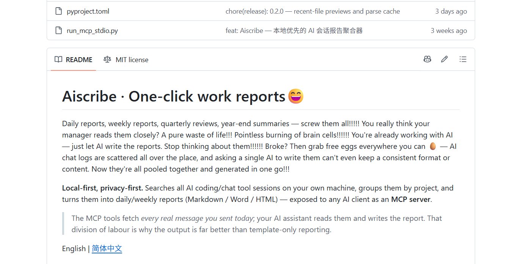

图 C-1　Aiscribe：README：原始截图，作为第 3、4 章结论的补充实证素材。（引自于悦《同类竞品调研记录》，截图由于悦本人采集）

图 C-2　Aiscribe：UI排版与输出

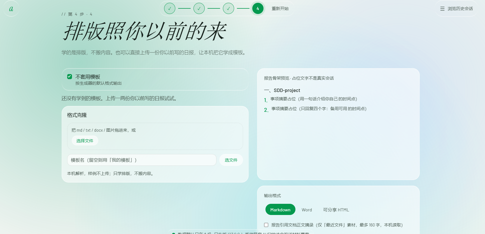

图 C-2　Aiscribe：UI排版与输出：原始截图，作为第 3、4 章结论的补充实证素材。（引自于悦《同类竞品调研记录》，截图由于悦本人采集）

图 C-3　Aiscribe：UI时间窗口

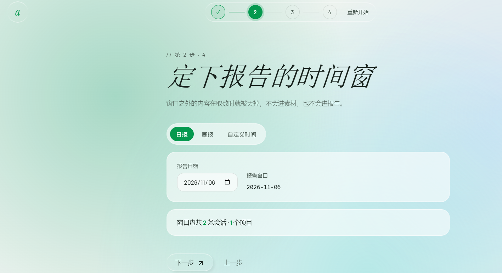

图 C-3　Aiscribe：UI时间窗口：原始截图，作为第 3、4 章结论的补充实证素材。（引自于悦《同类竞品调研记录》，截图由于悦本人采集）

图 C-4　Aiscribe：UI素材挑选

图 C-4　Aiscribe：UI素材挑选：原始截图，作为第 3、4 章结论的补充实证素材。（引自于悦《同类竞品调研记录》，截图由于悦本人采集）

图 C-5　Aiscribe：工具层代码页

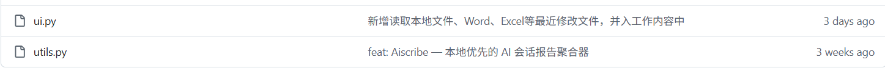

图 C-5　Aiscribe：工具层代码页：原始截图，作为第 3、4 章结论的补充实证素材。（引自于悦《同类竞品调研记录》，截图由于悦本人采集）

图 C-6　Teambition：创建任务表单

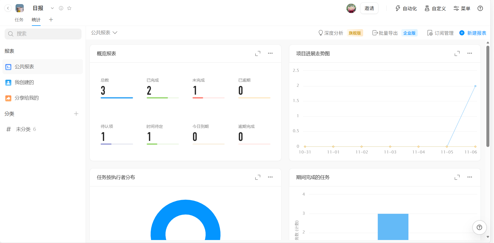

图 C-6　Teambition：创建任务表单：原始截图，作为第 3、4 章结论的补充实证素材。（引自于悦《同类竞品调研记录》，截图由于悦本人采集）

图 C-7　Teambition：项目模板首页

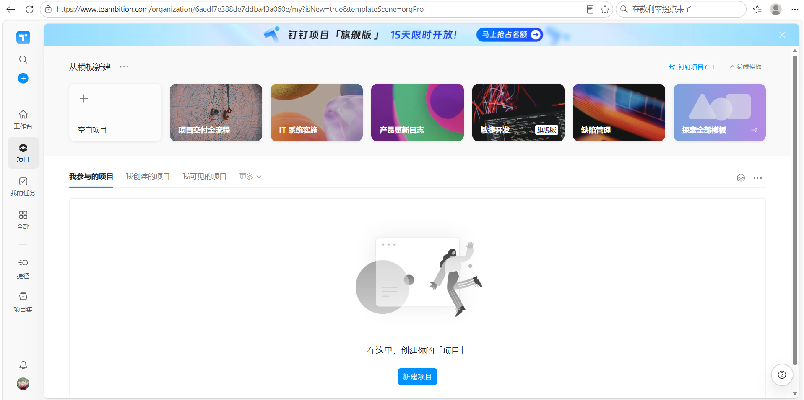

图 C-7　Teambition：项目模板首页：原始截图，作为第 3、4 章结论的补充实证素材。（引自于悦《同类竞品调研记录》，截图由于悦本人采集）

图 C-8　gh：daily-report-主脚本代码页

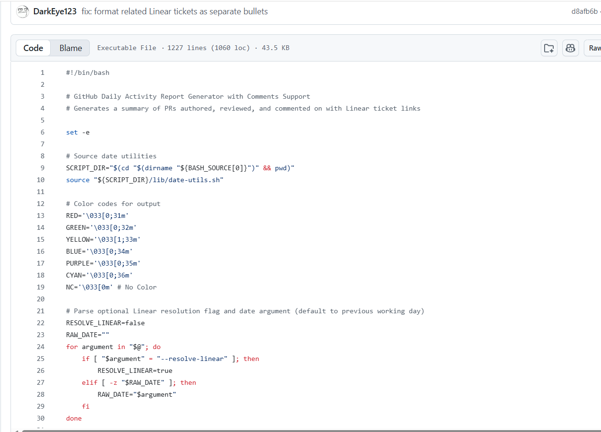

图 C-8　gh：daily-report-主脚本代码页：原始截图，作为第 3、4 章结论的补充实证素材。（引自于悦《同类竞品调研记录》，截图由于悦本人采集）

图 C-9　gh：daily-report-仓库目录

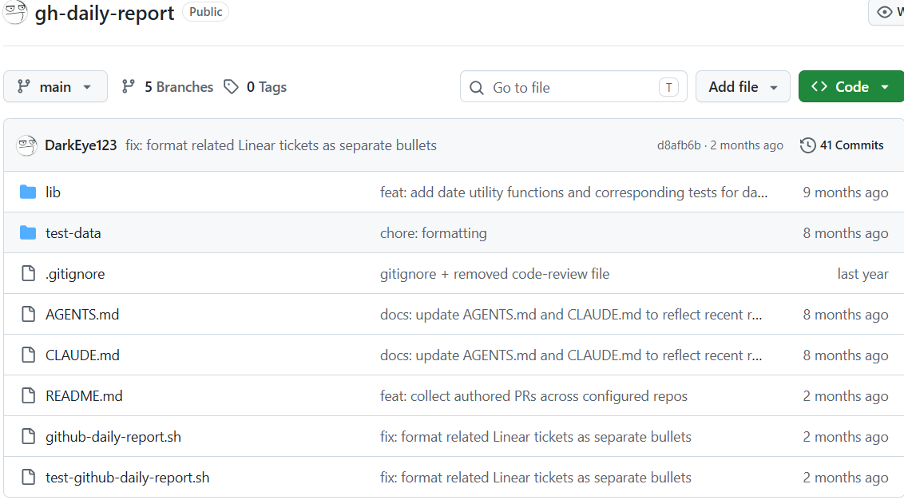

图 C-9　gh：daily-report-仓库目录：原始截图，作为第 3、4 章结论的补充实证素材。（引自于悦《同类竞品调研记录》，截图由于悦本人采集）
