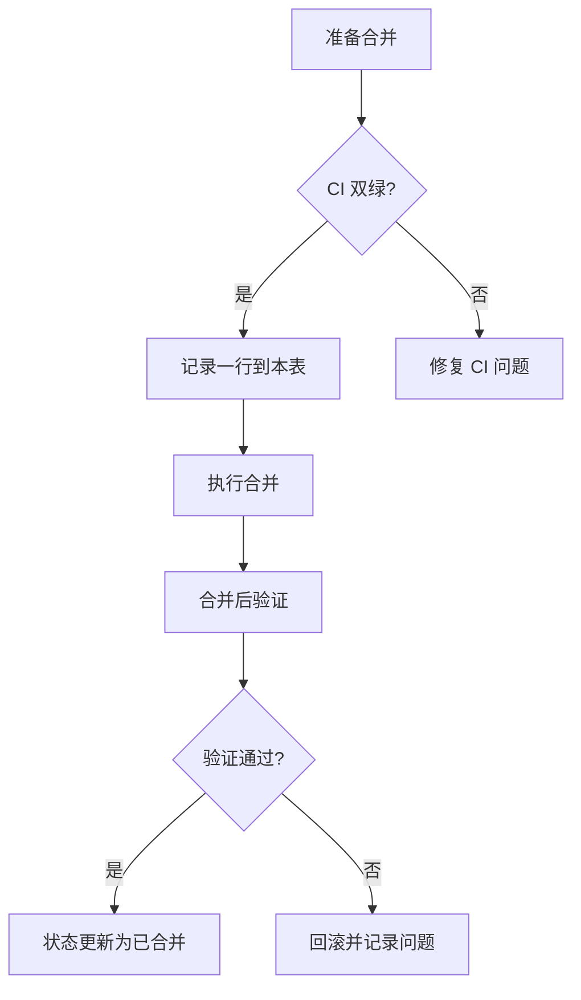

# 合并控制记录

**配置管理员**：赵蕊  
**撰写日期**：2026-11-17  
**文档状态**：持续维护

## 1. 口径与范围

### 1.1 算作合并的动作
1. **merge commit**（含分支/目录并入 dev）
   - 例如：`973e2da v2 工程骨架并入 dev`
   - 特征：包含 "Merge" 消息和至少两个父提交
2. **PR 合并到 main**
   - 例如：`ce224e5 Merge pull request #12 from onetwothree-go/dev`
   - 通过 GitHub UI 或 gh cli 合并的 PR
3. **强推对齐**
   - 例如：手动 `git push --force` 整理提交历史后的合并

### 1.2 不算作合并的动作
- ✅ 普通提交（feat/fix/test/docs 开头）
- ✅ `git pull --ff-only` 快进（非合并操作）
- ❌ stash 产生的 WIP 提交（如 `3bd787a`，已排除）
- ❌ 分支创建、重命名等操作

### 1.3 登记流程

## 2. 合并记录历史

| 序号 | 合并提交号 | 合并时间 | 合并内容 | 来源/目标 | CI 状态 | 风险与处置 |
| --- | --- | --- | --- | --- | --- | --- |
| 1 | 3bd787a | 2026-11-16 17:59:17 | WIP on dev: a1af126 | stash 合并到 dev | - | **已排除**：stash 产生的 WIP 提交，不算合并 |
| 2 | 2923c23 | 2026-11-16 11:30:32 | origin/dev 合入本地 dev | origin/dev → dev | 待确认 | **高风险**：冲突靠脚本重排，未逐行人工复核 → 后续同类冲突改人工逐行比对 |
| 3 | 973e2da | 2026-11-16 11:26:39 | v2 工程骨架并入 dev | 分支并入 dev | 待确认 | 无风险：规划好的目录隔离方案 |
| 4 | ce224e5 | - | PR #12 合并（人名前缀改名） | dev → main | 待确认 | 无风险：纯文本修改 |
| 5 | 3ff4561 | - | 同步 main 上组内人名前缀改名 | main → dev | 待确认 | 无风险：解决冲突为并集保留双方内容 |
| 6 | 1b78d16 | - | origin/main 合入本地 dev | origin/main → dev | 待确认 | 无风险：常规同步 |
| 7 | 1ae8af6 | - | origin/dev 合入本地 dev | origin/dev → dev | 待确认 | 无风险：常规同步 |
| 8 | 48022a4 | - | 反向同步 main 独有提交 7fbc338 | main → dev | 待确认 | 无风险：冲突解为并集，保留双方修正 |
| 9 | a2d4940 | - | TK-902 阶段一发布合并 dev → main | dev → main | 待确认 | 无风险：正式发布流程 |
| 10 | 59b40d2 | - | origin/dev 合入本地 dev | origin/dev → dev | 待确认 | 无风险：常规同步 |
| 11 | 579314a | - | origin/dev 合入本地 dev | origin/dev → dev | 待确认 | 无风险：常规同步 |
| 12 | 661a960 | - | origin/dev 合入本地 dev | origin/dev → dev | 待确认 | 无风险：常规同步 |
| 13 | 3076ada | - | 合并 main 独有 6 提交（第1周归档） | main → dev | 待确认 | 无风险：add/add 冲突保留 dev 较新内容 |
| 14 | 2ec7b70 | - | origin/dev 合入本地 dev | origin/dev → dev | 待确认 | 无风险：常规同步 |
| 15 | c7310ea | - | origin/dev 合入本地 dev | origin/dev → dev | 待确认 | 无风险：常规同步 |
| 16 | 433b505 | - | origin/dev 合入本地 dev | origin/dev → dev | 待确认 | 无风险：常规同步 |
| 17 | 8b20577 | - | origin/dev 合入本地 dev | origin/dev → dev | 待确认 | 无风险：常规同步 |
| 18 | e8b434a | - | origin/dev 合入本地 dev | origin/dev → dev | 待确认 | 无风险：常规同步 |
| 19 | 4a71aa1 | - | origin/dev 合入本地 dev | origin/dev → dev | 待确认 | 无风险：常规同步 |
| 20 | f77d879 | - | PR #2 合并（push 实时通知） | dev → main | 待确认 | 无风险：功能发布 |
| 21 | 5d1b8d8 | - | PR #9 合并（AI 日志补记） | dev → main | 待确认 | 无风险：文档更新 |
| 22 | 947129e | - | PR #8 合并（系统分析报告） | dev → main | 待确认 | 无风险：文档更新 |
| 23 | 4165f40 | - | PR #7 合并（技能拆解笔记） | dev → main | 待确认 | 无风险：文档更新 |
| 24 | f2ad46b | - | PR #6 合并（双轨建模对比） | dev → main | 待确认 | 无风险：文档更新 |
| 25 | b8c3f6a | - | PR #5 合并（tasks.md 0.1） | dev → main | 待确认 | 无风险：文档更新 |
| 26 | f78be14 | - | PR #3 合并（实时通道实测） | dev → main | 待确认 | 无风险：功能更新 |
| 27 | 7386577 | - | PR #2 合并（push 通知） | dev → main | 待确认 | 无风险：功能发布 |

## 3. 待合并队列

### 3.1 v2 → main 合并计划
| 分支/提交 | 合并内容 | 触发条件 | 门控要求 | 预计时间 |
| --- | --- | --- | --- | --- |
 | dev（含所有 v2 提交） | v2 工程首次发布 | 1. 所有 TK-V2-xxx 任务勾销完成 2. CI 双绿（ruff + test） 3. 覆盖率 ≥ 80% | 1. CI 双绿 2. 至少 1 人 code review 3. 生成 release notes | 待定 |
| v2-{feature-branch} | 新功能 | 1. 功能测试通过 2. 相关文档更新 3. 无 regression | 同上 | 按需 |

### 3.2 第 4 周变更涟漪分支
| 分支名称 | 变更内容 | 涟漪影响 | 触发条件 |
| --- | --- | --- | --- |
 | v1-{hotfix} | v1 生产问题修复 | 可能影响 v2 的兼容性 | 1. v1 修复提交 2. 兼容性测试通过 |
 | v2-{refactor} | v2 重构 | 需要 review 架构影响 | 1. 重构计划文档 2. 架构师评审通过 |

### 3.3 合并检查清单
- [ ] 合并前确认 CI 状态（绿色通过）
- [ ] 至少完成 1 次 code review
- [ ] 更新相关文档（如 README、CHANGELOG）
- [ ] 生成合并说明（merge message）
- [ ] 合并后验证功能正常
- [ ] 更新本记录表状态

---

## 说明

1. **记录统计**：
   - 回填了 27 条合并记录（含已知线索）
   - 排除了 1 条 WIP 提交
   - 待合并：v2 → main（当所有任务完成后）

2. **风险处置原则**：
   - 脚本自动解决的冲突 → 改为人工逐行比对
   - 强推对齐 → 确认无他人未合并提交
   - 定期 review 合并历史，确保无遗漏

3. **维护责任**：
   - 每次合并后 24 小时内更新本表
   - 定期（每周） review 合并记录的完整性
   - 重大变更（如强推）需特别标记风险

**注意**：PR #13 的合并记录在日志中未找到，需要进一步确认是否已正确记录。