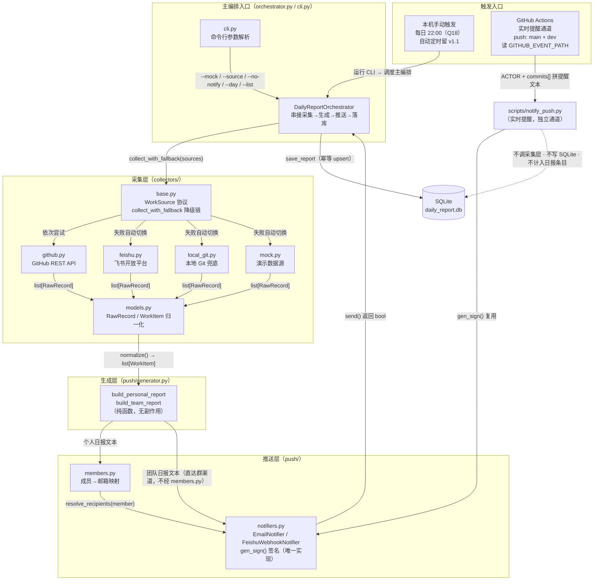

# design.md —— 智能日报生成器（Smart Daily Report Generator）

> 状态：**0.5.1（0.5 增补：接口清单 / ER 附件 / ADR 备选项 / 可维护性约束）**（`docs/于悦-红队评审意见清单.md` 2026-11-09，RT-01~09）· 依据 `specs/proposal.md` **0.4.2（2026-11-09 定稿，含 Q16–Q21 / I20–I28、C10 与 §6.2 可测性回应）**、`docs/技术栈候选清单.md`、`docs/采集层交接说明.md` 与 `src/smart_daily/` 当前工程实况撰写。逐条回应见 `docs/赵蕊-红队回应.md`。
> 本版新增（0.5）：**推送判定链一并改写**——1.4 送达判定改为「应送达集合 + `push_status`」并标注 `any()` 现状（RT-01）；3.4 新增 `push_status` 五态、CLI 退出码 0/1/2/3 与五条不变量（RT-02）、新增 3.4.1 `push_detail` 结构（`at`/`error`，RT-07）；1.1 架构图拆出团队日报直达群渠道的独立边（RT-04）；5.2 纪律 1 分层写明采集 `SourceUnavailableError` 与推送 `ValueError`（RT-05）；2.2/3.5/ADR-104 统一归属键匹配为 `strip + casefold` 并收敛到 `identity.py`（RT-06）；2.2 写明跨天任务归属规则（RT-08）；3.3 记载 `MultiNotifier` 并声明弃用（RT-09）；2.3 新增 `push_receipts` v1.1 结构草案（RT-07）。0.4.1 及其前版本内容除上述修订处外不变。
> 本版增补（0.5.1）：按交付项自检补齐文档结构——2.1 挂接 ER 图附件；ADR-101~104 各补「备选项」行；5.4 新增「可维护性」并把 Python 3.13 写入兼容性；§3 前言说明「单机 CLI 无入站 HTTP 接口」并新增 3.6 出站接口清单，同时标注 34 项断言待 RT-03 补提交。**不改变 0.5 的任何契约与判定口径。**
> 0.4.1 变更：依据开发工程师评审意见修订 7 条（架构图改本机手动触发、ADR-104 后果改为实测已闭合、5.4 的 C6/G2 改为观察项等）。
> 0.3 变更：**实时提醒作为独立通道**的定位与契约（1.4 / 3.5 / 5.3）、proposal 编号与本文档的对照表（附录 A）、实时通道失败语义（C10 / G5）。
> 写法约定：**已有实现的部分照实描述（每条注明出处）**；尚未实现、由本文档首次约定的部分标【本期约定】，须随 tasks.md 评审确认。
> ADR 结论均为本组自行论证，格式参照教材 ADR-001（httpx 选型）/ ADR-002（SQLite 选型），不照抄结论。编号自 101 起，避开教材编号。

---

## 1. 总体架构

### 1.1 分层架构图

整个系统按「**采集层 → 生成层 → 推送层 → 主编排入口**」四层构建（指导书第一部分）。依赖方向自上而下单向：主编排依赖下三层，下三层之间互不感知对方存在——生成层只认识 `WorkItem`，不知道数据来自 GitHub 还是飞书；推送层只认识文本和收件人，不知道日报怎么生成的。



### 1.2 分层职责一览

| 层 | 模块 | 职责 | 不做什么 |
| --- | --- | --- | --- |
| **采集层** | `collectors/base.py` | 定义 `WorkSource` 协议与降级入口 `collect_with_fallback` | 不关心任何具体数据源的实现细节 |
| | `collectors/models.py` | 三种原始记录（Commit/Message/Task）+ 统一 `WorkItem` 归一化 + 本地日历归属 | 不发任何网络请求 |
| | `collectors/github.py` | GitHub REST API 采集提交记录，细分 409/401/403/404 错误语义，手动翻页 | 不做写操作（只用 GET） |
| | `collectors/feishu.py` | 飞书任务/群消息/通讯录/群列表四组接口，自管 `tenant_access_token` 缓存（过期前 300 秒刷新） | 不缓存业务数据，只缓存凭证 |
| | `collectors/local_git.py` | 读取本地仓库的提交记录，作前两者凭证未就绪时的兜底 | 不访问网络 |
| | `collectors/mock.py` | 无凭证演示数据源，保证主流程永远可跑 | 不参与降级链自动挂载（仅 `--mock` 显式指定） |
| **生成层** | `push/generator.py` | `WorkItem 列表 → 个人日报 / 团队日报文本`，**纯函数、零副作用** | 不碰网络、不读文件、不做 AI 摘要（本期范围排除，proposal N1） |
| **推送层** | `push/notifiers.py` | `Notifier` 协议 + SMTP 邮件 / 飞书 Webhook（HMAC 签名）两个实现；`gen_sign()` 是签名算法的**唯一实现** | 推送失败只返回 False，**不抛异常、不阻断主流程**；**不抛采集层异常、不参与采集降级链**（5.2 纪律 1b）；**不提供多通道聚合**（`MultiNotifier` 已弃用，见 3.3） |
| | `push/members.py` | **个人日报**的成员 → 收件邮箱映射（环境变量配置，精确/前缀/后缀三段匹配） | 未知成员不报错，只跳过并记日志；**不服务团队日报**——团队日报不带收件人，收件人参数恒为 `[]`（3.3 分发规则） |
| **主编排入口** | `orchestrator.py` | 串接四层：采集 → 分组 → 生成 → 落库 → 推送；管理 SQLite 读写 | 不实现任何采集/渲染/推送细节 |
| | `cli.py` | argparse 参数解析、历史查询（`--list`）模式 | 不含业务逻辑 |

### 1.3 三条固化的数据流契约（实测驱动，出处：采集层交接说明）

1. **空列表是合法返回值**——源可用但窗口内无数据返回 `[]`，降级链据此**停止**而非继续切换（否则"今天没提交"会被误判为"源坏了"）。
2. **异常必须显式抛出**——源不可用抛 `SourceUnavailableError`，降级链据此**继续**切下一个源。反面教材：飞书采集器曾吞异常返回空列表，导致跳过 local-git 兜底、产出 0 条空日报（已修复并加断言 [9][10]）。
3. **日期按本地日历归属**——用 `local_date(ts)`（`ts.astimezone().date()`）而非 `ts.date()`。采集层拿到的是 UTC 时间戳，直接取 `.date()` 在东八区会让日报标题差一天（已修复并加断言 [12]）。

---

### 1.4 两条独立通道：日报汇总 vs 实时提醒

proposal 0.4.2 把「每次 push 在群里提醒」定性为**提醒（notification）**，不是日报条目（Q16/Q17）。两者在架构上必须**物理隔离**，否则实时消息会污染 G1 的 1:1 计数口径：

| 维度 | 日报汇总通道 | 实时提醒通道 |
| --- | --- | --- |
| 触发 | 每日 22:00 本机手动（Q18，自动定时留 v1.1；Actions 不做日报汇总调度） | GitHub `push` 到 `main` / `dev`（Q20） |
| 入口 | `cli.py` → `orchestrator.py` | `scripts/notify_push.py`（**独立脚本，不经主编排**） |
| 数据来源 | 采集层降级链（GitHub → 飞书 → local-git） | 事件文件 `GITHUB_EVENT_PATH` 的 `commits[]` 与 `ref`（**不调 GitHub API、不复用采集层**） |
| 归属键 | `author_name` → `MEMBER_DISPLAY_NAMES` | `github.actor` → `MEMBER_DISPLAY_NAMES`（Q19/ADR-104） |
| 落库 | 写 `daily_reports`（幂等 upsert） | **不写库**（Q16：不落库、不拼进日报） |
| 计数 | 计入 G1 的「条目数 = 提交 + 任务 + 消息」 | **一次都不计入**（Q17） |
| 送达 | 应送达 `len(groups) + 1` 条（本期 4 名成员即 4 封个人邮件 + 1 条群消息），**全部 ok 才算成功（C7）**；判定式 `pushed = (push_status == "ok")`（3.4） | 1 条群消息，`code=0` 即成功；**不计入 C7 的 5 条送达判定** |
| 失败语义 | 降级链兜底，全失败抛异常（C8） | 打印错误码 + `sys.exit(1)` 让 workflow 亮红灯；**不自动重试、不往群里发告警**，主流程不受影响（C10 / G5 / Q21） |
| 频次 | 每日 1 次 | 每次 push 1 条汇总（Q19：合并成 1 条，不逐条发） |

> 【0.5 现状标注】0.4.1 及以前 `orchestrator.py::run` 用 `pushed = any(...)`（L215），且 `push_detail` 只记录实际尝试项（L235-238 / L245-248 会跳过无邮箱成员而不记账），两处均与 C7 相抵。0.5 起以本表判定式为准；代码修正由 tasks TK-707 承接。**在修正落地前，`pushed=True` 不得作为 C7 送达证据。**

> 隔离的好处：实时提醒出问题（签名错、关键词改、Secrets 失效）只影响它自己那条链路，22:00 的日报生成与推送**一行代码都不用改**（分工单硬性约束）。反过来说，日报汇总的降级链、SQLite 幂等也不为实时通道承担任何责任。

---

## 2. 数据模型

### 2.1 实体关系

```
DailyReport（日报实体）          WorkItem（工作痕迹条目）
┌──────────────────────┐ 1    * ┌─────────────────────────┐
│ report_date  日期     │────────│ member    归属成员        │
│ member       成员     │        │ timestamp 事件时间（UTC） │
│ content     日报全文  │        │ title     做了什么        │
│ item_count  条目数    │        │ source    commit|message|task
│ source_name 生效数据源 │        │ detail/url/metrics        │
│ created_at  写入时间   │        └─────────────────────────┘
└──────────────────────┘           ↑ normalize()
                                RawRecord = CommitEntry | MessageEntry | TaskEntry
```

一份日报 = **(report_date, member) 唯一确定的条目集合的文本渲染**。原始记录先归一化为 `WorkItem`，按成员分组（`group_by_member`）后逐人生成个人日报；全组合集渲染为团队日报。

> **ER 图附件（0.5.1）**：[`docs/er-diagram.md`](../docs/er-diagram.md)（Mermaid ERD，含 `daily_reports` 与预留 `work_items`）｜[`docs/uml/ER图.png`](../docs/uml/ER图.png)（图片版）。附件与 2.3 DDL 同源；若两者不一致，以 2.3 的 SQL 为准。

### 2.2 内存实体（dataclass，出处：`collectors/models.py`）

**RawRecord 三型**（采集器返回值，frozen dataclass，采集完成即不可变）：

| 类型 | 关键字段 | 事件时间字段 | 来源 |
| --- | --- | --- | --- |
| `CommitEntry` | sha, author_login/author_name, message, repo, url, additions/deletions/changed_files, files | `timestamp` | github.py / local_git.py |
| `MessageEntry` | message_id, chat_id, sender_id/sender_name, text, msg_type, mentions, thread_id | `timestamp` | feishu.py（群消息） |
| `TaskEntry` | task_id, summary, description, creator_id/creator_name, created_at, completed_at, completed, members, due | `created_at` | feishu.py（任务） |

> 设计要点：`TaskEntry` 同时保留 `created_at` 与 `completed_at`。**归属日 = `local_date(created_at)`**，与 `WorkItem.from_task`（`models.py` L215）及 `record_timestamp`（L257）保持一致；`completed_at` 只写入 `metrics` 供追溯（L223），**不参与归属、不参与计数**。
>
> **跨天规则（RT-08）**：一条任务**只在其创建日计入一次**。昨晚创建、今早完成的任务归**创建日**（D-1）；完成日（D）的日报条目不因该任务增加，也不补发提示（N6 已排除历史补采）。同一任务在任意两份日报中最多出现一次。
>
> **与 C1 的口径对照**：本规则下 C1 的「当日任务数」= **当日新建任务数**，不等于「当日完成任务数」；完成情况通过条目 `detail` / `metrics.completed_at` 可追溯。若需求方需要「完成日视图」，属新口径，列 6 节未决问题（v1.1），不在 0.5 范围。
>
> **验收边界（tasks TK-303 据此写用例）**：构造 `created_at=2026-11-09T22:30+08:00`、`completed_at=2026-11-10T09:00+08:00`、`completed=True` 的任务——① `--day 2026-11-09` 运行：该任务出现在日报中、`item_count` 含 1；② `--day 2026-11-10` 运行：该任务**不出现**；③ 两次运行的条目合计出现次数 = 1（不重复计数）。

**WorkItem（归一化统一视图，生成层唯一输入）**：

| 字段 | 类型 | 说明 |
| --- | --- | --- |
| `member` | str | 归属成员（author_name / sender_name / creator_name，经 `MEMBER_DISPLAY_NAMES` 显示名映射归并多账号身份） |
| `timestamp` | datetime | 事件时间（统一自三种原始记录的时间字段收敛，见 `record_timestamp()`） |
| `title` | str | 做了什么（提交 message / 消息前 60 字 / 任务 summary） |
| `source` | `"commit" \| "message" \| "task"` | 来源类型，生成层据此加中文标签 |
| `detail` | str | 补充说明（含变更统计 / 消息全文 / 任务描述） |
| `url` | str | 关联链接 |
| `record_id` | str | 源平台唯一 ID（sha / message_id / task_id），**未来去重与对账的键** |
| `metrics` | dict | 各源特有指标（repo、增删行数、chat_id、completed 等） |

**成员归属的键选择**（ADR-104 实测约束）：凡由 GitHub 触发链路（Actions 工作流）决定的归属，一律以 `github.actor`（事件文件中的平台登录名）查 `MEMBER_DISPLAY_NAMES` 得到显示名；**禁止**用 `commits[].author.name`（git 本地配置的自由文本，同一人实测出现过 `fh` / `20233046方赫` 两种写法，无法稳定映射——proposal 痛点④的根源）。采集器内部的 `author_login` 字段保持为登录名，与本规则同源。

**映射匹配语义（RT-06，0.5 新增）**：`MEMBER_DISPLAY_NAMES` 的键匹配统一为 `strip()` 去首尾空白 + **大小写不敏感**（`casefold()`）。依据：GitHub 登录名在平台侧不区分大小写，`github.actor` 可能返回与手写键不同的大小写写法；实时通道已实测踩到（`notify_push.py` L74/L80 用 `.lower()`，而 `github.py` L44 的 `key.strip()==login` 大小写敏感）。**采集链路与实时通道必须同规**，不得各写一套。

【本期约定】**映射解析收敛到唯一实现**：`src/smart_daily/identity.py::lookup_display_name(login, mapping_raw=None) -> str | None`（包顶层模块，采集层与推送层均可依赖，不引入层间反向依赖；返回 `None` 表示未命中）。`collectors/github.py::_display_name` 与 `scripts/notify_push.py::resolve_display_name` 均改为调用它，删除各自的解析循环。选 `identity.py` 而非 `members.py` 的理由：`members.py` 属推送层，采集层引用它会违反 1.1 的单向依赖约束。未命中行为维持各自契约不变（采集链路静默回落登录名，实时通道回落并打告警，见 3.5 契约 2）。

【本期约定】协作成果归属按 proposal 0.4.2（Q5 / Q12 / I9）执行：本期只做「身份归并」（同一人多个 GitHub 登录名合并为一份日报），**不做**「一条成果归属多名贡献者」的展开，也不引入 `attribute_collaboration()`；飞书任务 `members` 与群消息 `mentions` 字段保留为可追溯线索，不拆成多人的条目，一条成果只进一人日报、不重复计数（团队日报按唯一记录数算）。

### 2.3 SQLite 表结构（已实现，出处：`orchestrator.py::_ensure_db`）

```sql
CREATE TABLE IF NOT EXISTS daily_reports (
    id           INTEGER PRIMARY KEY AUTOINCREMENT,
    report_date  TEXT NOT NULL,          -- ISO 日期 YYYY-MM-DD（本地日历日）
    member       TEXT NOT NULL,          -- 成员显示名（与 WorkItem.member 同源）
    content      TEXT NOT NULL,          -- 日报全文（Markdown 文本）
    item_count   INTEGER NOT NULL DEFAULT 0,
    source_name  TEXT,                   -- 实际生效的数据源名（github/feishu/local-git/mock）
    created_at   TEXT NOT NULL,          -- 写入时间（UTC ISO 格式）
    UNIQUE (report_date, member)         -- 幂等键：同日同人唯一
);
```

**幂等策略**（对应 proposal C5）：写入用 `INSERT ... ON CONFLICT(report_date, member) DO UPDATE SET content/item_count/source_name/created_at = excluded.*`——同日同人重复执行**覆盖而非追加**，重复跑不会产生重复记录，也天然保留最后一次（信息最全）的结果。

**查询接口**：`list_reports(day=None)` 按日期倒序返回元数据（不含全文），支撑 CLI `--list` 历史查询（proposal 隐含需求 I7 的最小实现）。

【本期约定】`record_id` 目前只存在于 `WorkItem` 内存态、未落库。若第 2 周需要条目级对账（proposal 痛点③"漏一条 = 采集缺陷（可测试）"），增补 `work_items` 表：

```sql
CREATE TABLE IF NOT EXISTS work_items (
    report_date TEXT NOT NULL,
    member      TEXT NOT NULL,
    record_id   TEXT NOT NULL,           -- sha / message_id / task_id
    source      TEXT NOT NULL,
    title       TEXT NOT NULL,
    timestamp   TEXT NOT NULL,
    PRIMARY KEY (report_date, record_id) -- 条目级幂等
);
```

是否引入取决于对账测试的粒度要求，**本期默认不建**，避免过度设计。

【v1.1 约定】`push_receipts`（推送回执持久化，**本期不建表，先定结构**，RT-07）：

```sql
CREATE TABLE IF NOT EXISTS push_receipts (
    run_date TEXT NOT NULL,      -- 本地日历日 YYYY-MM-DD
    channel  TEXT NOT NULL,      -- email / feishu-webhook
    scope    TEXT NOT NULL,      -- personal:<member> / team
    ok       INTEGER NOT NULL,   -- 0/1
    at       TEXT NOT NULL,      -- 送达/失败时刻（ISO 8601 带偏移）
    error    TEXT,               -- 失败原因，成功为 NULL
    PRIMARY KEY (run_date, channel, scope)
);
```

本期不建表，CLI 输出即回执（3.4.1）；proposal §6.2 已将「送达时刻」字段落地列为 v1.1，design 在 0.5 先定结构，避免 v1.1 再临场设计。**字段落地前，测试不得以缺少 `at` 判 C7 失败**（proposal 已把「23:59 前」定为运营约定）。

---

## 3. 接口契约

> 以下契约与代码一一对应；34 项断言（`scripts/verify_collectors.py`）**待采集层组员补提交后**可作证据（RT-03）。每条函数给出签名、行为约束与异常语义。

> **接口形态说明（0.5.1）**：本系统是**单机 CLI**，不提供对外 HTTP 服务端接口。本节“接口”指 **Python 函数/协议 + CLI 参数与退出码**，因此没有“路径/方法”字段；外部依赖的 HTTP 调用由 3.1/3.3/3.5 的工厂与脚本封装，其方法、路径、入参/出参与错误码汇总在 **3.6**。

### 3.1 采集层

```python
class WorkSource(Protocol):
    name: str   # 数据源名，用于日志与降级提示

    def collect(self, *, since: datetime | None = None,
                until: datetime | None = None,
                author: str | None = None) -> list[RawRecord]: ...
```

**`collect()` 行为约束**（每条有对应断言编号）：

| 约束 | 断言 |
| --- | --- |
| 返回记录按时间**倒序** | [1][4] |
| 时间窗口为**闭区间**（since、until 均含） | [1] |
| 源可用但无数据 → 返回 `[]`，**不抛异常** | [8] |
| 源不可用（凭证缺失/网络失败/仓库为空）→ 抛 `SourceUnavailableError` | [2][5][10] |
| 仓库地址未配置 → 判定不可用，**不误打 API** | [3] |

**降级入口**：

```python
def collect_with_fallback(sources: list[WorkSource], *, since=None, until=None,
                          author=None) -> tuple[list[WorkItem], str]:
    """按列表顺序依次尝试；返回 (归一化条目, 生效数据源名)。
    遇空列表 → 停止（返回空结果 + 该源名）；遇异常 → 继续下一个源。
    全部失败 → 抛 SourceUnavailableError，聚合各源错误信息。
    """
```

> 注意：`collect_with_fallback` 内部已完成 `normalize()`，编排层**不可二次归一化**。降级顺序 GitHub → 飞书 → local-git → mock 由编排层注入 `sources` 列表决定（见 ADR-103）。

**各采集器工厂**（统一模式：`from_env()` 读环境变量，缺凭证即抛 `SourceUnavailableError`）：

| 函数 | 环境变量 | 说明 |
| --- | --- | --- |
| `GitHubCollector.from_env(owner=None, repo=None)` | `GITHUB_TOKEN`、`GITHUB_REPO_OWNER/NAME` | httpx.Client 封装认证头 + `X-GitHub-Api-Version: 2022-11-28`，timeout 15s；`collect_commits(owner/repo, since, until)` 手动翻页 |
| `FeishuCollector.from_env()` | `FEISHU_APP_ID/APP_SECRET` | 自管 `tenant_access_token`（过期前 300 秒刷新）；任务/群消息/通讯录/群列表四组接口；飞书错误码（如 21001 租户资质）转中文提示 |
| `LocalGitCollector(repo_path)` | 无（构造参数传本地路径） | 只读本地 `.git`，永远可挂载，排降级链尾 |
| `MockCollector()` | 无 | 内置四人样例数据，`--mock` 显式指定 |

**归一化工具函数**：

| 函数 | 契约 |
| --- | --- |
| `normalize(entries) -> list[WorkItem]` | 接受三型任意混合；已是 `WorkItem` 的**原样放行**（可幂等二次调用）；不认识的类型抛 `TypeError`；输出按时间倒序 |
| `local_date(ts) -> date` | 按本地日历归属日期（时区坑，见 1.3 契约 3） |
| `record_timestamp(entry) -> datetime` | 收敛三型不同的时间字段名；不支持的类型抛 `TypeError` |

### 3.2 生成层

```python
def group_by_member(items) -> dict[str, list[WorkItem]]      # 按成员分组，组内时间倒序
def format_item(item: WorkItem) -> str                        # 单条 → "- [HH:MM] （标签）标题 —— 详情"
def build_personal_report(member: str, items, day=None) -> str
def build_team_report(groups: dict[str, list[WorkItem]], day=None) -> str
```

**行为约束**：纯函数，无网络、无文件、无全局状态——相同输入必得相同输出（proposal G4"格式统一"可测的根基）。`day=None` 时由编排层用 `local_date()` 决定归属日。本期**不做 AI 摘要**（proposal N1）；将来 AI 是这层外面的可选实现，不改这层（generator.py 模块注释原文）。

### 3.3 推送层

```python
class Notifier(Protocol):
    name: str
    def send(self, subject: str, body: str, recipients: list[str]) -> bool: ...
    # True=成功；False=失败。**不抛异常** —— 推送失败不阻断主流程
```

**协议补充约定（0.5）**：

- `Notifier.from_env()`：凭证缺失抛 **`ValueError`**（`notifiers.py` L94/L166），**不抛** `SourceUnavailableError`——推送层不依赖采集层异常（5.2 纪律 1b）；`send()` 永不抛异常，失败返回 `False`。
- 一个 `Notifier` 实例 = **一个通道**；跨通道聚合与判定由编排层负责（3.4），推送层不提供聚合实现（RT-09）。

| 实现 | 通道 | 承载内容 | 凭证（环境变量） |
| --- | --- | --- | --- |
| `EmailNotifier.from_env()` | SMTP | **个人日报**（每人只收自己的那份） | SMTP_HOST/PORT/USER/PASS 等 |
| `FeishuWebhookNotifier.from_env()` | 飞书自定义机器人 Webhook | **团队日报**（群渠道） | 飞书 Webhook URL + 签名密钥 |

**已知实现 · 弃用声明（RT-09，0.5）**：`MultiNotifier`（`notifiers.py` L211-232）实现「任一通道成功即成功」（L232 `any(results)`）。**0.5 起声明弃用**，原因：

1. 其布尔返回值无法承载 C7 的分通道回执（一个 `bool` 表达不了「4 邮件 + 1 群」的逐项成败），与 3.4.1 的 `push_detail` 结构不兼容；
2. 其 `any()` 语义与 3.4 的 `pushed = all(...)` 判定相抵，编排若误用即重演 RT-01；
3. 聚合通道的职责属于**编排层**（`notifiers` 列表 + 3.4 判定），不属于推送层。

**约束**：编排层 `_default_notifiers()`（`orchestrator.py` L71-93）不得实例化 `MultiNotifier`、不得放入 `notifiers` 列表；代码保留期间在类 docstring 标注「已弃用，勿用」，v1.1 删除或改造为返回逐通道明细。

**分发规则**（重要，曾出过回归 bug——旧实现给邮件通道传空收件人导致邮件"从未真正工作过"）：

| 日报类型 | 通道 | 收件人来源 |
| --- | --- | --- |
| 个人日报 | 仅邮件 | `resolve_recipients(member, load_member_emails())` |
| 团队日报 | 仅群渠道 | Webhook 无需收件人列表（传 `[]`） |

**两条分发硬规则（RT-04，0.5 新增）**：

1. **团队日报禁止经过 `resolve_recipients`**：`_push_team_report` 只调用 `send(subject, body, [])`，收件人参数是**显式空列表**（不是 `None`，也不是省略）；团队日报不得发邮件（proposal I5）。
2. **个人日报禁止走群渠道**：个人日报只经 `EmailNotifier`，收件人来自 `resolve_recipients`；未命中则跳过该成员，但**必须记一条失败回执**（`ok=False, error="no_recipient"`，与 3.4 应送达集合一致）。

> 反例（已发生过）：旧实现把团队日报交给「取收件人」的通用路径，导致邮件通道收到空收件人、个人邮件从未真正发出。1.1 架构图与实现都必须保持两条路径物理分开。

**回执契约（RT-07，0.5 新增）**：每一次分发（每个成员的 1 封个人邮件、团队日报的 1 条群消息）**恰好产生 1 条** `push_detail`，字段按 3.4.1；`ok=False` 也必须有记录（与 3.4 应送达集合一致）。

**飞书 Webhook 两条硬性约束**（组内实测）：

1. **消息文本必须包含「日报」二字**。群机器人若启用关键词安全设置，不含关键词的消息被飞书直接拒绝并返回 **19024**；发送前须校验文本含关键词。标题模板"团队日报 YYYY-MM-DD"天然满足，但任何绕过生成层直接拼消息体的路径（如 Actions 工作流脚本）必须自行保证这一点。
2. **签名必须复用 `push/notifiers.py::gen_sign()`**，任何触发路径（含 GitHub Actions 工作流脚本）**不得重复实现**签名算法——同一算法两处实现必然漂移（如时间戳单位、编码差异），漂移后报错还难以定位。

**签名算法**（`gen_sign(timestamp, secret)`）：按飞书官方算法 `base64(hmac_sha256(f"{timestamp}\n{secret}"))`，时间戳距当前不得超过 1 小时。

**成员映射**（`members.py`）：

```python
def load_member_emails() -> dict[str, list[str]]
    # 解析 MEMBER_EMAILS="成员:邮箱1;邮箱2,..."；未配置返回 {}（映射可选）
def resolve_recipients(member, mapping=None) -> list[str]
    # 三段匹配：精确 → 邮箱前缀（GitHub 登录名常是前缀）→ 配置键前缀反查
    # 未命中返回 []，调用方跳过该成员（未知成员不报错）
```

### 3.4 主编排入口

```python
class DailyReportOrchestrator:
    def __init__(self, sources=None, notifiers=None, db_path=DB_PATH)
    def run(self, since=None, until=None, day=None, notify=True) -> dict
    # 返回 {date, source, members, items, saved_reports, pushed, push_status, push_detail, team_report}

    def collect(self, since=None, until=None) -> tuple[list[WorkItem], str]
    def save_report(self, member, content, item_count, day, source) -> None   # 幂等 upsert
    def list_reports(self, day=None) -> list[dict]                            # 历史查询
```

**`push_status` 五态与判定不变量（RT-01，0.5 新增）**：

| 取值 | 含义 | `pushed` |
| --- | --- | --- |
| `ok` | 应送达集合内**每一条**都 ok | `True` |
| `partial` | 有成功也有失败 | `False` |
| `failed` | 全部失败 | `False` |
| `no_channel` | `notify=True` 但无任何可用通道 | `False` |
| `skipped` | `--no-notify` 显式不推送 | `False` |

不变量：`pushed == (push_status == "ok")`；Python 的 `all([]) == True` 真空真值**不得**产生 `pushed=True`。

**应送达集合的定义**（`notify=True` 时，RT-01）：

1. **个人**：`groups` 中**每个成员恰好 1 条** `{"scope": "personal:<member>"}` 记录。成员无邮箱映射、或没有邮件通道时，**仍必须产生记录**，记 `ok=False` 并带 `error`（`"no_recipient"` / `"no_channel"`），不得像 0.4.1 的 L235-238、L245-248 那样跳过不记账。
2. **团队**：恰好 1 条 `{"scope": "team"}` 记录；无群渠道时记 `ok=False, error="no_channel"`。
3. `notify=False`：不产生记录，`push_status="skipped"`。

**主流程顺序**（`run()`）：采集（降级链）→ 确定归属日（无数据则 `date.today()`）→ `group_by_member` → 生成团队日报 → 逐人生成个人日报并落库 → 推送（个人走邮件、团队走群渠道）→ 汇总推送明细。**任何推送失败不影响落库结果**——推送判定只决定 `push_status` 与 CLI 退出码，不影响已完成的落库。`run()` 只返回 `pushed` / `push_status`；**由 CLI 在下方退出码表中完成到进程退出码的映射**，编排层不调用 `sys.exit()`（保持层级职责：编排层不决定进程生死）。

**CLI 契约**（`cli.py`，argparse）：

| 参数 | 行为 |
| --- | --- |
| （无） | 正常跑：自动降级链采集 → 生成 → 落库 → 推送 |
| `--mock` | 强制演示数据源（不依赖任何凭证） |
| `--source mock\|local-git` | 指定单一数据源，跳过降级链 |
| `--no-notify` | 只生成落库，不推送 |
| `--day YYYY-MM-DD` | 指定报告日期 |
| `--list` | 只查历史，不采集 |

**进程退出码（RT-02，0.5 新增）**：

| 退出码 | 含义 | 触发条件 |
| --- | --- | --- |
| `0` | 成功 | 采集与落库均成功，且 `push_status ∈ {"ok", "skipped"}` |
| `1` | 采集或落库失败 | 降级链耗尽抛 `SourceUnavailableError`（C8）；或 DB 路径不可写 |
| `2` | 参数错误 | argparse 拒绝（`--day` 格式非法、`--source` 取值非法等），由 argparse 默认行为给出 |
| `3` | 推送存在失败项 | `notify=True` 且 `push_status ∈ {"partial", "failed", "no_channel"}` |

**不变量**（tasks TK-103 / TK-604 / TK-707 的验收依据）：

1. `notify=True` 时，`pushed=False` **当且仅当**退出码为 `3`（C7 成败可从 CLI 观测）；
2. `--no-notify` 时 `push_status="skipped"`，退出码 `0`，**不得**因「没有推送」报错；
3. `notify=True` 但未配置任何通道 → `push_status="no_channel"`、退出码 `3`（区别于显式 `--no-notify` 的 `0`）；
4. 退出码不改变 5.3 的失败语义：推送失败**仍不抛出**，落库**仍已完成**；退出码只是把结果暴露给调用方（22:00 手动触发者据非 0 判断是否需要人工重跑，重跑幂等，见 2.3）；
5. `--list` 恒返回 `0`（无记录也返回 0，属于正常结果而非错误）。

> 代码落点（供 TK-707 执行，非本文档范围）：`cli.py` L110 的 `return 0` 改为按 `result["push_status"]` 返回 `0/3`；采集/落库异常在 `main()` 外层转为 `1`；`sys.exit(main())`（L114）保持不变。

### 3.4.1 推送明细结构（`push_detail`，RT-07）

```python
{
    "channel": str,        # 通道名：email / feishu-webhook（取自 Notifier.name）
    "scope":   str,        # 个人：personal:<member>；团队：team
    "ok":      bool,       # 该条是否成功
    "at":      str,        # send() 返回瞬间的本地时间，ISO 8601 带时区偏移、秒级
    "error":   str | None, # ok=False 时的失败原因；ok=True 时为 None
}
```

**`at` 语义（写死，供 C7 判定）**：

- 由**编排层**在 `send()` 返回后立即取 `datetime.now().astimezone().isoformat(timespec="seconds")` 记录，**不修改 `Notifier` 协议**（3.3 不变）——notifier 只负责发，时刻统一由编排层记账，避免两通道各自取时导致口径不一；
- `ok=True` 时 `at` 即**送达时刻**；`ok=False` 时 `at` 为**失败落定时刻**；
- `error` 取值：异常类名（如 `SMTPAuthenticationError`）、HTTP 状态码（如 `HTTP 500`）、飞书错误码（如 `19024`）、编排层原因（`no_recipient` / `no_channel`）。

**C7 重判口径**：`at` 落地后，C7 判据 = 应送达集合 5/5 `ok=True` 且 `at <= 当日 23:59:59+08:00`；任一不满足即未送达。字段落地按 proposal §6.2 排在 v1.1，0.5 只负责结构。

### 3.5 实时提醒通道（`scripts/notify_push.py`，对应 proposal C10）

**输入（全部来自 Actions 注入的环境变量与事件文件，无命令行参数、无交互）**：

| 来源 | 变量 | 用途 |
| --- | --- | --- |
| runner 自动注入 | `GITHUB_EVENT_PATH` | 指向 push 事件的 JSON 文件，读 `commits[]`（sha/message/url）与 `ref` |
| workflow `env` | `ACTOR`（=`github.actor`） | 触发者登录名 → 查显示名映射（**不用 `commits[].author.name`**，ADR-104） |
| Secret | `FEISHU_WEBHOOK_URL`、`FEISHU_WEBHOOK_SECRET` | 群机器人端点与签名密钥 |
| workflow `env`（明文） | `MEMBER_DISPLAY_NAMES` | `登录名:显示名` 映射，可入库（5.2 分级） |

**行为契约**：

| # | 契约 | 依据 |
| --- | --- | --- |
| 1 | 读事件文件取 `commits[]`，**不调用 GitHub API、不复用采集层** | Q19 / 分工单步骤 8.1 |
| 2 | 归属用 `ACTOR` 查 `MEMBER_DISPLAY_NAMES`，**匹配语义同 2.2（`strip()` + `casefold()`，大小写不敏感）**，实现收敛到 `identity.lookup_display_name`（2.2 本期约定）；**未命中显示原始登录名并打告警**，不得静默丢弃 | Q13 / RT-06 |
| 3 | 一次 push 合并为 **1 条**消息，`commits[]` 全部列出、原文不截断不摘要；长 message 按 Q4 口径截前 60 字 | Q19 / Q4 |
| 4 | 文本**必须含「日报」二字**，发送前本地校验，不含则拒发并 `exit 1` | C10 / 3.3 约束 1 |
| 5 | 签名 `timestamp = str(int(time.time()))`，`sign = gen_sign(timestamp, secret)`，**复用 `notifiers.py`**，禁止另写算法 | 3.3 约束 2 |
| 6 | `httpx.post(..., timeout=15)`；`code == 0` 才 `exit 0`，否则打印错误码并 `exit 1`（workflow 亮红灯） | C10 / Q21 |
| 7 | **不写 SQLite、不改 `orchestrator.py`、不触发日报生成**；失败**不自动重试、不往群里发告警** | Q16 / Q21 |

**输出即 Actions 日志**：HTTP 状态码、飞书 `code` 与 `msg`、耗时（连通性测试已按同格式实测，`72155d0`）。

**实测证据（2026-11-09，run `42587824934`）**：`dev` 分支一次 push 触发 `notify.yml`，工作流结论 `success`，推送 step 耗时约 1 秒；日志实测值 `HTTP 200` / `code=0 msg=success` / `1.48s`，实发 **1 条**消息、含 **2 个** commit（`fd996a0` 功能提交 + `7386577` 合并提交）。据此本轮闭合的契约：**1**（只读事件文件、未调 GitHub API）、**3**（一次 push 一条、commits 全列）、**4**（文本含「日报」，未被 19024 拦截）、**5**（`gen_sign` 复用，未被 19021 拦截）、**6**（`code==0` 才 `exit 0`，工作流亮绿灯）。仍待验证：契约 2 的映射未命中告警分支、契约 7 的失败语义（需构造失败注入）。

### 3.6 外部 HTTP 依赖（出站接口清单，0.5.1）

> 本系统无**入站** HTTP 接口；下表是代码实际调用的**出站**接口，供“路径/方法/入参/出参/错误码”口径核对。GitHub 路径相对 `https://api.github.com`，飞书路径相对 `https://open.feishu.cn/open-apis`；Webhook 为 Secret 注入的完整 URL，不写入仓库。

| 用途 | 方法 | 路径 | 关键入参 | 关键出参 | 主要错误码 |
| --- | --- | --- | --- | --- | --- |
| GitHub 提交列表 | GET | `/repos/{owner}/{repo}/commits` | `since`、`until`、`author`、`per_page`、`page` | `sha`、`commit.message`、`author.login`、`html_url`、`stats` | 401/403（凭证/权限）、404（仓库不存在）、409（空仓库）、429（限频） |
| GitHub 仓库协作者 | GET | `/repos/{owner}/{repo}/collaborators` | 无（认证头） | `login`、`name`、`permissions` | 401/403/404 |
| 飞书 tenant_access_token | POST | `/auth/v3/tenant_access_token/internal` | `app_id`、`app_secret` | `tenant_access_token`、`expire` | `code != 0`（如 21001 租户资质） |
| 飞书任务列表 | GET | `/task/v1/tasks` | `page_size`、`page_token`、`completed`、`created_at_from/to` | `items[]`（task_id/summary/created_at/completed_at）、`has_more` | `code != 0`（权限/频控） |
| 飞书群消息列表 | GET | `/im/v1/messages` | `container_id`（chat_id）、`page_size`、`page_token`、`start_time`、`end_time` | `items[]`（message_id/sender/text/msg_type） | `code != 0` |
| 飞书通讯录成员 | GET | `/contact/v3/users` | `department_id`、`page_size`、`page_token` | `items[]`（user_id/name） | `code != 0` |
| 飞书群列表 | GET | `/im/v1/chats` | `page_size`、`page_token` | `items[]`（chat_id/name） | `code != 0` |
| 飞书 Webhook 发送 | POST | 自定义机器人 Webhook URL（Secret） | `timestamp`、`sign`、`msg_type`、`content` | `code`、`msg` | 19021（签名）、19022（IP 白名单）、19024（关键词） |

---

## 4. 架构决策记录（ADR）

> 格式参照教材 ADR-001（httpx 选型）/ ADR-002（SQLite 选型）；背景与论证为本组基于**当前工程实测**自行得出，候选事实来自 `docs/技术栈候选清单.md`（该文档只列不定，结论在此做出）。

### ADR-101：HTTP 客户端维持 httpx 直连 REST，不引入 SDK

| 项 | 内容 |
| --- | --- |
| **状态** | 已接受（2026-11-09） |
| **背景** | 采集层需访问 GitHub REST API 与飞书开放平台两套 HTTP 服务；候选为 httpx 直连（现状）、PyGithub、gh CLI 子进程（GitHub 侧）、lark-oapi 官方 SDK（飞书侧）。httpx 是仓库当前**唯一运行依赖**（pyproject.toml），github.py 已封装认证头、API 版本头、409/401/403/404 细分错误语义与手动翻页；feishu.py 已自管 token 缓存与页码翻页。 |
| **备选项** | ①httpx 直连（选中）；②PyGithub；③`gh` CLI 子进程；④lark-oapi 官方 SDK。逐项取舍见下方论证。 |
| **决策** | 采集与推送的全部 HTTP 调用统一走 httpx；不引入任何 SDK 或第二套 HTTP 栈。 |
| **论证** | ①**错误语义可控**：409=空仓库、401/403=凭证失效这类**项目自定义**降级语义，SDK 并不感知——换 SDK 必须为降级契约重写一层错误翻译，收益为负。②**依赖单一**：PyGithub 会引入 requests 系传递依赖，与 httpx 并存两套 HTTP 栈，违背"依赖最小化"（proposal 技术约束）。③**契约可保留**：WorkSource 协议外壳不变，未来若扩采 PR 评审等字段，直连改造成本低于 SDK 适配。④**飞书 token 自管已验证**：过期前 300 秒刷新的缓存逻辑已被实测覆盖，SDK 在此环节无增量价值（user_access_token 授权链路 SDK 是否覆盖未核实——见技术栈清单证据缺口 3，不作为决策依据）。⑤**国内可用性**：GitHub API 可达性波动是已识别风险（docs/GitHub访问诊断报告），但它是**网络问题不是客户端问题**，换 SDK 不解决。 |
| **后果** | 正面：零新增依赖；降级语义与代码同层、可测；错误信息直白。负面：翻页、重试、字段映射自行维护；飞书接口变更需跟官方文档手工适配。 |
| **触发重议的条件** | 需要采集的字段 SDK 才有现成支持且自研成本显著；或 httpx 停止维护。 |

### ADR-102：存储采用标准库 sqlite3，以 UNIQUE 约束实现幂等

| 项 | 内容 |
| --- | --- |
| **状态** | 已接受（2026-11-09） |
| **背景** | 需要持久化日报历史（proposal S8）并保证"同日重复执行不重复记录"（C5 幂等）。候选：SQLite（标准库 sqlite3）、JSON 文件、服务端数据库。部署形态是**单机命令行工具**（`uv run --env-file .env smart-daily`），无服务器、无并发写。 |
| **备选项** | ①标准库 `sqlite3`（选中）；②JSON 文件；③MySQL/PostgreSQL 服务端数据库。 |
| **决策** | 用标准库 `sqlite3`，单文件库（路径经 `DB_PATH` 环境变量配置，默认 `data/daily_report.db`）；幂等靠表约束 `UNIQUE(report_date, member)` + `ON CONFLICT ... DO UPDATE` upsert，不靠应用层先查后写。 |
| **论证** | ①**幂等放数据库层最可靠**：先 SELECT 再 INSERT 在两次运行并发时有竞态；`INSERT ... ON CONFLICT` 是原子操作，幂等性不依赖调用方自觉。②**零部署成本**：标准库随 Python 3.13 分发，组员 `uv sync` 后即可跑，与"凭证未就绪不阻塞进度"的小组处境匹配；MySQL/PostgreSQL 需要额外搭建与连接配置，对单机 CLI 是过度设计。③**JSON 文件否决理由**：无查询能力（`--list` 按日期/成员过滤要自己实现）、无约束（重复写入要靠应用层防）、并发写会互相覆盖。④**可迁移性**：SQL 是标准接口，若 v1.1 演化为多人共享服务，表结构可平移到服务端数据库。 |
| **后果** | 正面：零依赖、原子幂等、有查询能力、可按 (日期, 成员) 精确回溯（隐含需求 I7）。负面：单文件不利于多人同时写（本期无此场景）；日报全文存 TEXT，条目级统计需应用层解析（条目级对账表见 2.3【本期约定】，默认不建）。 |
| **触发重议的条件** | 出现多机并发写入需求；或条目级对账成为硬性测试要求。 |

### ADR-103：采集容错采用"异常驱动降级"，采集器内不做重试

| 项 | 内容 |
| --- | --- |
| **状态** | 已接受（2026-11-09） |
| **背景** | 凭证失效、租户资质卡审、网络波动是本项目**常态**而非异常（proposal I1、C2、C8；指导书 FAQ 明示"凭证申请不下来不必阻塞进度"）。问题：源失败后系统该重试、该跳过、还是该中断？"今天没提交"和"源坏了"如何区分？ |
| **备选项** | ①采集器内重试；②失败后静默跳过/返回 `[]`；③中断全流程；④异常驱动降级、采集器不重试（选中）。 |
| **决策** | 三条规则：①源不可用**显式抛** `SourceUnavailableError`，严禁吞异常返回 `[]`；②降级链**异常驱动**——捕获异常即切下一个源，遇空列表即停止；③**采集器内不做重试**，单源一次尝试，失败直接降级；重试（若做）只放在推送层。 |
| **论证** | ①**实测教训**：飞书采集器曾吞异常返回空列表，降级链误判"成功"跳过 local-git 兜底，产出 0 条空日报（断言 [9][10] 固化此教训）。②**空列表与异常的区分是语义必需**：把"没数据"报成异常会导致无提交的日子（缺勤/纯会议日，隐含需求 I5）误触发降级，浪费配额且日志失真。③**采集侧不重试的理由**：采集源失败多为确定性故障（凭证缺失、资质未过、仓库地址错），重试同样失败，只会拖慢主流程；降级到下一个源本身就是最好的"重试"。而推送失败多为瞬时故障（网络抖动），值得重试——但本期推送层只返回 False 留痕，重试列入 v1.1（见第 5 节）。④**全失败必须显式报错**（C8）：降级链耗尽抛聚合了各源错误的 `SourceUnavailableError`，禁止静默产出空日报。 |
| **后果** | 正面：主流程在任一单点故障下不中断（G5）；故障原因留痕（errors 聚合）；语义可测（34 项断言中 8 项覆盖此契约）。负面：瞬时网络抖动会直接降级到低质量源（如 local-git 只有本机克隆的仓库），产出可能不全——接受此代价，换取行为确定性；缓解手段是 `--source` 显式指定源重跑（幂等覆盖，无脏数据）。 |
| **触发重议的条件** | 推送重试落地后实测仍有明显数据缺口；或新增的采集源失败模式不再以确定性故障为主。 |

### ADR-104：推送触发采用 GitHub Actions，成员归属以事件文件的 github.actor 为准

| 项 | 内容 |
| --- | --- |
| **状态** | 已接受（2026-11-09，组内实测约束） |
| **背景** | 定时触发落点是技术栈清单开放问题 7 的未决项（本机计划任务 vs GitHub Actions vs 常驻服务）。组内把日报推送接进飞书群机器人实测时踩到五个坑，直接约束了工作流与归属设计。 |
| **备选项** | ①本机计划任务（cron / Windows 任务计划程序）；②GitHub Actions（选中）；③常驻服务/守护进程。 |
| **决策** | 五条：①触发采用 **GitHub Actions**（push / schedule 事件）；②workflow 的 `branches` 过滤**只保留 `main` 与 `dev`**——不过滤时每个 PR 分支（`docs/xxx` 等）的推送都会触发一次，把群消息刷成流水账（实测教训）；③成员归属**读 `GITHUB_EVENT_PATH` 事件文件**，取 `github.actor`（触发本次推送的 GitHub 登录名）查 `MEMBER_DISPLAY_NAMES` 得显示名，**禁止**以 `commits[].author.name` 做归属键（映射匹配大小写不敏感、去首尾空白，见 2.2，两条链路共用同一实现 `identity.lookup_display_name`）；④飞书 Webhook 消息体必须含「日报」关键词，否则 19024（见 3.3）；⑤Webhook 签名复用 `push/notifiers.py::gen_sign()`，不在工作流脚本里重复实现（见 3.3）。 |
| **论证** | ①**归属键的稳定性**：`github.actor` 是平台侧登录名，与 `MEMBER_DISPLAY_NAMES` 的键（GitHub 登录名）同源，映射一一对应；而 `commits[].author.name` 来自提交者本地 git config 的自由文本，同一人实测出现过 `fh` / `20233046方赫` 两种写法（proposal 痛点④），拿它查映射必漏。②**branches 过滤是防刷群的唯一闸门**：Actions 对 push 事件默认全分支触发，而本组工作流（每人各推 `docs/xxx` 分支）推送频繁，不过滤等于把群消息频道交给 git 事件流。③**事件文件零成本**：`GITHUB_EVENT_PATH` 是 Actions 官方注入的本地 JSON 文件，读文件不增加任何 API 调用、不消耗频率配额（呼应 5.1）；而另查 commits API 既多打请求，又拿不到"这次是谁触发的"这层语义。④**关键词与签名复用**：19024 报错只报错误码不指明原因，排查成本高，发送前校验把失败拦在本机；签名算法单点实现是"同一逻辑只写一遍"的通用纪律（与降级链收敛在 `collect_with_fallback` 同理）。 |
| **后果** | 正面：零本机开机依赖；触发与运行记录在仓库 workflow 留痕；归属稳定可复现。负面：Actions runner 境外访问飞书开放平台已在 run `42587824934` 实测通过（HTTP 200 / code=0 / 1.48s，技术栈清单证据缺口 5 已闭合），仍须随环境与凭证变更定期复核；凭证须配成 Actions Secrets（5.2）；本机调试路径（`--mock` / `--source local-git`）与线上触发路径不同，须各自验证；关键词约束对"绕过生成层的自定义消息"构成限制。 |
| **触发重议的条件** | runner 到飞书连通性实测不可用 → 回退本机计划任务（技术栈清单 3.9 候选 A，`uv run --env-file .env smart-daily` 一行对接，零代码改动）。 |

---

## 5. 非功能性约束

### 5.1 采集频率限制

| 平台 | 限制（平台公开规则） | 本组对策 |
| --- | --- | --- |
| GitHub REST | 认证请求 5,000 次/小时/账号；未认证 60 次/小时/IP | ①只用认证请求（`GITHUB_TOKEN` 必配，未配即抛 `SourceUnavailableError` 不误打）；②一次运行 = 一个时间窗口一次翻页拉取，不做轮询（proposal N5 已排除实时刷新）；③单成员 100 条提交 < 30s（C6），串行翻页即可满足，不并发打接口；④Actions 触发路径读 `GITHUB_EVENT_PATH` 事件文件取归属信息，**不额外消耗 API 配额**（ADR-104） |
| 飞书开放平台 | 各接口设有频率限制（以官方文档为准，本组未实测具体阈值） | ①`tenant_access_token` 内存缓存、过期前 300 秒刷新——**每次运行最多取一次 token**，不为每个请求取；②同上按窗口一次拉取；③21001 等错误码显式转译，频控报错不会被误判为"无数据" |
| 飞书 Webhook | 关键词安全设置 + 签名校验 | 消息含「日报」关键词（否则 19024）；签名复用 `gen_sign()` 单一实现（见 3.3） |
| SMTP | 邮件服务商按账号限频（QQ/163 每日发信上限，具体以服务商为准） | 个人日报逐人串行发送；单人单日一封，量级极小 |

**总原则**：本系统按自然日聚合（N5），单日运行一次的调用次数天然远低于任何平台限额；不实现自适应限速。

### 5.2 密钥与配置管理（红线约束）

配置按敏感度**分两级**管理：

| 级别 | 变量 | 存放位置 | 规则 |
| --- | --- | --- | --- |
| **秘密级（绝不进仓库）** | `GITHUB_TOKEN`、`FEISHU_APP_ID/APP_SECRET`、飞书 Webhook 签名密钥、SMTP 授权码、**`MEMBER_EMAILS`（成员真实邮箱属个人信息）** | 本地 `.env`（`.gitignore` 保护）/ GitHub Actions Secrets | 严禁写入代码、严禁提交仓库；推送前执行敏感信息扫描；仓库内示例一律用 `example.com` 占位（members.py 已践行） |
| **可入库级** | `MEMBER_DISPLAY_NAMES`（GitHub 登录名 → 显示名映射） | 可随仓库分发（含 Actions 工作流读取） | 不含任何敏感信息，入库反而保证 Actions 与全员环境读到同一份映射，避免各机漂移 |

其余纪律：

1. **凭证缺失 = 源不可用 / 通道未配置**（0.5 分层写明，RT-05）：
   - **1a. 采集层：凭证缺失 = 源不可用**。`Collector.from_env()` 读到空值即抛 `SourceUnavailableError`（`github.py` L83/L87），由降级链接手——采集凭证问题不以崩溃栈形式暴露。
   - **1b. 推送层：凭证缺失 = 通道未配置**。`Notifier.from_env()` 读到空值即抛 `ValueError`（`notifiers.py` L94/L166），含义是「该通道没配好」，**不是源坏了**；调用方捕获后**不挂载该通道、静默跳过**（`orchestrator.py` L84/L89），异常不得逃逸到 CLI。
   - **调用方约束**：调用 `Collector.from_env()` 的代码捕获 `SourceUnavailableError`；调用 `Notifier.from_env()` 的代码捕获 `ValueError`。**两种异常不可互换、不可合并捕获后再按字符串区分。**

   **为什么不统一异常类型**：①**依赖方向**——`notifiers.py` 若改抛 `SourceUnavailableError`，推送层就必须 import 采集层异常，违反 1.1「下三层互不感知、依赖单向」；把异常下沉到公共模块则等于承认两层同一语义，而它们并不相同。②**语义不同**——采集层缺凭证是运行时可降级的源故障（切下一个源），推送层缺凭证是部署时未配置（该通道根本不挂载）。合并会诱导编排层把推送通道当采集源纳入降级链，制造新的语义漂移。③**现状即正确**——代码已按两种异常分工，0.5 只需把事实写进契约，零代码改动。这不是历史包袱，是分层设计。
2. **最小权限**：GitHub 用只读 PAT；飞书采集与推送是两条独立通道（推 Webhook 无需租户资质，读接口需要），能力分开申请。
3. **日志脱敏**：日志只打数据源名与错误摘要，不打 token、不打完整 Webhook URL。
4. **Actions 场景**：秘密级变量配成 Actions Secrets 注入环境，与本地 `.env` 同名同语义；工作流脚本不落任何明文凭证。

### 5.3 异常与重试策略

| 环节 | 失败语义 | 重试 |
| --- | --- | --- |
| 采集（单源） | 抛 `SourceUnavailableError`，信息含根因（凭证缺失/409 空仓库/飞书错误码） | **不重试**（ADR-103：确定性故障重试无意义） |
| 采集（降级链） | 逐源切换，errors 聚合各源失败原因；全失败抛聚合异常，**禁止静默空日报**（C8） | 降级即重试的替代 |
| 生成 | 纯函数，确定性输入输出；不认识的记录类型抛 `TypeError`（fail-fast，属程序 bug 不容降级） | 不适用 |
| 落库 | sqlite 原子 upsert；DB 路径不可写属环境错误，抛出并中断（此时日报文本仍会打印到终端，不丢失） | 不适用 |
| 推送 | `send()` 返回 False / 捕获一切异常记入 `push_detail`，**不抛出**；汇总判定：应送达集合全部 ok 才算送达（C7），`any()` 语义自 0.5 起弃用（见 1.4 现状标注）；失败不阻断落库，汇总结果经 `push_status` 交 CLI 映射为退出码 `3`（3.4） | 本期不重试，推送明细留痕（含 `at`/`error`，3.4.1）；指数退避重试列为 v1.1【本期约定】 |
| 推送通道工厂（`from_env`） | 凭证缺失抛 `ValueError`，由编排层捕获并不挂载该通道；不视为程序错误、不中断主流程（5.2 纪律 1b） | 不适用（部署配置问题，重试无意义） |
| 飞书 Webhook 关键词校验 | 发送前本地校验文本含「日报」，不含则拒发并留痕——比 19024 报错后排查便宜 | 不适用（确定性错误） |
| 整体超时 | httpx Client timeout 15s（github.py）；飞书请求同层超时 | 单源超时即视为失败，走降级 |
| 实时提醒通道（Actions） | 飞书返回非 0 或网络异常 → 打印错误码与 `msg`、`sys.exit(1)` 使 workflow 亮红灯；**不自动重试、不往群里发自动告警**；与 22:00 主流程完全隔离，主流程不受影响（C10 / G5 / Q21） | **不重试**：失败多为确定性配置问题（签名密钥、关键词、Secrets 失效），重试只会重复亮红灯 |

### 5.4 其他约束

| 约束 | 内容 | 依据 |
| --- | --- | --- |
| 性能 | 单成员 100 条提交采集 < 30s（**观察项，非验收标准**；proposal 0.4.2 §6.2 / C6 / G2 明确不建计时断言） | 串行翻页 + httpx 连接复用（`httpx.Client` 单例）即可满足，不做并发 |
| 可观测性 | 统一 `[source]` / `[push]` 前缀 print；推送明细含通道名、范围、成败、**送达/失败时刻（`at`）与失败原因（`error`）**（3.4.1）；CLI 输出格式同步补这两列（`cli.py` L101-107 扩展）；CLI 汇总面板。logging 文件化列入 v1.1（技术栈清单 3.6 候选 B，定时任务落地时一并做） | 现状 + 开放问题 7 + RT-07 |
| 可维护性 | 分层依赖单向、下三层互不感知（1.1）；同一逻辑只写一遍——`gen_sign()`、`identity.lookup_display_name()`、`collect_with_fallback` 均单点实现；生成层纯函数、推送层不抛异常，故障定位边界清晰；模块与文件边界见 1.2，接口契约见 3.x | 1.1 / 1.2 / 3.3 / 3.5 / ADR-103 |
| 时区正确性 | 一切日期归属走 `local_date()`，禁止直接 `.date()`（契约 3，断言 [12]） | 实测教训 |
| 平台可迁移 | Python 3.13（`.python-version`，ADR-102）；代码不依赖 Windows 特性，可迁移 Linux（proposal 技术约束）；路径用 `pathlib` | proposal / ADR-102 |
| 启动纪律 | 必须经 `uv run --env-file .env` 启动——直接 `python -m` 不读 .env 会**静默降级**（README 已警示） | proposal 技术约束 |

---

## 6. 未决问题（承接技术栈清单第六节，随 tasks.md 评审收敛）

1. ~~定时触发落点~~ → **已决**：GitHub Actions（ADR-104）仅用于实时提交通知；22:00 日报汇总按 Q18 保持本机手动触发、自动定时留 v1.1。~~runner 到飞书开放平台的连通性实测~~ → **已闭合**：run `42587824934` 返回 HTTP 200 / code=0（技术栈清单证据缺口 5 已销项）。
2. 推送重试是否引入指数退避 → 影响推送层契约（3.3，当前"返回 False 不抛"已为重试留出实现空间）。
3. 条目级对账表 `work_items` 是否建表 → 见 2.3【本期约定】。
4. ~~协作归属函数 `attribute_collaboration()` 的规则细节~~ → **本期不引入**：按 proposal 0.4.2（Q5 / Q12 / I9），本期只做身份归并、不做多人协作归属；G3 改按身份归并准确率定义（构造多账号数据集）。
5. 「完成日视图」（任务按 `completed_at` 归属）是否作为新口径引入 → 0.5 已固定按 `created_at` 归属（2.2 跨天规则），若需求方需要完成日视图，属新口径，列入 v1.1 再议。

---

## 附录 A · proposal 0.4.2 条款与本文档章节对照

> 供架构评审与 tasks.md 拆分时逐条核对：proposal 里每一条「要什么」，在本文档的哪一节得到「怎么实现」的回答。

| proposal 条款 | 本文档落点 |
| --- | --- |
| §4 范围 S1–S8 | 1.2 分层职责、3.1–3.4 接口契约 |
| G1 / C1（条目 1:1、零手工、实时提醒不计入） | 1.4 通道隔离表、3.2 生成层纯函数 |
| G4 / C4（个人与团队条目行格式一致） | 3.2 `build_personal_report` / `build_team_report` |
| G5 / C2 / C8（降级不中断、两种空要区分） | 1.3 三条数据流契约、3.1 `collect_with_fallback`、ADR-103 |
| C3（身份归并 100%） | 2.2 成员归属的键选择（`MEMBER_DISPLAY_NAMES`） |
| C5（同日重跑不追加） | 2.3 `UNIQUE(report_date, member)` + `ON CONFLICT DO UPDATE` |
| C6 / G2（100 条 < 30s，性能观察项） | 5.1 采集频率、5.4 性能 |
| C7（4 邮件 + 1 群消息全 ok 才算送达） | **3.4 应送达集合与 `pushed=all` 判定**、3.4.1 推送明细（RT-07） |
| C9（跨时区按本地日历日） | 1.3 契约 3、3.1 `local_date()` |
| **C10（实时提醒：1 次 push 1 条、含关键词、中文名、code=0、失败不重试）** | **1.4 通道对比、3.5 接口契约、5.3 失败语义** |
| N1（不做 AI 摘要） | 3.2 生成层「不做什么」 |
| N5（不做实时轮询） | 5.1「一次运行 = 一个窗口一次拉取」 |
| I7（历史日报可查） | 2.3 `list_reports()` / CLI `--list` |
| I24–I28（实时通道的失败、分支、条数口径） | 1.4、3.5 第 1/3/6/7 条、ADR-104 |

---

## 变更记录

| 日期 | 版本 | 变更内容 | 撰写 |
| --- | --- | --- | --- |
| 2026-11-09 | 0.1 | 初稿：四层架构图与职责、数据模型与 SQLite 表、函数级接口契约（含 34 项断言对照）、ADR-101/102/103、非功能性约束 | AI 起草，架构评审签字：赵蕊 2026-11-11 |
| 2026-11-09 | 0.2 | 并入推送链路实测约束：新增 ADR-104（Actions 触发 / branches 过滤 main+dev / github.actor 归属 / 关键词 19024 / gen_sign 单点复用）；5.2 配置分两级（MEMBER_DISPLAY_NAMES 可入库、MEMBER_EMAILS 绝不进）；2.2 增补归属键选择；未决问题 1 关闭 | AI 起草，架构评审签字：赵蕊 2026-11-11 |
| 2026-11-09 | 0.3 | 对齐 proposal 0.4 定稿：新增 1.4「两条独立通道」隔离表（实时提醒不落库、不计入 G1、不计入 C7 送达）、3.5 实时提醒通道接口契约（对应 C10）、5.3 实时通道失败语义（不重试、不进群告警、workflow 亮红灯）、附录 A proposal 条款对照表；架构图补实时提醒支路 | AI 起草，架构评审签字：赵蕊 2026-11-11 |
| 2026-11-09 | 0.4 | 3.5 附 Actions 真实运行证据（run 42587824934：HTTP 200 / code=0 / 1.48s / 1 条含 2 个 commit），逐条回指已闭合契约 1、3、4、5、6，并列出契约 2、7 的待验证项 | AI 起草，架构评审签字：赵蕊 2026-11-11 |
| 2026-11-09 | 0.4.1 | 依据开发工程师评审意见（会话内提出，未单独成文）修订 7 条发现：状态与依据对齐 proposal 0.4.2；1.1 架构图删除「Actions 日报汇总 / schedule」改为本机手动触发；1.4 触发表同步；ADR-104 后果把「连通性未实测」改为实测已闭合；2.2 与 6.4 删除本期不做的多人协作归属函数；3.1 引用 ADR-003→ADR-103；5.4 的 C6/G2 改为观察项非验收标准；附录 A 标题同步。**原作者署名仍为架构师赵蕊，本次属评审—修订循环，不代签** | 杨佳莹（开发工程师）依据评审意见修订 |
| 2026-11-10 | **0.5** | **依据红队评审意见（于悦《红队评审意见清单》RT-01~09）修订，逐条回应见 `docs/赵蕊-红队回应.md`**：①**RT-01** 1.4 送达行改为「应送达集合 + `pushed=(push_status=="ok")`」并加 0.4.1 `any()` 现状标注，3.4 新增 `push_status` 五态与应送达集合定义，5.3 推送行补汇总判定，附录 A C7 落点改指 3.4/3.4.1；②**RT-02** 3.4 新增 CLI 进程退出码 0/1/2/3 与五条不变量，编排层不调 `sys.exit()`；③**RT-04** 1.1 架构图拆出「团队日报直达群渠道（不经 members.py）」独立边，1.2 职责表与 3.3 增两条分发硬规则及反例；④**RT-05** 5.2 纪律 1 拆 1a（采集 `SourceUnavailableError`）/1b（推送 `ValueError`）并补「为什么不统一类型」，3.3 补 `from_env` 契约，5.3 新增「推送通道工厂」行，1.2 职责表补「不抛采集层异常」；⑤**RT-06** 2.2 增映射匹配语义（`strip + casefold`）与 `identity.py` 唯一实现约定，3.5 契约 2 改写，ADR-104 ③ 补匹配语义；⑥**RT-07** 新增 3.4.1 `push_detail` 结构（`at`/`error`）与 C7 重判口径，3.3 补回执契约，5.4 可观测性改写，2.3 新增 `push_receipts` v1.1 结构草案；⑦**RT-08** 2.2 写明任务归属日 = `local_date(created_at)`、跨天规则、C1 口径对照与 TK-303 验收边界；⑧**RT-09** 3.3 记载 `MultiNotifier` 并声明弃用，1.2 职责表补「不提供多通道聚合」。**本次仅改 design，`tasks.md` 的 TK-103/TK-303/TK-604/TK-707 同步与于悦清单「闭环记录」回填另行提交** | 赵蕊（架构师） |
| 2026-11-10 | **0.5.1** | 按交付项自检补齐文档结构：2.1 增 ER 图附件链接（`docs/er-diagram.md` / `docs/uml/ER图.png`）；ADR-101~104 各增「备选项」行；5.4 增「可维护性」行、兼容性补 Python 3.13；§3 前言说明本系统无入站 HTTP 接口，新增 3.6 出站 HTTP 接口清单（GitHub/飞书/Webhook 的方法、路径、入参、出参、错误码），并标注 34 项断言待 RT-03 补提交。**不改变 0.5 已定契约与判定口径** | 赵蕊（架构师） |
| 2026-11-12 | 0.5.1 补记（不升版） | 依 proposal「0.4.2 补记 2」追认 C4 / G4 口径 A，把 §5 覆盖表 G4 / C4 条款由「模板骨架一致」同步为「条目行格式一致」；**3.2 接口契约与 ADR 正文不改**——`format_item()` 生成的条目行格式本就是生成层固定格式，实现无需变更。依据 E-07 实测与 E-12（11-11 需求方群内确认、于悦复测改判），C4 改判由于悦签字，全组 / 导师于 11-15 阶段评审会追认；本次为规范追认归档，不倒填 | 方赫（需求方裁定，经配置管理员归档） |
