# tasks.md —— 智能日报生成器 v1 任务拆解

> 状态：**0.1.4 随 design 0.5.1 同步（依赖图/并行组自检修订；架构/开发/测试/配置评审签字已落）** · 原作者：赵蕊（架构师） · 修订：杨佳莹（开发工程师）、赵蕊（架构师，0.1.2/0.1.4） · 日期：2026-11-11
> 输入：`specs/proposal.md` **0.4.2**（S1–S9 / N1–N9 / C1–C10 / §6.2）、`specs/design.md` **0.5.1**（1.x 分层、2.x 数据模型、3.x 接口契约含 3.4.1 推送明细与 3.6 出站接口、4 ADR、5 非功能约束）；红队评审待办 T-01–T-07 已并入本表 TK-7xx / TK-8xx 系列（见「评审 T-xx」标注），不再引用仓库中不存在的外部评审单
> **本表不是"待开发愿望清单"**：`src/` 已实现的照实标 ✅，实现了但没验证的标 ☐，需要补做的标 ⏳ 并给验收命令。这样它才能作为 `v1-sdd` 打 tag 的基线，而不是一张自我表扬的清单。
> 阅读顺序：§2 依赖图 → §2.1 并行组 → 各阶段表 → §12 覆盖矩阵（确认 proposal 每条范围都有任务承接）。
> 修订说明（0.1.1）：依据开发工程师评审意见（会话内提出，未单独成文）修订 3 条发现——输入版本号与死引用、任务表补「预估」列、TK-903 与 TK-804 口径。原作者署名仍为架构师赵蕊，本次属评审—修订循环，签字栏不代填。
> 修订说明（0.1.2，2026-11-10）：**随 `design.md` 0.5 同步红队评审 4 处口径**——TK-103（退出码表改为 0/1/2/3 四码，引 design 3.4）、TK-303（补跨天任务归属验收边界，引 design 2.2）、TK-604（退出码验收细化到 `push_status` 映射）、TK-707（C7 判定改为「应送达集合 + `all()`」，回执须含 `at`/`error`，引 design 3.4/3.4.1）。对应回应见 `docs/赵蕊-红队回应.md`，本次不改任务条目总数与依赖 DAG。
> 修订说明（0.1.3，2026-11-10）：按交付项自检修订——①重画 §2 依赖图，补齐 TK-705/706/707/708/804，修正与任务表「依赖」列不一致的边（TK-503 入边、TK-504 前置、TK-701/TK-901 前置、TK-702~705 串并行、TK-708 汇合）；②新增 §2.1「并行组标记」，按「仅无共享文件可并行」覆盖全部 39 条任务；③TK-601 依赖补 TK-404（编排直接调用生成层）；④TK-903 版本号同步 design 0.5.1 / tasks 0.1.3。任务条目总数不变；除 TK-903 的版本号外，其余验收标准不变。
> 修订说明（0.1.4，2026-11-11）：架构签字落格；按测试评审意见（`docs/于悦-tasks验收标准可测性评审意见.md`，`fcfea96`）改写 TK-404 ③（口径已经需求方群内确认，证据 `docs/testing/证据/E-12-复测改判与C4口径确认-2026-11-11.txt`）与 TK-706，小幅修订 TK-103 ② / TK-305 ③ / TK-701 ③；TK-903 版本号同步 tasks 0.1.4。任务条目总数与依赖 DAG 不变。

---

## 1. 编号、依赖与验收约定

| 约定 | 内容 |
| --- | --- |
| 任务编号 | `TK-<阶段><两位序号>`：`1xx` 项目结构 / `2xx` 共享基础层 / `3xx` 采集 / `4xx` 生成 / `5xx` 推送 / `6xx` 编排与 CLI / `7xx` 集成测试 / `8xx` 实时提醒 / `9xx` 交付发布 |
| 依赖 | 只写**直接前置**任务；"→"表示 A 完成才能开始 B。同一阶段内默认串行，跨阶段按依赖图 |
| 并行组 | 见 §2.1；**仅产出文件无重叠且无直接前置**的任务可并行，其余串行 |
| 验收标准 | 必须写成「**给定输入 → 可观测输出 → 阈值/状态**」，且能落到一条命令或一次人工核对；禁止"功能正常"这类不可测表述 |
| 状态 | ✅ 已实现且有实测证据 ｜ ☐ 已实现但无验证 ｜ ⏳ 未实现或需补做 ｜ — 不需要（说明理由） |
| 角色 | 架构（契约与评审）／开发（实现）／测试（验收装置与执行）／配置（入库、tag、归档） |

---

## 2. 依赖关系图

```mermaid
flowchart LR
    subgraph P1["① 项目结构"]
        A1["TK-101 骨架与依赖锁定"]
        A2["TK-102 配置与 .env 约定"]
        A3["TK-103 日志与退出码约定"]
    end
    subgraph P2["② 共享基础层"]
        B1["TK-201 数据模型 dataclass"]
        B2["TK-202 WorkSource 协议"]
        B3["TK-203 降级链 + normalize"]
    end
    subgraph P3["③ 采集"]
        C1["TK-301 GitHub 提交"]
        C2["TK-302 飞书 token"]
        C3["TK-303 飞书任务"]
        C4["TK-304 飞书群消息"]
        C5["TK-305 local-git"]
        C6["TK-306 mock"]
    end
    subgraph P4["④ 生成"]
        D1["TK-401 group_by_member"]
        D2["TK-402 format_item"]
        D3["TK-403 个人日报"]
        D4["TK-404 团队日报"]
    end
    subgraph P5["⑤ 推送"]
        E1["TK-501 邮箱映射"]
        E2["TK-502 EmailNotifier"]
        E3["TK-503 gen_sign + 群 Webhook"]
        E4["TK-504 分发规则"]
    end
    subgraph P6["⑥ 编排"]
        F1["TK-601 编排主流程"]
        F2["TK-602 SQLite 幂等"]
        F3["TK-603 list_reports"]
        F4["TK-604 CLI"]
    end
    subgraph P7["⑦ 集成测试"]
        G1["TK-701 断言脚本回填"]
        G2["TK-702 降级注入"]
        G3["TK-703 幂等/时区/空数据"]
        G4["TK-704 模板骨架一致性"]
        G5["TK-705 性能观察项"]
        G6["TK-706 采集遗漏对账"]
        G7["TK-707 C7 送达判定修正"]
        G8["TK-708 C1–C10 逐条核对表"]
    end
    subgraph P8["⑧ 实时提醒"]
        H1["TK-801 notify_push.py"]
        H2["TK-802 notify.yml"]
        H3["TK-803 签名负向用例"]
        H4["TK-804 大 push 边界实测"]
    end
    subgraph P9["⑨ 交付"]
        I1["TK-901 敏感扫描"]
        I2["TK-902 dev→main 发布"]
        I3["TK-903 tag v1-sdd"]
    end
    A1 --> A2
    A1 --> A3
    A2 --> B1
    B1 --> B2 --> B3
    B3 --> C1
    B3 --> C2
    B3 --> C5
    B3 --> C6
    C2 --> C3
    C2 --> C4
    B1 --> D1 --> D2 --> D3 --> D4
    B1 --> E1
    E1 --> E2
    E1 --> E3
    E2 --> E4
    E3 --> E4
    E4 --> F1
    C5 --> F1
    D4 --> F1
    F1 --> F2 --> F3 --> F4
    C6 --> G1
    G1 --> G2
    G1 --> G3
    G1 --> G4
    G1 --> G5
    G1 --> G7
    F4 --> G6
    G2 --> G8
    G3 --> G8
    G4 --> G8
    G5 --> G8
    G6 --> G8
    G7 --> G8
    E3 --> H1 --> H2
    H2 --> H3
    H2 --> H4
    G1 --> I1
    G8 --> I2 --> I3
    C1 -.-> F1
    C3 -.-> F1
    C4 -.-> F1
    C6 -.-> F1
```

> 图例：**实线**严格对应各任务「依赖」列的直接前置；**虚线**表示编排层运行时的实现汇合（采集器由 `sources` 注入、生成层被 `run()` 调用），只表示开工顺序，不作为验收依赖。`TK-601` 的依赖列已补 `TK-404`（编排直接调用生成层）。

### 2.1 并行组标记（仅无共享文件的任务可并行）

> 组内「可并行」= 产出文件无重叠且无直接前置；「串行」= 产出文件重叠或后者依赖前者。阶段⑧整体可与①–⑦并行；跨组任务仍按上图依赖执行。

| 并行组 | 任务 | 组内关系 | 共享文件检查 |
| --- | --- | --- | --- |
| P0 | TK-101 | 单独执行 | 建包骨架，无前置 |
| P1-a | TK-102、TK-103 | 可并行 | TK-102 改 `.env.example`/`.gitignore`，TK-103 写日志/退出码约定，无共享文件 |
| P1-b | TK-201→TK-202→TK-203 | 串行 | TK-202/TK-203 同改 `collectors/base.py`；TK-201 为其前置 |
| P2 | TK-301、TK-305、TK-306 | 可并行 | 分别改 `github.py` / `local_git.py` / `mock.py`，无共享文件 |
| P3 | TK-302→TK-303→TK-304 | 串行 | 三者同改 `collectors/feishu.py`，不可并行 |
| P4 | TK-401→TK-402→TK-403→TK-404 | 串行 | 同改 `push/generator.py` |
| P5 | TK-501→TK-502→TK-503→TK-504 | 串行 | TK-502/TK-503 同改 `push/notifiers.py`；TK-504 依赖二者 |
| P6 | TK-601→TK-602→TK-603→TK-604 | 串行 | TK-601–603 同改 `orchestrator.py`；TK-604 依赖 TK-603 |
| P7-0 | TK-701 | 串行前置 | 产出 `scripts/verify_collectors.py`，是 P7-a~d 与 TK-901 的前置 |
| P7-a | TK-702、TK-703、TK-704 | 可并行（TK-701 完成后） | 分别写 `tests/test_fallback.py` / `test_orchestrator.py` / `test_generator.py`，无共享文件 |
| P7-b | TK-705 | 暂不并行 | 计时断言产出文件未定；若并入现有测试文件，则随该文件串行 |
| P7-c | TK-706 | 可与 P7-a/P7-d 并行 | 只写 `docs/testing/对账记录模板.md`，不碰代码与测试 |
| P7-d | TK-707 | 可与 P7-a/P7-c 并行；建议避开 TK-703 | 改 `orchestrator.py`/`cli.py`，与测试文件不共享；但会改变 TK-703 的被测代码 |
| P7-e | TK-708 | 串行汇合 | 依赖 TK-702…707 全部完成，不与其他任务并行 |
| P8 | TK-801→TK-802→TK-803→TK-804 | 阶段内串行 | TK-803/TK-804 的实验记录可能共用评审文档；整个阶段与①–⑦并行 |
| P9-a | TK-901 | 可并行（TK-701 完成后） | 只改 CI 扫描配置，不与其他任务共享文件 |
| P9-b | TK-902→TK-903 | 串行 | 发布合并完成才能打 tag |

---

## 3. 阶段①：项目结构与工程基线

> 「预估」列为开发工程师按当前工程骨架给出的量级估计（单位：人天），非承诺排期，评审签字时可调整。

| 编号 | 任务 | 产出 | 依赖 | 预估 | 验收标准 | 状态 |
| --- | --- | --- | --- | --- | --- | --- |
| TK-101 | 建包骨架与依赖锁定 | `pyproject.toml`、`uv.lock`、`src/smart_daily/{collectors,push}/`、`main.py` 入口 | — | 0.5d | ①`uv sync` 在干净环境成功；②`uv run python -c "import smart_daily"` 返回 0；③运行依赖只有 `httpx`（`uv pip list` 可核）；④`pyproject.toml` 的入口必须写 `smart_daily.cli:main`（**现状写的是 `smart_daily:main`，属缺陷，随本任务修**） | ⏳（骨架在，入口待修） |
| TK-102 | 配置与环境变量约定 | `.env.example`、`.gitignore`、`DB_PATH`/`MEMBER_*`/凭证变量清单 | TK-101 | 0.5d | ①`.env.example` 含全部变量且值为占位；②`git check-ignore -v .env` 命中；③故意把 `.env` 改名后运行 → 报"凭证缺失→降级"，不崩溃 | ✅ |
| TK-103 | 日志前缀与退出码约定 | `[source]`/`[push]` 打印规范；CLI 退出码表 | TK-101 | 0.5d | ①同一运行中每行日志能看出属于哪个源/哪个通道；②退出码表按 **design 3.4** 写进 `--help` 输出，四码固定：`0` 成功（含 `push_status="skipped"`）/ `1` 采集或落库失败 / `2` 参数错误（argparse）/ `3` 推送存在失败项（`partial`/`failed`/`no_channel`）；③`--list` 恒返回 `0`（无记录也算正常）；④文档与代码实际返回值一致，不得留「非 0」这类模糊表述 | ☐（前缀有；0.5 已定四码表，待实现） |

---

## 4. 阶段②：共享基础层

| 编号 | 任务 | 产出 | 依赖 | 预估 | 验收标准 | 状态 |
| --- | --- | --- | --- | --- | --- | --- |
| TK-201 | 三型原始记录 + WorkItem | `collectors/models.py`：`CommitEntry`/`MessageEntry`/`TaskEntry`（frozen）、`WorkItem`、`record_timestamp()`、`local_date()`、`normalize()` | TK-102 | 0.5d | ①三型混入 `normalize()` 输出按时间倒序；②`WorkItem` 二次传入原样放行（幂等）；③未知类型抛 `TypeError` 而非静默丢弃；④东八区 23:30 的 UTC 时间戳经 `local_date()` 归属当日次日边界正确（对应 C9） | ✅ |
| TK-202 | `WorkSource` 协议 | `collectors/base.py` 的 `Protocol`（`name` + `collect(since, until, author)`） | TK-201 | 0.5d | ①四个采集器都满足协议（`isinstance(x, WorkSource)` 为真，`runtime_checkable`）；②协议里不出现任何具体平台字段 | ✅ |
| TK-203 | 降级链与归一化入口 | `collect_with_fallback(sources)` | TK-202 | 0.5d | ①源返回 `[]` → **停止**并返回该源名（不继续切）；②源抛 `SourceUnavailableError` → 切下一个；③全部失败 → 抛聚合异常且错误信息含每个源的原因（对应 C8）；④返回的条目已完成归一化，编排层二次归一化应被禁止（文档 + 断言双保险） | ✅ |

---

## 5. 阶段③：三个采集模块（GitHub / 飞书 / 本地兜底）

| 编号 | 任务 | 产出 | 依赖 | 预估 | 验收标准 | 状态 |
| --- | --- | --- | --- | --- | --- | --- |
| TK-301 | GitHub 提交采集 | `collectors/github.py`：`from_env()`、`collect_commits()`、手动翻页、错误语义 | TK-203 | 1d | ①给定 `main` 上时间窗内的提交 → 返回条数与 GitHub 页面一致（单成员 100 条窗口内误差 0）；②无效 token → 抛 `SourceUnavailableError`（含 401/403 语义），**不返回 `[]`**；③空仓库（409）→ 抛异常并说明"仓库为空"；④未配 `GITHUB_REPO_OWNER/NAME` → 直接判定不可用，**不发请求**（断言 [3]） | ✅ |
| TK-302 | 飞书 tenant_access_token 缓存 | `collectors/feishu.py` 的 token 管理 | TK-203 | 1d | ①同一进程内多次调用只取一次 token（计数断言 = 1）；②过期前 300 秒刷新；③`app_id/secret` 缺失 → 抛 `SourceUnavailableError` 且信息含中文提示（如 21001 租户资质） | ✅ |
| TK-303 | 飞书任务采集 | 同上，任务接口 → `TaskEntry` | TK-302 | 1d | ①返回条目含 task_id/summary/created_at/completed；②时间归属用 `created_at`（design 2.2：归属日 = `local_date(created_at)`）；③分页翻完取全，不因单页上限漏条；④**跨天用例**（design 2.2 跨天规则，构造 `created_at=2026-11-09T22:30+08:00`、`completed_at=2026-11-10T09:00+08:00`、`completed=True`）：`--day 2026-11-09` 该任务出现且 `item_count` 含 1；`--day 2026-11-10` **不出现**；两次合计出现 1 次（不重复计数） | ☐（凭证就绪，待真实数据） |
| TK-304 | 飞书群消息采集（单群限定） | 同上，群消息接口 → `MessageEntry` | TK-302 | 1d | ①只读 `FEISHU_CHAT_ID` 指定群，其他群/私聊**零条目**（对应 S3/N7 红线）；②消息超过 N 条时分页取全；③群 ID 缺失 → 抛不可用，不静默返回 `[]` | ☐（同上） |
| TK-305 | local-git 兜底采集 | `collectors/local_git.py` | TK-203 | 1d | ①只读本地仓库，不发任何网络请求（可用断网复跑验证）；②仓库不存在/非 git 目录 → 抛不可用；③与 GitHub 采集同一时间窗结果集应一致（取最近 20 条提交逐条比对 record_id） | ✅ |
| TK-306 | mock 演示源 | `collectors/mock.py`（内置 4 人样例） | TK-203 | 1d | ①`--mock` 下**不依赖任何凭证**即可产出完整日报；②mock **不出现在默认降级链**里（构造无凭证环境跑默认链 → 结果不含演示数据） | ✅ |

---

## 6. 阶段④：日报生成

| 编号 | 任务 | 产出 | 依赖 | 预估 | 验收标准 | 状态 |
| --- | --- | --- | --- | --- | --- | --- |
| TK-401 | 按成员分组 | `push/generator.py::group_by_member` | TK-201 | 0.5d | ①分组后组内时间倒序；②同一成员多账号（映射后同名）合入一组（C3）；③成员顺序稳定（同样的输入两次运行顺序一致） | ✅ |
| TK-402 | 单条渲染 | `format_item()` | TK-401 | 0.5d | ①格式为 `- [HH:MM] （标签）标题 —— 详情`；②commit 的 message **不改写**，详情只追加文件数/增删行（Q4，C1）；③同一输入渲染两次字节一致 | ✅ |
| TK-403 | 个人日报 | `build_personal_report(member, items, day)` | TK-402 | 0.5d | ①给定 3 提交 + 2 任务 → 条目数 **= 5**（C1，硬指标）；②0 条成员输出"今日无工作记录"而非空文件（C8）；③纯函数：不读文件、不发请求（可用 monkeypatch 断言无 IO） | ✅（①③有实测，②待补断言） |
| TK-404 | 团队日报 | `build_team_report(groups, day)` | TK-403 | 0.5d | ①含全部 4 位成员，按贡献降序，统计头计数=各人条目和（C4）；②20 条与 0 条成员都全量列出、不压缩；③条目行格式与个人日报逐字一致（`- [HH:MM]（类型）标题`），用剥离函数去成员名/条目正文/计数后，**逐行比对条目行**而非整篇；团队日报的分组维度为成员、个人为来源，不参与骨架逐字比对 | ✅（条目行比对脚本待建） |

---

## 7. 阶段⑤：邮件与群推送

| 编号 | 任务 | 产出 | 依赖 | 预估 | 验收标准 | 状态 |
| --- | --- | --- | --- | --- | --- | --- |
| TK-501 | 成员→邮箱映射 | `push/members.py::load_member_emails` | TK-201 | 0.5d | ①`MEMBER_EMAILS="成员:邮箱1;邮箱2"` 解析正确，多邮箱可用；②未配置返回 `{}`，**不报错**；③仓库内无真实邮箱（示例一律 `example.com`，红线） | ✅ |
| TK-502 | SMTP 邮件通道 | `EmailNotifier.from_env()` + `send()` | TK-501 | 0.5d | ①4 人各收到**仅自己**那份（内容交叉检查不串人）；②缺 SMTP 凭证 → 返回 False 并留原因，**不抛异常**、不中断落库；③发送超时/认证失败只记失败，不重试（本期） | ✅ |
| TK-503 | 群 Webhook 通道与签名 | `FeishuWebhookNotifier`、`gen_sign()` | TK-501 | 0.5d | ①签名算法唯一实现（全仓 `hmac` 只出现一处，可用 grep 断言）；②文本必含「日报」，缺失时本地拒发（防 19024）；③`code != 0` 返回 False 并打印错误码提示（19021/19022/19024） | ✅ |
| TK-504 | 分发规则 | 个人→邮件、团队→群 | TK-502、TK-503 | 0.5d | ①个人日报**只走邮件**、团队日报**只走群**（email 通道收件人不为空，回归 bug 防复发）；②团队日报不发邮件（S7 明确）；③`--no-notify` 时两个通道都不发且落库正常 | ✅ |

---

## 8. 阶段⑥：主编排与 CLI

| 编号 | 任务 | 产出 | 依赖 | 预估 | 验收标准 | 状态 |
| --- | --- | --- | --- | --- | --- | --- |
| TK-601 | 编排主流程 | `orchestrator.py::run()` | TK-504、TK-305、TK-404 | 0.5d | ①顺序为 采集→归属日→分组→团队→逐人个人→落库→推送；②任一推送失败不影响落库（查库可证）；③返回字典含 `date/source/members/items/saved_reports/pushed/push_detail/team_report`（字段名与 design 3.4 逐字一致） | ✅ |
| TK-602 | SQLite 幂等落库 | `_ensure_db`、`save_report` | TK-601 | 0.5d | ①同日两次运行 → `(report_date, member)` 行数不变（C5）；②内容为最后一次运行结果；③`DB_PATH` 指向不可写路径 → 抛错且日报文本已打印到终端（不丢数据） | ✅ |
| TK-603 | 历史查询 | `list_reports(day=None)` | TK-602 | 0.5d | ①按日期倒序；②`--list` 输出不含全文，只元数据；③排序键是 `report_date` 而**不是** `created_at`（后者是"最后写入时间"，见 design 2.3） | ✅ |
| TK-604 | CLI | `cli.py`（`--mock`/`--source`/`--no-notify`/`--day`/`--list`） | TK-603 | 0.5d | ①五个参数行为与 design 3.4 表一致；②`--day` 指定日期时落库日期=该日；③`--list` 不触发采集（可用断网验证）；④退出码按 **design 3.4 五条不变量**验收：`notify=True` 时 `pushed=False` **当且仅当**退出码 `3`；`--no-notify` 退出码 `0`；`notify=True` 但未配任何通道 → `push_status="no_channel"` 且退出码 `3`；`--list` 恒 `0` | ☐（参数齐；退出码仍恒 0，待按 3.4 实现） |

---

## 9. 阶段⑦：集成测试与逐条验收

| 编号 | 任务 | 产出 | 依赖 | 预估 | 验收标准 | 状态 |
| --- | --- | --- | --- | --- | --- | --- |
| **TK-701** | **断言脚本回填（评审 T-02）** | `scripts/verify_collectors.py`（34 项断言） | TK-306 | 1d | ①`uv run python scripts/verify_collectors.py` 全绿、打印 `34/34`；②覆盖 design 3.1 表格中标注的编号 [1][2][3][4][5][8][9][10][12]；③接入 CI 后 PR 必须绿；CI 落地前以本地 `uv run python scripts/verify_collectors.py` 输出 34/34 为准，CI 落地后补验 | ✅（2026-11-11 已实现并有实测证据：`docs/testing/证据/TK-701-验证脚本输出-2026-11-11.txt`，34/34） |
| TK-702 | 失效注入用例（C2） | `tests/test_fallback.py` | TK-701 | 1d | ①把 `GITHUB_TOKEN` 设为无效值 → 降级到 local-git、主流程不中断、日志有"降级原因"；②全过程无崩溃栈 | ⏳ |
| TK-703 | 幂等 / 时区 / 空数据三件套（C5/C9/C8） | `tests/test_orchestrator.py` | TK-701 | 1d | ①连跑两次行数不变；②东八区 23:30 的提交归当日；③"当天无数据"与"三源全坏"两种空**输出不同**（前者落"今日无工作记录"，后者抛异常） | ⏳ |
| TK-704 | 模板骨架一致性（C4） | `tests/test_generator.py` | TK-701 | 1d | ①个人/团队模板去变量后逐字一致；②20 条与 0 条成员都全量出现 | ⏳ |
| TK-705 | 性能观察项（C6，评审 T-04） | 计时断言 | TK-701 | 1d | ①构造 100 条提交，打印耗时；②**只作观察、不进硬验收**（proposal 已降级），但必须有一条可复跑的计时输出 | ⏳ |
| TK-706 | 采集遗漏人工对账流程 | `docs/testing/对账记录模板.md` | TK-604 | 1d | ①`docs/testing/对账记录模板.md` 含三栏：CLI 汇总条数 / `--list` 条数 / 群消息条数，及一栏「差异原因」；②模板中至少有 1 次真实对账的填写样例（填本仓库 v1 的实际数字），差异栏写「无差异」也须填；③发布动作的触发点写在 BRANCHING.md 或本模板抬头，明确「谁在什么时点填」 | ⏳ |
| **TK-707** | **C7 送达判定修正（评审 T-01 / RT-01、RT-02、RT-07）** | `orchestrator.py`、`cli.py` | TK-701 | 1.5d | ①`pushed = all(...)` 且分母是**应送达集合**（`len(groups)+1`：每人恰好 1 条 + 团队 1 条），`all([])==True` 不得判成送达成功（design 3.4）；②无邮箱/无通道的成员**仍产生记录**（`ok=False, error="no_recipient"/"no_channel"`），不得跳过不记账（现状 L235-238/L245-248 的缺口）；③任一通道失败 → `push_status≠"ok"` → CLI 退出码 `3`（design 3.4 退出码表）；④`push_detail` 能指出**哪一条**失败，元素含 `channel`/`scope`/`ok`/**`at`**/**`error`**（design 3.4.1） | ⏳ **P0** |
| TK-708 | C1–C10 逐条核对表 | `docs/testing/成功标准核对表.md` | TK-702…707 | 1d | ①C1–C10 每条对应到 ≥1 个任务编号与 ≥1 条验收证据；②无证据的条目必须显式写"未验收 + 原因"，不许留空 | ⏳ |

---

## 10. 阶段⑧：实时提醒通道（S9 / C10，独立支线）

> 关键约束：本支线**不写 SQLite、不进 G1 计数、不改 `orchestrator.py`**（design 1.4 隔离表）。它与 ①–⑦ 并行，失败不影响 22:00 主流程。

| 编号 | 任务 | 产出 | 依赖 | 预估 | 验收标准 | 状态 |
| --- | --- | --- | --- | --- | --- | --- |
| TK-801 | 提醒脚本 | `scripts/notify_push.py` | TK-503（复用 `gen_sign`） | 0.5d | ①读 `GITHUB_EVENT_PATH`，**不调 GitHub API**；②1 次 push 合 1 条、commits 全列、标题取首行≤60 字；③`ACTOR` 未命中映射 → 仍然发送并打 `::warning::`；④文本不含「日报」→ 拒发并 `exit 1`；⑤`code != 0` → `exit 1` | ✅（run 42587824934 / 42588443836） |
| TK-802 | workflow | `.github/workflows/notify.yml` | TK-801 | 0.5d | ①`branches: [main, dev]`，`docs/*` 分支 push 触发 0 次；②`permissions: contents: read`；③两条 Webhook 凭证只从 Secrets 注入，文件内无明文；④不需要 `GITHUB_TOKEN` | ✅ |
| **TK-803** | **签名负向用例（评审 T-07）** | 一次性实验记录（写入评审单附录） | TK-802 | 0.5d | 临时用错误 secret 跑一次 → 飞书返回 **19021** 且 workflow 红灯。**只有能被打红，才能证明签名校验真的开着**（`code=0` 不能证明，见 design 3.5 注） | ⏳ **P1** |
| TK-804 | 大 push 边界实测（评审 T-06） | 实验记录 | TK-802 | 0.5d | 构造 21 个提交一次 push → 记录 `len(commits)` 与事件 `size` 是否相等，验证 Q19 / I24「合并成 1 条消息、列全所有 commit、不截断不摘要」在事件上限下是否成立；若事件确被截断，按 Q21 兜底如实记录并回报，**不得**改成"仅列前 N 条" | ⏳ |

---

## 11. 阶段⑨：交付与发布

| 编号 | 任务 | 产出 | 依赖 | 预估 | 验收标准 | 状态 |
| --- | --- | --- | --- | --- | --- | --- |
| TK-901 | 敏感信息扫描（评审 T-05） | CI 步骤（gitleaks 或等价） | TK-701 | 0.5d | ①故意提交一个假 AWS key → CI 红；②正常 PR → 绿；③扫描结果不含任何真实凭证值时也不得打印密钥片段 | ⏳ |
| **TK-902** | **dev → main 发布合并（评审 T-03）** | 一次 PR + merge commit | TK-708 | 0.5d | ①合并后默认分支上同时存在 `specs/design.md`、`specs/tasks.md`、`scripts/notify_push.py`、`.github/workflows/notify.yml`（可用 `git ls-tree main` 核对）；②main 上 `uv run python -m smart_daily.cli --mock` 可跑 | ⏳ **P0** |
| TK-903 | 打标签 | `v1-sdd`（附三份规范版本号） | TK-902 | 0.5d | ①`git show v1-sdd` 的 tag message 列出 proposal 0.4.2 / design 0.5.1 / tasks 0.1.4；②tag 落在 main 的发布提交上 | ⏳ |

---

## 12. 覆盖矩阵（proposal 范围 → 任务）

### 12.1 范围条目 S1–S9

| 范围 | 承接任务 | 验收锚点 |
| --- | --- | --- |
| S1 GitHub 提交采集 | TK-301、TK-201 | C1 / 断言 [1][4] |
| S2 飞书任务 | TK-303 | C1 |
| S3 飞书群消息（单群） | TK-304 | C1 / N7 红线（零越界） |
| S4 个人日报 1:1 原文 | TK-402、TK-403 | C1 |
| S5 身份归并 + 未映射告警 | TK-201、TK-501、TK-801③ | C3 |
| S6 团队日报格式统一 | TK-404 | C4 |
| S7 22:00 手动触发、邮件+群送达 | TK-502、TK-504、TK-604 | C7（修正后） |
| S8 SQLite 快照 + `--list` | TK-602、TK-603 | C5、I7 |
| S9 实时提醒 | TK-801–TK-804 | C10 |

### 12.2 成功标准 C1–C10

| 标准 | 承接任务 | 备注 |
| --- | --- | --- |
| C1 条目 1:1、零手工 | TK-403、TK-706 | 3 提交 + 2 任务 = 5 条为硬断言；遗漏靠三处对照人工核验 |
| C2 假 token 降级 | TK-702 | 需**正式失效注入**，不能再用"`.env` 没加载"充数 |
| C3 身份归并 100% | TK-201、TK-501 | 构造多账号数据集 |
| C4 模板骨架一致 | TK-404、TK-704 | 去变量后逐字比对 |
| C5 同日重跑不追加 | TK-602、TK-703 | |
| C6 100 条 < 30s | TK-705 | **观察项**，不进硬验收 |
| C7 5 条送达全 ok | **TK-707** | 判定口径与契约相反（现状 `any()`），P0；design 0.5 的 3.4/3.4.1 已定「应送达集合 + `all()` + `at`/`error`」 |
| C8 两种空可区分 | TK-703 | 现在只有"全失败抛异常"有实现 |
| C9 跨时区归属 | TK-201、TK-703 | |
| C10 实时提醒 | TK-801–TK-804 | `code=0` 只算正向通过，负向见 TK-803 |

### 12.3 不做什么（N1–N9）的反向校验

| 排除项 | 任务表里的守卫 |
| --- | --- |
| N1 AI 摘要 | 生成层无任何模型调用；TK-403 断言"纯函数、无网络" |
| N5 实时刷新 / 提醒计入条目 | TK-801 明确不写库；design 1.4 隔离表；TK-707 只统计应送达集合（4 邮件 + 1 群），不含实时提醒 |
| N8 自动定时汇总 / 自动重试 | 仓库只有 push 工作流，无 `schedule`；TK-802 验收里核对触发条件；补充（2026-11-10）：`3f2b3ee` 的本机计划任务 `SmartDaily-2200` 属 **v1.1 预研、不计入 v1 验收**（见 `docs/方赫-N8范围冲突处置记录.md`），GitHub Actions 侧仍无 `schedule`，本守卫继续有效 |
| N9 服务化 / 多机部署 | TK-902 只做分支发布，不引入部署 |

---

## 13. 风险与前置条件

| 风险 | 影响任务 | 处置 |
| --- | --- | --- |
| 34 项断言脚本缺失 → 阶段⑦ 全部悬空 | TK-701 及其下游 | **先补 TK-701**，否则 TK-702–708 无法动工 |
| C7 判定与实现相反 | TK-707 | 列为 P0，排在发布之前 |
| 飞书任务/群消息仍无真实数据实测 | TK-303、TK-304 | 凭证就绪但未跑真实窗口，验收只能用构造数据，须在核对表标注"构造数据" |
| 默认分支 main 落后 38 个提交 | TK-902 | 发布合并前先 `main → dev` 反向同步一次，避免合并时冲突扩大 |
| 验收标准里的测试用例尚无人认领 | TK-702–708 | 需测试工程师在评审时认领并给排期 |

---

## 14. 评审签字

| 角色 | 评审关注点 | 意见 | 签字 |
| --- | --- | --- | --- |
| 架构（赵蕊） | 依赖是否成立、契约是否被任务覆盖 | 起草 | 赵蕊 2026-11-11 |
| 开发工程师 | 工程可行性：任务粒度是否可并行、是否有隐藏前置 | 评审意见已成文：`docs/杨佳莹-接口契约工程可行性评审意见.md`（提交 `2b0e418`），工程可行性结论与待架构师裁定差异见该文件 | 杨佳莹 2026-11-10 |
| 测试工程师 | 验收标准是否**可测**（能否写出用例） | 评审意见已成文：`docs/于悦-tasks验收标准可测性评审意见.md`（`fcfea96`，2026-11-11 补记口径确认结果）。39 条中 33 条可直接写用例、4 条有条件可测、2 条须重写（TK-404、TK-706）、3 条须小幅修订；TK-404 口径已经需求方确认（2026-11-11，E-12），③ 已按评审建议改写（tasks 0.1.4） | 于悦 2026-11-11 |
| 配置管理员 | 分支与 tag 流程是否可执行 | 评审意见已成文：`docs/于悦-分支与tag流程可执行性评审意见.md`（`fcfea96`）。分支流程可执行；tag 流程因 `BRANCHING.md` 缺 tag 章节暂不可执行，TK-903 保留异议：待补规范、TK-902 合并后在 main 重打 v1-sdd（现 dev 上 tag 为过渡基线） | 于悦 2026-11-11 |

> 评审规则：测试工程师对任一条验收标准说"这条我写不出用例"，该任务**不得进入开发**，须回到本表重写验收标准。
