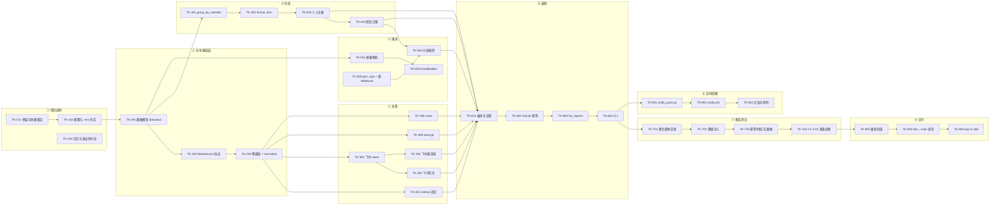

# tasks.md —— 智能日报生成器 v1 任务拆解

> 状态：**0.1 草案（待开发/测试评审签字）** · 作者：赵蕊（架构师） · 日期：2026-11-09
> 输入：`specs/proposal.md` **0.4**（S1–S9 / N1–N9 / C1–C10）、`specs/design.md` **0.5**（1.x 分层、2.x 数据模型、3.x 接口契约、4 ADR、5 非功能约束）、`docs/赵蕊-design红队评审单.md`（待办 T-01–T-07）
> **本表不是"待开发愿望清单"**：`src/` 已实现的照实标 ✅，实现了但没验证的标 ☐，需要补做的标 ⏳ 并给验收命令。这样它才能作为 `v1-sdd` 打 tag 的基线，而不是一张自我表扬的清单。
> 阅读顺序：§2 依赖图 → 各阶段表 → §12 覆盖矩阵（确认 proposal 每条范围都有任务承接）。

---

## 1. 编号、依赖与验收约定

| 约定 | 内容 |
| --- | --- |
| 任务编号 | `TK-<阶段><两位序号>`：`1xx` 项目结构 / `2xx` 共享基础层 / `3xx` 采集 / `4xx` 生成 / `5xx` 推送 / `6xx` 编排与 CLI / `7xx` 集成测试 / `8xx` 实时提醒 / `9xx` 交付发布 |
| 依赖 | 只写**直接前置**任务；"→"表示 A 完成才能开始 B。同一阶段内默认串行，跨阶段按依赖图 |
| 验收标准 | 必须写成「**给定输入 → 可观测输出 → 阈值/状态**」，且能落到一条命令或一次人工核对；禁止"功能正常"这类不可测表述 |
| 状态 | ✅ 已实现且有实测证据 ｜ ☐ 已实现但无验证 ｜ ⏳ 未实现或需补做 ｜ — 不需要（说明理由） |
| 角色 | 架构（契约与评审）／开发（实现）／测试（验收装置与执行）／配置（入库、tag、归档） |

---

## 2. 依赖关系图

---

## 3. 阶段①：项目结构与工程基线

| 编号 | 任务 | 产出 | 依赖 | 验收标准 | 状态 |
| --- | --- | --- | --- | --- | --- |
| TK-101 | 建包骨架与依赖锁定 | `pyproject.toml`、`uv.lock`、`src/smart_daily/{collectors,push}/`、`main.py` 入口 | — | ①`uv sync` 在干净环境成功；②`uv run python -c "import smart_daily"` 返回 0；③运行依赖只有 `httpx`（`uv pip list` 可核）；④`pyproject.toml` 的入口必须写 `smart_daily.cli:main`（**现状写的是 `smart_daily:main`，属缺陷，随本任务修**） | ⏳（骨架在，入口待修） |
| TK-102 | 配置与环境变量约定 | `.env.example`、`.gitignore`、`DB_PATH`/`MEMBER_*`/凭证变量清单 | TK-101 | ①`.env.example` 含全部变量且值为占位；②`git check-ignore -v .env` 命中；③故意把 `.env` 改名后运行 → 报"凭证缺失→降级"，不崩溃 | ✅ |
| TK-103 | 日志前缀与退出码约定 | `[source]`/`[push]` 打印规范；CLI 退出码表 | TK-101 | ①同一运行中每行日志能看出属于哪个源/哪个通道；②退出码表写进 `--help` 或 README：0 成功 / 2 参数错 / 1 采集或落库失败 / **推送有失败项时非 0**（见 TK-707） | ☐（前缀有，退出码未定义） |

---

## 4. 阶段②：共享基础层

| 编号 | 任务 | 产出 | 依赖 | 验收标准 | 状态 |
| --- | --- | --- | --- | --- | --- |
| TK-201 | 三型原始记录 + WorkItem | `collectors/models.py`：`CommitEntry`/`MessageEntry`/`TaskEntry`（frozen）、`WorkItem`、`record_timestamp()`、`local_date()`、`normalize()` | TK-102 | ①三型混入 `normalize()` 输出按时间倒序；②`WorkItem` 二次传入原样放行（幂等）；③未知类型抛 `TypeError` 而非静默丢弃；④东八区 23:30 的 UTC 时间戳经 `local_date()` 归属当日次日边界正确（对应 C9） | ✅ |
| TK-202 | `WorkSource` 协议 | `collectors/base.py` 的 `Protocol`（`name` + `collect(since, until, author)`） | TK-201 | ①四个采集器都满足协议（`isinstance(x, WorkSource)` 为真，`runtime_checkable`）；②协议里不出现任何具体平台字段 | ✅ |
| TK-203 | 降级链与归一化入口 | `collect_with_fallback(sources)` | TK-202 | ①源返回 `[]` → **停止**并返回该源名（不继续切）；②源抛 `SourceUnavailableError` → 切下一个；③全部失败 → 抛聚合异常且错误信息含每个源的原因（对应 C8）；④返回的条目已完成归一化，编排层二次归一化应被禁止（文档 + 断言双保险） | ✅ |

---

## 5. 阶段③：三个采集模块（GitHub / 飞书 / 本地兜底）

| 编号 | 任务 | 产出 | 依赖 | 验收标准 | 状态 |
| --- | --- | --- | --- | --- | --- |
| TK-301 | GitHub 提交采集 | `collectors/github.py`：`from_env()`、`collect_commits()`、手动翻页、错误语义 | TK-203 | ①给定 `main` 上时间窗内的提交 → 返回条数与 GitHub 页面一致（单成员 100 条窗口内误差 0）；②无效 token → 抛 `SourceUnavailableError`（含 401/403 语义），**不返回 `[]`**；③空仓库（409）→ 抛异常并说明"仓库为空"；④未配 `GITHUB_REPO_OWNER/NAME` → 直接判定不可用，**不发请求**（断言 [3]） | ✅ |
| TK-302 | 飞书 tenant_access_token 缓存 | `collectors/feishu.py` 的 token 管理 | TK-203 | ①同一进程内多次调用只取一次 token（计数断言 = 1）；②过期前 300 秒刷新；③`app_id/secret` 缺失 → 抛 `SourceUnavailableError` 且信息含中文提示（如 21001 租户资质） | ✅ |
| TK-303 | 飞书任务采集 | 同上，任务接口 → `TaskEntry` | TK-302 | ①返回条目含 task_id/summary/created_at/completed；②时间归属用 `created_at`（与 design 2.2 一致）；③分页翻完取全，不因单页上限漏条 | ☐（凭证就绪，待真实数据） |
| TK-304 | 飞书群消息采集（单群限定） | 同上，群消息接口 → `MessageEntry` | TK-302 | ①只读 `FEISHU_CHAT_ID` 指定群，其他群/私聊**零条目**（对应 S3/N7 红线）；②消息超过 N 条时分页取全；③群 ID 缺失 → 抛不可用，不静默返回 `[]` | ☐（同上） |
| TK-305 | local-git 兜底采集 | `collectors/local_git.py` | TK-203 | ①只读本地仓库，不发任何网络请求（可用断网复跑验证）；②仓库不存在/非 git 目录 → 抛不可用；③与 GitHub 采集同一时间窗结果集应一致（同一仓库抽样比对） | ✅ |
| TK-306 | mock 演示源 | `collectors/mock.py`（内置 4 人样例） | TK-203 | ①`--mock` 下**不依赖任何凭证**即可产出完整日报；②mock **不出现在默认降级链**里（构造无凭证环境跑默认链 → 结果不含演示数据） | ✅ |

---

## 6. 阶段④：日报生成

| 编号 | 任务 | 产出 | 依赖 | 验收标准 | 状态 |
| --- | --- | --- | --- | --- | --- |
| TK-401 | 按成员分组 | `push/generator.py::group_by_member` | TK-201 | ①分组后组内时间倒序；②同一成员多账号（映射后同名）合入一组（C3）；③成员顺序稳定（同样的输入两次运行顺序一致） | ✅ |
| TK-402 | 单条渲染 | `format_item()` | TK-401 | ①格式为 `- [HH:MM] （标签）标题 —— 详情`；②commit 的 message **不改写**，详情只追加文件数/增删行（Q4，C1）；③同一输入渲染两次字节一致 | ✅ |
| TK-403 | 个人日报 | `build_personal_report(member, items, day)` | TK-402 | ①给定 3 提交 + 2 任务 → 条目数 **= 5**（C1，硬指标）；②0 条成员输出"今日无工作记录"而非空文件（C8）；③纯函数：不读文件、不发请求（可用 monkeypatch 断言无 IO） | ✅（①③有实测，②待补断言） |
| TK-404 | 团队日报 | `build_team_report(groups, day)` | TK-403 | ①含全部 4 位成员，按贡献降序，统计头计数=各人条目和（C4）；②20 条与 0 条成员都全量列出、不压缩；③与个人日报**模板骨架逐字一致**（去成员名/条目/计数后比对，C4） | ✅（骨架比对脚本待建） |

---

## 7. 阶段⑤：邮件与群推送

| 编号 | 任务 | 产出 | 依赖 | 验收标准 | 状态 |
| --- | --- | --- | --- | --- | --- |
| TK-501 | 成员→邮箱映射 | `push/members.py::load_member_emails` | TK-201 | ①`MEMBER_EMAILS="成员:邮箱1;邮箱2"` 解析正确，多邮箱可用；②未配置返回 `{}`，**不报错**；③仓库内无真实邮箱（示例一律 `example.com`，红线） | ✅ |
| TK-502 | SMTP 邮件通道 | `EmailNotifier.from_env()` + `send()` | TK-501 | ①4 人各收到**仅自己**那份（内容交叉检查不串人）；②缺 SMTP 凭证 → 返回 False 并留原因，**不抛异常**、不中断落库；③发送超时/认证失败只记失败，不重试（本期） | ✅ |
| TK-503 | 群 Webhook 通道与签名 | `FeishuWebhookNotifier`、`gen_sign()` | TK-501 | ①签名算法唯一实现（全仓 `hmac` 只出现一处，可用 grep 断言）；②文本必含「日报」，缺失时本地拒发（防 19024）；③`code != 0` 返回 False 并打印错误码提示（19021/19022/19024） | ✅ |
| TK-504 | 分发规则 | 个人→邮件、团队→群 | TK-502、TK-503 | ①个人日报**只走邮件**、团队日报**只走群**（email 通道收件人不为空，回归 bug 防复发）；②团队日报不发邮件（S7 明确）；③`--no-notify` 时两个通道都不发且落库正常 | ✅ |

---

## 8. 阶段⑥：主编排与 CLI

| 编号 | 任务 | 产出 | 依赖 | 验收标准 | 状态 |
| --- | --- | --- | --- | --- | --- |
| TK-601 | 编排主流程 | `orchestrator.py::run()` | TK-504、TK-305 | ①顺序为 采集→归属日→分组→团队→逐人个人→落库→推送；②任一推送失败不影响落库（查库可证）；③返回字典含 `date/source/members/items/saved_reports/pushed/push_detail/team_report`（字段名与 design 3.4 逐字一致） | ✅ |
| TK-602 | SQLite 幂等落库 | `_ensure_db`、`save_report` | TK-601 | ①同日两次运行 → `(report_date, member)` 行数不变（C5）；②内容为最后一次运行结果；③`DB_PATH` 指向不可写路径 → 抛错且日报文本已打印到终端（不丢数据） | ✅ |
| TK-603 | 历史查询 | `list_reports(day=None)` | TK-602 | ①按日期倒序；②`--list` 输出不含全文，只元数据；③排序键是 `report_date` 而**不是** `created_at`（后者是"最后写入时间"，见 design 2.3） | ✅ |
| TK-604 | CLI | `cli.py`（`--mock`/`--source`/`--no-notify`/`--day`/`--list`） | TK-603 | ①五个参数行为与 design 3.4 表一致；②`--day` 指定日期时落库日期=该日；③`--list` 不触发采集（可用断网验证）；④退出码遵循 TK-103 的表 | ☐（参数齐，退出码待统一） |

---

## 9. 阶段⑦：集成测试与逐条验收

| 编号 | 任务 | 产出 | 依赖 | 验收标准 | 状态 |
| --- | --- | --- | --- | --- | --- |
| **TK-701** | **断言脚本回填（评审 T-02）** | `scripts/verify_collectors.py`（34 项断言） | TK-306 | ①`uv run python scripts/verify_collectors.py` 全绿、打印 `34/34`；②覆盖 design 3.1 表格中标注的编号 [1][2][3][4][5][8][9][10][12]；③接入 CI，PR 上必须绿 | ⏳ **P0** |
| TK-702 | 失效注入用例（C2） | `tests/test_fallback.py` | TK-701 | ①把 `GITHUB_TOKEN` 设为无效值 → 降级到 local-git、主流程不中断、日志有"降级原因"；②全过程无崩溃栈 | ⏳ |
| TK-703 | 幂等 / 时区 / 空数据三件套（C5/C9/C8） | `tests/test_orchestrator.py` | TK-701 | ①连跑两次行数不变；②东八区 23:30 的提交归当日；③"当天无数据"与"三源全坏"两种空**输出不同**（前者落"今日无工作记录"，后者抛异常） | ⏳ |
| TK-704 | 模板骨架一致性（C4） | `tests/test_generator.py` | TK-701 | ①个人/团队模板去变量后逐字一致；②20 条与 0 条成员都全量出现 | ⏳ |
| TK-705 | 性能观察项（C6，评审 T-04） | 计时断言 | TK-701 | ①构造 100 条提交，打印耗时；②**只作观察、不进硬验收**（proposal 已降级），但必须有一条可复跑的计时输出 | ⏳ |
| TK-706 | 采集遗漏人工对账流程 | `docs/testing/对账记录模板.md` | TK-604 | ①每次发布前用 CLI 汇总 / `--list` / 群消息三处对照；②差异逐条记录并注明原因（proposal 要求"人工核验方式"入文档） | ⏳ |
| **TK-707** | **C7 送达判定修正（评审 T-01）** | `orchestrator.py`、`cli.py` | TK-701 | ①`pushed = all(...)`（4 邮件 + 1 群全部 ok 才真）；②任一通道失败 → CLI 退出码非 0；③`push_detail` 能指出**哪一条**失败（通道+范围+原因） | ⏳ **P0** |
| TK-708 | C1–C10 逐条核对表 | `docs/testing/成功标准核对表.md` | TK-702…707 | ①C1–C10 每条对应到 ≥1 个任务编号与 ≥1 条验收证据；②无证据的条目必须显式写"未验收 + 原因"，不许留空 | ⏳ |

---

## 10. 阶段⑧：实时提醒通道（S9 / C10，独立支线）

> 关键约束：本支线**不写 SQLite、不进 G1 计数、不改 `orchestrator.py`**（design 1.4 隔离表）。它与 ①–⑦ 并行，失败不影响 22:00 主流程。

| 编号 | 任务 | 产出 | 依赖 | 验收标准 | 状态 |
| --- | --- | --- | --- | --- | --- |
| TK-801 | 提醒脚本 | `scripts/notify_push.py` | TK-503（复用 `gen_sign`） | ①读 `GITHUB_EVENT_PATH`，**不调 GitHub API**；②1 次 push 合 1 条、commits 全列、标题取首行≤60 字；③`ACTOR` 未命中映射 → 仍然发送并打 `::warning::`；④文本不含「日报」→ 拒发并 `exit 1`；⑤`code != 0` → `exit 1` | ✅（run 42587824934 / 42588443836） |
| TK-802 | workflow | `.github/workflows/notify.yml` | TK-801 | ①`branches: [main, dev]`，`docs/*` 分支 push 触发 0 次；②`permissions: contents: read`；③两条 Webhook 凭证只从 Secrets 注入，文件内无明文；④不需要 `GITHUB_TOKEN` | ✅ |
| **TK-803** | **签名负向用例（评审 T-07）** | 一次性实验记录（写入评审单附录） | TK-802 | 临时用错误 secret 跑一次 → 飞书返回 **19021** 且 workflow 红灯。**只有能被打红，才能证明签名校验真的开着**（`code=0` 不能证明，见 design 3.5 注） | ⏳ **P1** |
| TK-804 | 大 push 边界实测（评审 T-06） | 实验记录 | TK-802 | 构造 21 个提交一次 push → 记录 `len(commits)` 与事件 `size` 是否相等，据此在 design 3.5 边界表里定稿"仅列前 N 条"的措辞 | ⏳ |

---

## 11. 阶段⑨：交付与发布

| 编号 | 任务 | 产出 | 依赖 | 验收标准 | 状态 |
| --- | --- | --- | --- | --- | --- |
| TK-901 | 敏感信息扫描（评审 T-05） | CI 步骤（gitleaks 或等价） | TK-701 | ①故意提交一个假 AWS key → CI 红；②正常 PR → 绿；③扫描结果不含任何真实凭证值时也不得打印密钥片段 | ⏳ |
| **TK-902** | **dev → main 发布合并（评审 T-03）** | 一次 PR + merge commit | TK-708 | ①合并后默认分支上同时存在 `specs/design.md`、`specs/tasks.md`、`scripts/notify_push.py`、`.github/workflows/notify.yml`（可用 `git ls-tree main` 核对）；②main 上 `uv run python -m smart_daily.cli --mock` 可跑 | ⏳ **P0** |
| TK-903 | 打标签 | `v1-sdd`（附三份规范版本号） | TK-902 | ①`git show v1-sdd` 的 tag message 列出 proposal 0.4 / design 0.5 / tasks 0.1；②tag 落在 main 的发布提交上 | ⏳ |

---

## 12. 覆盖矩阵（proposal 范围 → 任务）

### 12.1 范围条目 S1–S9

| 范围 | 承接任务 | 验收锚点 |
| --- | --- | --- |
| S1 GitHub 提交采集 | TK-301、TK-201 | C1 / 断言 [1][4] |
| S2 飞书任务 | TK-303 | C1 |
| S3 飞书群消息（单群） | TK-304 | C1 / N7 红线（零越界） |
| S4 个人日报 1:1 原文 | TK-402、TK-403 | C1 |
| S5 身份归并 + 未映射告警 | TK-201、TK-501、TK-801③ | C3 |
| S6 团队日报格式统一 | TK-404 | C4 |
| S7 22:00 手动触发、邮件+群送达 | TK-502、TK-504、TK-604 | C7（修正后） |
| S8 SQLite 快照 + `--list` | TK-602、TK-603 | C5、I7 |
| S9 实时提醒 | TK-801–TK-804 | C10 |

### 12.2 成功标准 C1–C10

| 标准 | 承接任务 | 备注 |
| --- | --- | --- |
| C1 条目 1:1、零手工 | TK-403、TK-706 | 3 提交 + 2 任务 = 5 条为硬断言；遗漏靠三处对照人工核验 |
| C2 假 token 降级 | TK-702 | 需**正式失效注入**，不能再用"`.env` 没加载"充数 |
| C3 身份归并 100% | TK-201、TK-501 | 构造多账号数据集 |
| C4 模板骨架一致 | TK-404、TK-704 | 去变量后逐字比对 |
| C5 同日重跑不追加 | TK-602、TK-703 | |
| C6 100 条 < 30s | TK-705 | **观察项**，不进硬验收 |
| C7 5 条送达全 ok | **TK-707** | 现状 `any()` 与契约相反，P0 |
| C8 两种空可区分 | TK-703 | 现在只有"全失败抛异常"有实现 |
| C9 跨时区归属 | TK-201、TK-703 | |
| C10 实时提醒 | TK-801–TK-804 | `code=0` 只算正向通过，负向见 TK-803 |

### 12.3 不做什么（N1–N9）的反向校验

| 排除项 | 任务表里的守卫 |
| --- | --- |
| N1 AI 摘要 | 生成层无任何模型调用；TK-403 断言"纯函数、无网络" |
| N5 实时刷新 / 提醒计入条目 | TK-801 明确不写库；design 1.4 隔离表；TK-707 只统计 5 条 |
| N8 自动定时汇总 / 自动重试 | 仓库只有 push 工作流，无 `schedule`；TK-802 验收里核对触发条件 |
| N9 服务化 / 多机部署 | TK-902 只做分支发布，不引入部署 |

---

## 13. 风险与前置条件

| 风险 | 影响任务 | 处置 |
| --- | --- | --- |
| 34 项断言脚本缺失 → 阶段⑦ 全部悬空 | TK-701 及其下游 | **先补 TK-701**，否则 TK-702–708 无法动工 |
| C7 判定与实现相反 | TK-707 | 列为 P0，排在发布之前 |
| 飞书任务/群消息仍无真实数据实测 | TK-303、TK-304 | 凭证就绪但未跑真实窗口，验收只能用构造数据，须在核对表标注"构造数据" |
| 默认分支 main 落后 38 个提交 | TK-902 | 发布合并前先 `main → dev` 反向同步一次，避免合并时冲突扩大 |
| 验收标准里的测试用例尚无人认领 | TK-702–708 | 需测试工程师在评审时认领并给排期 |

---

## 14. 评审签字

| 角色 | 评审关注点 | 意见 | 签字 |
| --- | --- | --- | --- |
| 架构（赵蕊） | 依赖是否成立、契约是否被任务覆盖 | 起草 | ＿＿＿ |
| 开发工程师 | 工程可行性：任务粒度是否可并行、是否有隐藏前置 | 待填 | ＿＿＿ |
| 测试工程师 | 验收标准是否**可测**（能否写出用例） | 待填 | ＿＿＿ |
| 配置管理员 | 分支与 tag 流程是否可执行 | 待填 | ＿＿＿ |

> 评审规则：测试工程师对任一条验收标准说"这条我写不出用例"，该任务**不得进入开发**，须回到本表重写验收标准。
