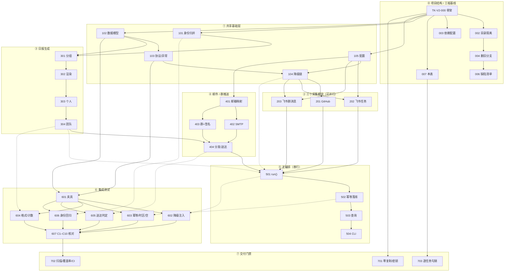

# 智能日报生成器 v2 实现计划（tasks.md）

> **目标路径**：`v2/specs/tasks.md`（dev 分支，v2 目录隔离）｜**本地文件名**：`于悦-第3周-v2-tasks.md`
> **版本**：0.1.2（0.1.1 + 第 3 周组会角色分工负责人归属，见 §4）｜**撰写**：于悦（第 3 周需求分析师）｜**修订**：杨佳莹 2026-11-17（404 / 401 / 605）；负责人归属 2026-11-20 按组会分工补入｜**日期**：2026-11-17
> **起草方式**：WorkBuddy 依据指导书、远端 dev 只读事实与 v1 规范起草；**复核：于悦待确认；组内评审签字：待落**。本文件不代签、不代勾销、不倒填。
> **工作流**：Superpowers `writing-plans`（第 3 周起专一使用，不混用 SDD）。本文件同时是课程交付物 `tasks.md` 与该工作流的计划产物，只保留这一份，避免"两处不一致即缺陷"。
> **关联规范**：`v1/specs/proposal.md` 0.4.4（S1–S9 / N1–N9 / C1–C10，**产品级需求基线，v1/v2 共用**）、`v1/specs/design.md` 0.6（**v1 设计，只作文字参考**）、`v2/README.md`（ADR-101~104 结论、接口契约、v1 三个坑）、指导书第七部分第 3 周第 3 步、附录 B。
> **粒度依据**：教材第 6.5 节任务粒度，按指导书第 3 周转述执行——一条任务 = 一个可验证交付物 = 一次提交；每条含验收标准、依赖、预估、并行组标记。

---

## 0. 这份表和仓库现状的关系（先读）

- 远端 dev 的 `v2/` 目录 11-16 已建，提交里已在用 **`TK-V2-000 / 002 / 003 / 004 / 006 / 101`**。本表**沿用这套编号**，不另起一套，也不覆盖 v1 的 `v1/specs/tasks.md`（0.1.4，`TK-1xx~9xx`，已定稿，只读）。
- `001`、`005` 远端没出现过，**保留空号不复用**，免得日后对不上。
- 下表把周一已发生的工作**回填成可验收的任务条目**，但状态一律写"🟩 上游自报绿，待核对"——**提交存在 ≠ 验收标准达成**，勾销由需求分析师在《第 3 周 tasks.md 进度维护记录》里逐条核过后才做。
- 本表**不含任何 v1 源代码**。v1 的设计结论只按 `v2/README.md` 的文字带入（ADR、接口契约、数据模型经验、三个坑），代码全部从零写。

**远端已有证据（11-16，供起始核对，不是核销结论）**

| 编号 | 提交 | message 首行 | 状态 |
| --- | --- | --- | --- |
| TK-V2-000 | `58b921f` / `973e2da` | 初始化 v2 工程骨架与设计结论带入 / 骨架并入 dev | 🟩 待核对 |
| TK-V2-002 | `defdb7a` | v2 方案改为目录隔离，同步 CI 与分支规范 | 🟩 待核对 |
| TK-V2-003 | `fa9deab` | 补入 v2 dev 依赖与 ruff/pytest 配置 | 🟩 待核对 |
| TK-V2-004 | `b6062ae` | 删除阶段二旧分支 v2-superpowers 并同步分支口径 | 🟩 待核对 |
| TK-V2-006 | `96fa4aa` | 新增缺陷清单与根因记录 | 🟩 待核对 |
| TK-V2-101 | `a1af126`（红）→ `6c226b5`（绿）→ `25115d3`（日志） | 身份归并用例（红）/ 实现 identity.py（绿）；自报 pytest 9 passed、覆盖率 100% | 🟩 待核对 |

---

## 1. 约定（writing-plans · Global Constraints）

**Goal**：从零重做智能日报 v2，用 tasks.md 逐任务驱动 TDD 红→绿→重构，产出可运行、可验收、可追溯的 `v2/` 工程与测试。

**Architecture**：采集层（异常驱动降级 → `fallback.py` 内统一 `normalize()` 一次）→ 共享基础层（`WorkItem` 数据模型）→ 生成层（纯函数）→ 推送层（应送达集合判定）→ 主编排（串行落库与分发，禁止二次归一化）；v2 全部落在 `v2/`，与 v1 目录隔离、不共享文件。

**Tech Stack**：Python（`pyproject.toml` ruff target `py313`；周一实跑环境自报 3.14）、`httpx`（ADR-101 直连，无 ORM）、`sqlite3`（ADR-102）、`ruff` E/F/I/B + `pytest` + `coverage`、`uv sync --dev`、GitHub Actions（`.github/workflows/ci.yml`，触发 dev + `paths: v2/**`）。

**Spec**：`v2/README.md` + `v1/specs/proposal.md` 0.4.4。执行者两份都要读。

| # | 全局约束（每条任务的验收标准隐含包含本节） |
| --- | --- |
| G1 | 所有新增/修改文件在 `v2/` 下；`v1/` 下的 `src/`、`tests/`、`specs/` 一行不动 |
| G2 | 禁止复制、改造 v1 源码与测试；`v2/` 下不得出现 `import smart_daily`；零复制校验可复跑 |
| G3 | 测试先于实现：先写失败测试（红）→ 最小实现（绿）→ 重构；**没有验收标准的任务不许进入执行** |
| G4 | 一次提交对应一个任务，message 格式 `feat\|fix\|test\|docs: [TK-V2-编号] 一句话说明`；合并前执行 `code-review` 并逐条回应 |
| G5 | `ruff check` / `ruff format --check` 清零，`pytest` 全绿；覆盖率按教师公布阈值，未公布前只记录数值、**不擅自判定达标** |
| G6 | 密钥只走环境变量 / GitHub Secrets；仓库内不得出现真实 token、邮箱、Webhook 地址；示例一律 `example.com` |
| G7 | 归一化只执行一次（`normalize()`），下游禁止二次归一化；日期一律 `local_date()` 按东八区归属；生成层纯函数无 IO |
| G8 | 共享文件（尤其主编排入口 `orchestrator.py`、`cli.py`）必须串行；只有产出文件无重叠且无直接前置的任务才可并行 |
| G9 | 补记、AI 日志、勾销按真实时间写，注明补记；不倒填、不代签、不代勾 |

**状态**：⬜ 未开始 ｜ 🔴 红（失败测试已写）｜ 🟢 绿（实现通过）｜ 🟩 上游自报绿、待核对 ｜ ✅ 已勾销（须绑提交号 + 验收逐条核对）｜ ⏸ 阻塞。

**每条任务的 TDD 步骤（统一模板，下文只写"红 / 绿 / 提交"三行，不重复整套说明）**：
`- [ ] 红：写 tests/... 中具名用例 → 跑 pytest 指定用例，预期 FAIL` → `- [ ] 绿：按 Interfaces 的签名实现最小代码 → 跑同一命令，预期 PASS` → `- [ ] 重构 + ruff 清零` → `- [ ] 提交：一次提交，message 带任务编号` → `- [ ] code-review 后由需求分析师逐条核对验收标准再勾销`。

---

## 2. 文件结构（先锁边界，再拆任务）

边界决定并行性：**三个采集模块各占一个文件**，所以能并行；生成层四条同改 `reports/generator.py`，所以串行。

| 路径 | 职责 | 任务 |
| --- | --- | --- |
| `v2/specs/tasks.md` | 本文件：任务清单、依赖图、并行组 | 007 |
| `v2/README.md`、`pyproject.toml`、`uv.lock`、`.gitignore` | 已有：设计结论文字带入、依赖与工具配置 | 000/003 |
| `v2/src/smart_daily_v2/identity.py` | 已有：身份键归一化与归并 | 101 |
| `.../config.py` | 环境变量读取、凭证缺失语义 | 105 |
| `.../models.py` | 三型原始记录、`WorkItem`、`local_date()`、`normalize()` | 102 |
| `.../sources/base.py` | `WorkSource` 协议、`SourceUnavailableError`、聚合异常 | 103 |
| `.../sources/fallback.py` | `collect_with_fallback()` 异常驱动降级 | 104 |
| `.../sources/github.py` / `feishu_tasks.py` / `feishu_chat.py` | 三路正式采集，**各一文件** | 201 / 202 / 203 |
| `.../sources/mock.py` | 无凭证可复现夹具（**非第四路正式数据源**，不进计数口径） | 601 |
| `.../reports/generator.py` | 分组 / 单条渲染 / 个人 / 团队日报 | 301–304 |
| `.../notifiers/members.py` / `email.py` / `webhook.py` / `dispatch.py` | 邮箱映射 / SMTP / 群签名 / 分发与送达判定 | 401–404 |
| `.../orchestrator.py` / `storage.py` / `cli.py` | 主编排 / SQLite 幂等与查询 / CLI 与退出码 | 501 / 502–503 / 504 |
| `v2/tests/*.py`、`v2/tests/fixtures/` | 单测、集成用例、夹具 | 全部任务 |
| `v2/tests/acceptance_matrix.md` | C1–C10 逐条核对表 | 607 |
| `v2/docs/` | 第 3 周及后续周次课程交付文档（**AI 使用日志除外**，见 §9-6） | 000 / 006 / 607 / 701 / 702 / 703 |

---

## 3. Review Focus（规范隐含、最容易咬人的 5 类输入）

按 `writing-plans` 要求，规范没写全的输入也要有测试兜住；每条都已在 owning task 的验收标准里点名。

| # | 输入 / 条件 | 合理预期 | 钉在哪个任务 |
| --- | --- | --- | --- |
| R1 | 身份键为 `None` / 空串 / 首尾空格 / 大小写混用 | 显式 `TypeError` 或统一 `strip()+casefold()`，不静默丢条目（v1 坑 3 / RT-06） | 101、606 |
| R2 | 三源全失效 vs 当天确实无数据 | 前者抛聚合异常，后者输出「今日无工作记录」，**两种空输出必须不同**（v1 坑 1 / C8） | 104、602、603 |
| R3 | 6 个通道里只有 3 个 `ok` | 不得判送达成功，应送达集合 + `all()`（v1 坑 2 / C7） | 404、605 |
| R4 | 东八区 23:30 与 UTC 16:00 的时间戳 | 归当日；`.date()` 与 `local_date()` 的差异要专打（C9） | 102、603 |
| R5 | 缺凭证 / 凭证错误 | 采集层不发请求、抛 `SourceUnavailableError`；通知层 `from_env()` 抛 `ValueError`、`send()` 返回 `False` 不抛 | 105、402、602 |

---

## 4. 任务总览

> 七段链路按指导书第 3 步排布：项目结构 → 共享基础层 → 三个采集模块 → 日报生成 → 邮件推送 → 主编排 → 集成测试；0xx 为工程基线回填，7xx 为交付门禁。
>
> **负责人栏（2026-11-20 按组会角色分工 + 指导书第 3 周「各角色本周产出物」核定）**：需求 = 于悦，架构 = 杨佳莹，开发 = 方赫，测试 + 配置 = 赵蕊（兼任两角色、分别留痕）。分工**按指导书产出物类型**而非编码任务条数：需求分析师交本表与进度维护记录（007 / 703）；开发工程师交「所负责任务」的红绿循环与实现提交，故 36 条中全部 `src/` 编码任务（含 102 / 103 / 501）归开发；测试工程师交用例集与覆盖率（601–607）、配置管理员交工程初始化与 CI 门禁（000 / 002 / 003 / 004 / 701 / 702），均由赵蕊兼任；缺陷清单（006）按指导书归测试。**架构师本周产出是三份文档**——《接口契约变更审核记录》《code-review 评审意见》《设计与 specs/ 一致性检查记录》，均已交（`v2/docs/杨佳莹-第3周-*.md`），不在 36 条编码任务表内，故架构在表内记 0 条；issue #14 的 K4 / K8 / K2 审核结论体现在其审核记录文档中，**不等于负责实现 102 / 103 / 501 的代码**。**负责人 ≠ 实际提交人**：如 601–606 实际由方赫提交、701 由赵蕊交，本栏只记职责主责，实际提交号以《进度维护记录》为准。

| 编号 | 标题 | 负责人 | 依赖 | 预估 | 并行组 | 状态 |
| --- | --- | --- | --- | --- | --- | --- |
| TK-V2-000 | v2 工程骨架与设计结论文字带入 | 赵蕊（配置） | — | 0.5d | P0 | 🟩 待核对 |
| TK-V2-002 | 目录隔离方案变更 + CI / 分支规范同步 | 赵蕊（配置） | 000 | 0.25d | P0 | 🟩 待核对 |
| TK-V2-003 | dev 依赖与 ruff / pytest 配置 | 赵蕊（配置） | 000 | 0.25d | P0 | 🟩 待核对 |
| TK-V2-004 | 删除旧分支、同步分支口径 | 赵蕊（配置） | 002 | 0.25d | P0 | 🟩 待核对 |
| TK-V2-006 | 缺陷清单与根因记录 | 赵蕊（测试） | 004 | 0.25d | P0 | 🟩 待核对 |
| TK-V2-007 | 撰写 v2 tasks.md（本表）+ 组内评审 | 于悦（需求） | 000 | 0.5d | P0-a | ⬜ |
| TK-V2-101 | 身份归并 `identity.py` | 方赫（开发） | 000 | 0.5d | P1-a | 🟩 待核对 |
| TK-V2-102 | 数据模型与归一化入口 `models.py` | 方赫（开发） | 000 | 0.5d | P1-b | ⬜ |
| TK-V2-103 | `WorkSource` 协议与异常类型 `base.py` | 方赫（开发） | 102 | 0.25d | P1-b | ⬜ |
| TK-V2-104 | 异常驱动降级链 `fallback.py` | 方赫（开发） | 103、105 | 0.5d | P1-b | ⬜ |
| TK-V2-105 | 配置与凭证读取 `config.py` | 方赫（开发） | 000 | 0.25d | P1-a | ⬜ |
| TK-V2-201 | GitHub 提交采集 `github.py` | 方赫（开发） | 104 | 1d | **P2 并行** | ⬜ |
| TK-V2-202 | 飞书任务采集 `feishu_tasks.py` | 方赫（开发） | 104、105 | 1d | **P2 并行** | ⬜ |
| TK-V2-203 | 飞书群消息采集 `feishu_chat.py` | 方赫（开发） | 104、105 | 1d | **P2 并行** | ⬜ |
| TK-V2-301 | 按成员分组 `group_by_member()` | 方赫（开发） | 101、102 | 0.25d | P3 串行 | ⬜ |
| TK-V2-302 | 单条渲染 `format_item()` | 方赫（开发） | 301 | 0.25d | P3 串行 | ⬜ |
| TK-V2-303 | 个人日报 `build_personal_report()` | 方赫（开发） | 302 | 0.25d | P3 串行 | ⬜ |
| TK-V2-304 | 团队日报 `build_team_report()` | 方赫（开发） | 303 | 0.5d | P3 串行 | ⬜ |
| TK-V2-401 | 成员→邮箱映射 `members.py` | 方赫（开发） | 105 | 0.25d | P4 | ⬜ |
| TK-V2-402 | SMTP 通道 `email.py` | 方赫（开发） | 401 | 0.5d | P4-a 并行 | ⬜ |
| TK-V2-403 | 群通道与 `gen_sign()` `webhook.py` | 方赫（开发） | 401 | 0.5d | P4-a 并行 | ⬜ |
| TK-V2-404 | 分发规则 + 送达判定 `dispatch.py` | 方赫（开发） | 402、403、304 | 0.5d | P4 | ⬜ |
| TK-V2-501 | 主编排 `orchestrator.run()` | 方赫（开发） | 104、201–203、304、404 | 1d | P5 串行 | ⬜ |
| TK-V2-502 | SQLite 幂等落库 `storage.py` | 方赫（开发） | 501 | 0.5d | P5 串行 | ⬜ |
| TK-V2-503 | 历史查询 `list_reports()` | 方赫（开发） | 502 | 0.25d | P5 串行 | ⬜ |
| TK-V2-504 | CLI 与退出码 `cli.py` | 方赫（开发） | 503 | 0.5d | P5 串行 | ⬜ |
| TK-V2-601 | 无凭证可复现夹具 `mock.py` + fixtures | 赵蕊（测试） | 102、103 | 0.5d | P6-a | ⬜ |
| TK-V2-602 | 降级注入用例（C2 / R2 / R5） | 赵蕊（测试） | 601、501 | 0.5d | P6-b 并行 | ⬜ |
| TK-V2-603 | 幂等 / 时区 / 两种空（C5 / C9 / C8） | 赵蕊（测试） | 601、502 | 0.5d | P6-b 并行 | ⬜ |
| TK-V2-604 | 条目行格式与 1:1 计数（C1 / C4） | 赵蕊（测试） | 601、304 | 0.5d | P6-b 并行 | ⬜ |
| TK-V2-605 | 送达判定用例（C7 / R3） | 赵蕊（测试） | 601、404 | 0.5d | P6-b 并行 | ⬜ |
| TK-V2-606 | 身份归并回归扩展（C3 / R1） | 赵蕊（测试） | 601、101 | 0.25d | P6-b 并行 | ⬜ |
| TK-V2-607 | C1–C10 逐条核对表与覆盖率 / 扫描归档 | 赵蕊（测试） | 602–606 | 0.5d | P6-c 汇合 | ⬜ |
| TK-V2-701 | 零复制与密钥红线自查 | 赵蕊（配置） | 000 | 0.25d | P7-a | ⬜ |
| TK-V2-702 | 静态扫描 / 覆盖率 / CI 门禁归档 | 赵蕊（配置） | 607 | 0.25d | P7-b | ⬜ |
| TK-V2-703 | 逐任务勾销与提交历史对照（贯穿全周） | 于悦（需求） | 007 | 0.5d | P7-c | ⬜ |

合计 36 条：于悦（需求）2 条（007 / 703）、方赫（开发）20 条（101–105 / 201–203 / 301–304 / 401–404 / 501–504）、赵蕊（测试 8 条 006 / 601–607 + 配置 6 条 000 / 002 / 003 / 004 / 701 / 702）14 条、杨佳莹（架构）0 条编码任务（三份审核文档另计）；`001`/`005` 为空号。

---

## 5. 依赖关系图

> 图例：**实线**=直接前置（对应总览表「依赖」列）；**虚线**=运行时实现汇合（编排调用采集/生成、集成用例引用被测模块），只表示开工顺序，不作验收依赖。

### 5.1 并行组标记（仅无共享文件的任务可并行）

| 组 | 任务 | 组内关系 | 共享文件检查 |
| --- | --- | --- | --- |
| P0 | 000 → 002/003 → 004 → 006 | 按依赖串行 | 同改 `BRANCHING.md`、`ci.yml`、初始化记录，已发生 |
| P0-a | 007 | 可与 006 并行 | 只新建 `v2/specs/tasks.md`，不碰 `v2/docs/` 与代码 |
| P1-a | 101、105 | 可并行 | `identity.py` 与 `config.py` 无重叠；101 已完成 |
| P1-b | 102 → 103 → 104 | 串行 | 103/104 都依赖 102 的类型定义；105 完成后 104 才能开工 |
| **P2** | **201、202、203** | **可并行（老师点名）** | 分别为 `github.py` / `feishu_tasks.py` / `feishu_chat.py`，**文件不重叠**；v1 曾把三个飞书功能塞进一个文件导致串行，v2 按文件边界拆开 |
| P3 | 301 → 302 → 303 → 304 | 串行 | 四条同改 `reports/generator.py` |
| P4 | 401 → 402/403 → 404 | 402 与 403 可并行 | `email.py` / `webhook.py` 分开；404 依赖两者且依赖 304 |
| P5 | 501 → 502 → 503 → 504 | **串行（共享文件）** | 501 与 502/503 可能同改编排侧文件；主编排入口与 CLI 必须串行 |
| P6-a | 601 | 可与 P2/P3/P4 并行 | 只新增 `sources/mock.py` 与 `tests/fixtures/`，不改正式模块 |
| P6-b | 602、603、604、605、606 | 可并行（601 完成后） | 五个不同测试文件，互不重叠 |
| P6-c | 607 | 串行汇合 | 依赖 602–606 全部完成 |
| P7-a | 701 | 可与 P2–P6 并行 | 只读校验 + 一份自查记录 |
| P7-b | 702 | 依赖 607 | 归档扫描/覆盖率/CI 输出 |
| P7-c | 703 | 贯穿全周，收口依赖 607 | 只维护进度维护记录，不改代码 |

---

## 6. 任务明细

> 每条 = 一个可验证交付物 = 一次提交。验收标准一律「给定输入 → 可观测输出 → 阈值/状态」，能落到一条 `pytest` 命令或一次人工核对。

### ⓪ 项目结构 / 工程基线（回填 + 本表）

#### TK-V2-000 · v2 工程骨架与设计结论文字带入
- 交付物：`v2/README.md`、`pyproject.toml`、`uv.lock`、`.gitignore`、`src/smart_daily_v2/`、`tests/`、`scripts/`、`v2/docs/赵蕊-v2初始化记录.md`
- 依赖 — ｜ 预估 0.5d ｜ 状态 🟩 上游自报绿，待核对（`58b921f`、`973e2da`）
- 验收标准：① 给定干净环境执行 `uv sync --dev` → 退出码 0、可 `import smart_daily_v2`；② `v2/README.md` 逐条含 ADR-101~104、接口契约、数据模型经验、v1 三个坑 → 文字齐、**全文无 v1 代码块**；③ 对每条 v2 任务提交执行 `git diff 该提交~1 该提交 -- v1/` → 0 行（v2 的提交不得改动 v1；v1 已于 11-17 整体迁入 `v1/`，根目录不再有 `src/ tests/ specs/`，旧写法 `-- src/ tests/ specs/` 因路径不存在而失效）；另 `ls src tests specs 2>/dev/null` → 根目录三目录均不存在；④ `grep -r "import smart_daily" v2/` → 0 命中。
- 红/绿/提交：本任务为工程基线，验收方式是复跑上述 4 条命令并留输出；`docs: [TK-V2-000] 初始化 v2 工程骨架与设计结论带入`

#### TK-V2-002 · 目录隔离方案 + CI / 分支规范同步
- 交付物：`BRANCHING.md` 阶段二段、`.github/workflows/ci.yml`（触发 dev + `paths: v2/**`，工作目录 `v2`）、初始化记录「方案变更」节
- 依赖 000 ｜ 预估 0.25d ｜ 状态 🟩 待核对（`defdb7a`）
- 验收标准：① 给定一次只改 `v2/` 的提交 → CI 被触发且 `uv sync --dev` / `ruff` / `pytest` 三步全跑；② 给定只改 v1 `docs/` 的提交 → CI **不触发**（paths 过滤生效）；③ `git branch -a` → 无 `v2-superpowers`；④ 故意留一条 F401 → CI 判红。
- 红/绿/提交：CI 负向验证记录归档；`ci: [TK-V2-002] v2 方案改为目录隔离，同步 CI 与分支规范`

#### TK-V2-003 · dev 依赖与 ruff / pytest 配置
- 交付物：`v2/pyproject.toml` 的 `[dependency-groups]`（PEP 735）、ruff 配置、`[tool.pytest.ini_options]`
- 依赖 000 ｜ 预估 0.25d ｜ 状态 🟩 待核对（`fa9deab`）
- 验收标准：① `uv sync --dev` 后 `ruff --version` / `pytest --version` 均可执行（CI 里找不到 ruff 即为失败）；② ruff `line-length=100`、`target-version=py313`、规则 `E,F,I,B`；③ 故意写 `import os` 未使用 → `ruff check` 报 F401 且退出码非 0；④ 运行依赖只有 `httpx`（ADR-101）与 `tzdata`（Windows 无系统时区库，`zoneinfo.ZoneInfo("Asia/Shanghai")` 需靠它，TK-V2-102 补入），`uv pip list` 可核。
- 红/绿/提交：`ci: [TK-V2-003] 补入 v2 dev 依赖与 ruff/pytest 配置`

#### TK-V2-004 · 删除旧分支并同步分支口径
- 交付物：`BRANCHING.md`、初始化记录中「v2-superpowers 已删除」的口径
- 依赖 002 ｜ 预估 0.25d ｜ 状态 🟩 待核对（`b6062ae`）
- 验收标准：① `git ls-remote --heads origin v2-superpowers` → 空；② 删除前比对记录中含「仅多 2bb4650（故意留 F401）」及 v2 目录差异结论；③ `BRANCHING.md` 与初始化记录中不再出现「历史快照」表述。
- 红/绿/提交：`docs: [TK-V2-004] 删除阶段二旧分支 v2-superpowers 并同步分支口径`

#### TK-V2-006 · 缺陷清单与根因记录
- 交付物：`v2/docs/赵蕊-缺陷清单与根因记录.md`
- 依赖 004 ｜ 预估 0.25d ｜ 状态 🟩 待核对（`96fa4aa`）
- 验收标准：① 每条缺陷含复现命令、实际/预期、根因（观察→假设→实验→结论）、修复验证；② 6 条状态细分可核（已闭环 3 / 待确认 1 / 已确认未修复 2）；③ GREEN 后自愈**不记**已修复；④ 未闭环项（U2 及 §8.2 其余待确认项）写明所需证据与责任人；U1 已于 11-17 闭环，按 §8.2 留痕行核对闭环证据，不再计入未闭环项。
- 红/绿/提交：`docs: [TK-V2-006] 新增缺陷清单与根因记录`

#### TK-V2-007 · 撰写 v2 tasks.md（本表）并过组内评审
- 交付物：`v2/specs/tasks.md`（本文件）
- 依赖 000 ｜ 预估 0.5d ｜ 并行组 P0-a ｜ 状态 ⬜
- 验收标准：① 逐条扫本表 36 条 → 每条都有「给定输入 → 可观测输出 → 阈值/状态」的验收标准，0 条空缺（自查清单第 1 条）；② 覆盖指导书七段链路 → §4 总览表能逐段指到任务编号；③ §5 有依赖图与并行组标记，且 P2 三个采集模块已标"可并行"；④ 对照 §8 覆盖矩阵 → S1–S8 / C1–C9 每条有承接任务，缺口如实登记；⑤ 组内评审意见逐条回应后再改状态，评审签字不代填。
- 红/绿/提交：本任务验收靠人工逐条核对 + 评审记录；`docs: [TK-V2-007] 撰写 v2 tasks.md（含依赖图与并行组）`

### ① 共享基础层

#### TK-V2-101 · 身份归并（已完成，待核对）
- 交付物：`v2/src/smart_daily_v2/identity.py`、`v2/tests/test_identity.py`
- 依赖 000 ｜ 预估 0.5d ｜ 状态 🟩 上游自报绿，待核对（`a1af126` 红 → `6c226b5` 绿）
- Interfaces / Produces：**以 `identity.py` 现有公开函数为准**（`normalize_key`、`normalize_members`），本表不另定签名；下游只通过这两个函数调用。
- 验收标准：① 给定 `"  YuYue  "` / `"yuyue"` / `"YUYUE"` → 归一化键三者相同（`strip()+casefold()`）；② 给定 `None` → 抛 `TypeError`，不静默兜底；③ 给定同键多身份 → `normalize_members` 按出现顺序收成列表、不丢条目；④ 重跑 `pytest v2/tests/test_identity.py -v` → 9 passed、覆盖率 100%（与提交自报一致才算通过）。
- 红/绿/提交：`test: [TK-V2-101] 身份归并用例（红）` → `feat: [TK-V2-101] 实现身份归并模块 identity.py（绿）`

#### TK-V2-102 · 数据模型与归一化入口
- 交付物：`models.py`、`tests/test_models.py`
- 依赖 000 ｜ 预估 0.5d ｜ 并行组 P1-b ｜ 状态 ⬜
- Interfaces / Produces：`WorkItem`（frozen，字段 `record_id / source / member / kind / title / detail / occurred_at / local_day`）、`CommitEntry` / `TaskEntry` / `MessageEntry`、`local_date(ts: datetime) -> date`、`normalize(entries: list[...]) -> list[WorkItem]`
- 归一化单点（issue #14 K4 方案甲）：采集器 201–203 只产 `RawRecord`（即 `CommitEntry` / `TaskEntry` / `MessageEntry` 三型原始记录），不自行归一化；`normalize()` 的**唯一调用点**在 `TK-V2-104` 的 `fallback.py` 内，本任务只提供定义与单测、不在此调用；下游一律禁止二次归一化（G7）。按架构师推荐方案甲写入；组内会若改选方案乙，需同步改本节、104 ④ 与 Architecture 三处。
- 验收标准：① 给定三型记录混合输入 → `normalize()` 输出按 `occurred_at` 倒序、条数与输入相等；② 给定已是 `WorkItem` 的输入 → 原样放行（幂等防御性断言，不代表允许下游再次调用，G7）；③ 给定未知类型 → 抛 `TypeError`，不静默丢弃；④ **R4**：给定 `2026-11-09T23:30+08:00` 与 `2026-11-10T00:00Z` → `local_date()` 分别返回 11-09 / 11-10，与 `ts.date()` 的差异有专门断言。
- 红：`test_normalize_sorts_and_keeps_count`、`test_normalize_idempotent`、`test_unknown_type_raises`、`test_local_date_utc8_boundary`
- 绿 / 提交：`feat: [TK-V2-102] 实现 WorkItem 与单次归一化入口`

#### TK-V2-103 · `WorkSource` 协议与异常类型
- 交付物：`sources/base.py`、`tests/test_worksource.py`
- 依赖 102 ｜ 预估 0.25d ｜ 并行组 P1-b ｜ 状态 ⬜
- Interfaces / Produces：`WorkSource`（`@runtime_checkable` Protocol）：`name: str`、`collect(*, since: datetime, until: datetime, author: str | None = None) -> list[WorkItem]`；`SourceUnavailableError(source, reason)`；`AllSourcesUnavailableError(errors: list[SourceUnavailableError])` **继承 `SourceUnavailableError`**：`class AllSourcesUnavailableError(SourceUnavailableError)`，`errors` 作附加属性；因父类签名 `(source, reason)`，子类须自实现 `__init__(errors)` 并调 `super().__init__("all_sources", "; ".join(原因))`（K8 方案甲，保证按旧类兜底的 501 / 504 / 602 继续生效）
- 验收标准：① 给定三个采集器实例 → `isinstance(x, WorkSource)` 全为 True；② 协议文本中 → 不含任何平台专有字段（grep 断言）；③ 给定 `AllSourcesUnavailableError([e1,e2,e3])` → `str(e)` 含全部 3 个源名与原因；④ **K8**：`issubclass(AllSourcesUnavailableError, SourceUnavailableError)` 为 True，`except SourceUnavailableError` 能捕获全失败异常（防上层静默穿透）。
- 红 / 绿 / 提交：`feat: [TK-V2-103] 定义 WorkSource 协议与异常类型`

#### TK-V2-104 · 异常驱动降级链
- 交付物：`sources/fallback.py`、`tests/test_fallback.py`
- 依赖 103、105 ｜ 预估 0.5d ｜ 并行组 P1-b ｜ K1 已裁定、U1 已闭环，⏸ 解除、状态 ⬜
- Interfaces / Produces：`collect_with_fallback(sources: Sequence[WorkSource], *, since, until, author=None) -> tuple[list[WorkItem], list[str]]`（条目 + 降级原因；`*` 强制 since/until 关键字传参，防顺序传反，见 K5）
- 验收标准：① 给定第一源抛 `SourceUnavailableError`、第二源返回 3 条 → 返回 (3 条, 含第一源原因的列表)，不中断；② 给定第一源返回 `[]`、第二源有数据 → 返回（空列表，第一源名），**不切第二源**（空列表 = 该源当天无数据，属合法结果；与"异常"严格区分）；③ **R2**：给定三源全抛异常 → 抛 `AllSourcesUnavailableError`，错误信息含 3 条原因，**不返回空列表**（v1 坑 1 / C8）；④ `collect_with_fallback()` 内对合并后的 `RawRecord` 统一调用 `normalize()` **一次**（归一化单点，与 102 呼应）；返回的条目已是 `WorkItem`，编排层不得再次调用 `normalize()`（G7）；⑤ **K3**：给定第一源正常返回非空数据、全程未发生降级 → 第二元素（降级原因列表）返回 `[]`，不记任何源名；第一源返回空列表的情形见 ②，不属本条。
- 红 / 绿 / 提交：`feat: [TK-V2-104] 实现异常驱动降级链`

#### TK-V2-105 · 配置与凭证读取
- 交付物：`config.py`、`tests/test_config.py`、`v2/.env.example`
- 依赖 000 ｜ 预估 0.25d ｜ 并行组 P1-a ｜ 状态 ⬜
- Interfaces / Produces：`load_config(env: Mapping[str, str] | None = None) -> Config`；`require_credential(name: str) -> str`
- 验收标准：① 给定缺 `GITHUB_TOKEN` 的环境 → 采集侧拿到 `SourceUnavailableError` 语义、**不发任何 HTTP 请求**（用 monkeypatch 断言 httpx 调用次数 0）；② 给定缺 SMTP 凭证 → 通知侧 `from_env()` 抛 `ValueError`（R5）；③ `.env.example` 含全部变量名且值为占位、`git check-ignore -v .env` 命中；④ `grep -rE "ghp_|xoxb-|@qq.com|@gmail.com" v2/` → 0 命中（G6）。
- 红 / 绿 / 提交：`feat: [TK-V2-105] 实现配置与凭证缺失语义`

### ② 三个采集模块（P2 可并行）

> 三条都消费 `WorkSource` / `WorkItem` / `SourceUnavailableError`（103）与 `Config`（105），分别落在不同文件，可同时开工。凭证一律环境变量注入，禁止硬编码。

#### TK-V2-201 · GitHub 提交采集
- 交付物：`sources/github.py`、`tests/test_source_github.py`
- 依赖 104 ｜ 预估 1d ｜ 并行组 **P2** ｜ 状态 ⬜
- Interfaces / Produces：`GithubSource.from_env() -> GithubSource`、`collect(*, since, until, author=None) -> list[WorkItem]`；只读 `main` 分支、按登录名经 101 归人（S1 / I2）
- 验收标准：① 给定 fixture 中时间窗内 3 条 commit → 返回 3 条 `WorkItem`，`record_id` 与原始 sha 一一对应、无改写；② 给定无效 token（桩 401）→ 抛 `SourceUnavailableError`，**不返回 `[]`**；③ 给定空仓库 409 → 抛异常且信息含"仓库为空"；④ 给定未配 `GITHUB_REPO_OWNER/NAME` → 不发请求直接判不可用（httpx 调用次数 0）。
- 红 / 绿 / 提交：`feat: [TK-V2-201] 实现 GitHub 提交采集`

#### TK-V2-202 · 飞书任务采集
- 交付物：`sources/feishu_tasks.py`、`tests/test_source_feishu_tasks.py`
- 依赖 104、105 ｜ 预估 1d ｜ 并行组 **P2** ｜ 状态 ⬜
- Interfaces / Produces：`FeishuTaskSource.from_env() -> FeishuTaskSource`、`collect(*, since, until, author=None) -> list[WorkItem]`
- 验收标准：① 给定 fixture 中 2 条任务 → 返回 2 条，含 `task_id / summary / created_at / completed` 派生字段；② 给定 `created_at=2026-11-09T22:30+08:00`、`completed_at=2026-11-10T09:00+08:00` → 归属 11-09，且 `--day 11-10` 结果中不出现、两次合计只计 1 次；③ 给定翻页响应（第 1 页满、第 2 页 1 条）→ 全量取回不漏条；④ 给定缺 app 凭证 → 抛 `SourceUnavailableError`、请求次数 0。
- 红 / 绿 / 提交：`feat: [TK-V2-202] 实现飞书任务采集`

#### TK-V2-203 · 飞书群消息采集（单群限定）
- 交付物：`sources/feishu_chat.py`、`tests/test_source_feishu_chat.py`
- 依赖 104、105 ｜ 预估 1d ｜ 并行组 **P2** ｜ 状态 ⬜
- Interfaces / Produces：`FeishuChatSource.from_env() -> FeishuChatSource`、`collect(*, since, until, author=None) -> list[WorkItem]`
- 验收标准：① 给定 fixture 中含指定群 2 条 + 其他群/私聊 3 条 → 只返回 2 条（S3 / N7 / I12）；② 给定超过单页上限的消息 → 分页取全，条数等于 fixture 总数；③ 给定 `FEISHU_CHAT_ID` 缺失 → 抛不可用，不静默返回 `[]`；④ 消息正文原样保留，不做截断以外的改写（S4 / I8）。
- 红 / 绿 / 提交：`feat: [TK-V2-203] 实现飞书群消息采集`

### ③ 日报生成（纯函数，P3 串行）

#### TK-V2-301 · 按成员分组
- 交付物：`reports/generator.py::group_by_member`、`tests/test_generator.py`
- 依赖 101、102 ｜ 预估 0.25d ｜ 状态 ⬜
- Interfaces：`group_by_member(items: list[WorkItem]) -> dict[str, list[WorkItem]]`
- 验收标准：① 给定 5 条分属 2 人 → 2 组，组内按 `occurred_at` 倒序；② 给定同一人多账号（101 归一后同键）→ 合入 1 组、不串人（C3）；③ 同一输入连跑两次 → 成员顺序逐字一致。
- 红 / 绿 / 提交：`feat: [TK-V2-301] 实现按成员分组`

#### TK-V2-302 · 单条渲染
- 交付物：`reports/generator.py::format_item`、同测试文件
- 依赖 301 ｜ 预估 0.25d ｜ 状态 ⬜
- Interfaces：`format_item(item: WorkItem) -> str`
- 验收标准：① 给定一条 commit → 输出 `- [HH:MM] （类型）标题 —— 详情`，标题与原始 message 逐字一致；② 详情只追加客观信息（文件数/增删行），不改写标题（S4 / I8）；③ 同一输入渲染两次 → 字节一致；④ 纯函数：monkeypatch 断言无文件读写、无网络调用（G7）。
- 红 / 绿 / 提交：`feat: [TK-V2-302] 实现单条渲染`

#### TK-V2-303 · 个人日报
- 交付物：`reports/generator.py::build_personal_report`、同测试文件
- 依赖 302 ｜ 预估 0.25d ｜ 状态 ⬜
- Interfaces：`build_personal_report(member: str, items: list[WorkItem], day: date) -> str`
- 验收标准：① 给定 3 提交 + 2 任务 → 条目数 **= 5**（C1，硬指标）；② 给定 0 条 → 输出含「今日无工作记录」而非空字符串（C8）；③ 纯函数断言同 302。
- 红 / 绿 / 提交：`feat: [TK-V2-303] 实现个人日报生成`

#### TK-V2-304 · 团队日报
- 交付物：`reports/generator.py::build_team_report`、同测试文件
- 依赖 303 ｜ 预估 0.5d ｜ 状态 ⬜
- Interfaces：`build_team_report(groups: Mapping[str, list[WorkItem]], day: date) -> str`
- 验收标准：① 给定 4 位成员（含 1 位 20 条、1 位 0 条）→ 4 人全部列出、不压缩不截断，按贡献条数降序，统计头计数 = 各人条目和（C4 / S6）；② 用剥离函数逐行比对 → 团队日报与个人日报的**条目行格式逐字一致**，整体骨架不比对；③ 全组 0 条 → 团队日照发且含零记录文案。
- 红 / 绿 / 提交：`feat: [TK-V2-304] 实现团队日报生成`

### ④ 邮件与群推送

#### TK-V2-401 · 成员→邮箱映射
- 交付物：`notifiers/members.py`、`tests/test_notifiers.py`
- 依赖 105 ｜ 预估 0.25d ｜ 状态 ⬜
- Interfaces：`load_member_emails(env: Mapping[str, str] | None = None) -> dict[str, list[str]]`；`load_report_recipients(env: Mapping[str, str] | None = None) -> list[str]`
- 验收标准：① 给定 `MEMBER_EMAILS="甲:a@example.com;b@example.com"` → 解析出 2 个收件人；② 未配置 → 返回 `{}` 不抛异常；③ 仓库内 0 处真实邮箱（G6）；④ 给定 `REPORT_RECIPIENTS="a@x.com, b@x.com"` → `load_report_recipients()` 返回 2 个已去空白的收件人、未配置返回 `[]` 且不抛异常；两个变量互不影响，**外部收件人不得混入 `MEMBER_EMAILS`，也不得经 `resolve_recipients` 处理**（design 0.6 3.3 硬规则 1）。
- 红 / 绿 / 提交：`feat: [TK-V2-401] 实现成员邮箱映射`

#### TK-V2-402 · SMTP 通道
- 交付物：`notifiers/email.py`、同测试文件
- 依赖 401 ｜ 预估 0.5d ｜ 并行组 P4-a ｜ 状态 ⬜
- Interfaces：`EmailNotifier.from_env() -> EmailNotifier`、`send(subject: str, body: str, recipients: list[str]) -> bool`；`Notifier` Protocol 同签名
- 验收标准：① 给定 4 位成员各自日报 → 每人仅收到自己那份（收件人与正文交叉检查不串人）；② **R5**：缺 SMTP 凭证 → `from_env()` 抛 `ValueError`；已建实例发送超时/认证失败 → `send()` 返回 `False`、记录原因、**不抛异常**、不中断落库；③ 本期不重试（N8）。
- 红 / 绿 / 提交：`feat: [TK-V2-402] 实现 SMTP 邮件通道`

#### TK-V2-403 · 群通道与签名
- 交付物：`notifiers/webhook.py`、同测试文件
- 依赖 401 ｜ 预估 0.5d ｜ 并行组 P4-a ｜ 状态 ⬜
- Interfaces：`FeishuWebhookNotifier.from_env() -> ...`、`send(...) -> bool`、`gen_sign(timestamp: int, secret: str) -> str`
- 验收标准：① `grep -rn "hmac" v2/src/` → 签名算法只出现 1 处（ADR-104 单点复用）；② 给定不含「日报」的文本 → 本地拒发，不产生 HTTP 调用（防 19024）；③ 给定飞书返回 `code != 0`（19021/19022/19024）→ `send()` 返回 `False` 并打印错误码。
- 红 / 绿 / 提交：`feat: [TK-V2-403] 实现群通道与签名`

#### TK-V2-404 · 分发规则与送达判定
- 交付物：`notifiers/dispatch.py`、`tests/test_dispatch.py`
- 依赖 402、403、304 ｜ 预估 0.5d ｜ 状态 ⬜
- Interfaces：`dispatch(personal: Mapping[str, str], team: str, *, no_notify: bool = False, team_recipients: Sequence[str] = ()) -> dict[str, bool]`；`all_delivered(expected: set[str], results: Mapping[str, bool]) -> bool`。`team_recipients` 由编排层经 `load_report_recipients()` 注入，**`dispatch` 本身不读环境变量**（保持层内不碰配置）
- 验收标准：① 给定 4 份个人日报 + 1 份团队日报 + `REPORT_RECIPIENTS` 配置 1 个外部收件人 → 个人只走邮件；团队走群 + 外部邮件两条通道，**两条各自独立 try、各自 1 条回执**（`scope` 分别为 `team` / `team:report_recipients`，S7 / I5）；② 给定 `no_notify=True` → 6 个通道调用次数全 0，落库照常；③ **R3**：给定 `expected` 6 个通道、`results` 中仅 3 个 `True` → `all_delivered()` 返回 `False`（**禁止 `any()`**，v1 坑 2）；④ 全文 `grep -n "any(" v2/src/smart_daily_v2/notifiers/` → 送达判定处 0 命中；⑤ 给定 `REPORT_RECIPIENTS` 未配置 → 应送达集合退回 5 条（`len(groups) + 1`）、外部邮件通道不产生回执，**不得判失败**（design 0.6 3.4 第 3 条）。
- 红 / 绿 / 提交：`feat: [TK-V2-404] 实现分发规则与应送达集合判定`

### ⑤ 主编排与 CLI（P5 串行）

#### TK-V2-501 · 主编排
- 交付物：`orchestrator.py`、`tests/test_orchestrator.py`
- 依赖 104、201–203、304、404 ｜ 预估 1d ｜ 状态 ⬜
- Interfaces：`run(day: date, *, sources: Sequence[WorkSource], notify: bool = True) -> dict`，返回 **9 键**：`date / source / members / items / saved_reports / pushed / push_status / push_detail / team_report`（与 v1 design 3.4 对齐；本契约由架构师 K2 确认定稿，`push_status` 是 504 退出码 `3` 的唯一数据来源）
- 验收标准：① 给定夹具 5 条 → 执行顺序为 采集→归属日→分组→团队→逐人个人→落库→推送，日志可逐步核对；② 给定任一通道 `send()` 返回 False → `run()` 不抛异常，查库仍有记录；③ `pushed` 由 `all_delivered()` 得出，不得由 `any()` 得出（R3）；④ 全源失效 → 抛 `AllSourcesUnavailableError`，**不产出 0 条空日报**（R2）；⑤ **K2**：`push_status` 五态 `ok / partial / failed / no_channel / skipped`——`notify=True` 且全部通道成功 → `ok`、`pushed=True`；任一失败 → `partial`/`failed`、`pushed=False`；`notify=False` → `skipped`；不变量 `pushed == (push_status == "ok")`，`all([])` 不得判成功（五态沿用 v1 design 3.4 RT-01）。
- 红 / 绿 / 提交：`feat: [TK-V2-501] 实现主编排流程`

#### TK-V2-502 · SQLite 幂等落库
- 交付物：`storage.py::save_report`、同测试文件
- 依赖 501 ｜ 预估 0.5d ｜ 状态 ⬜
- Interfaces：`save_report(conn, day: date, member: str, text: str, item_count: int, source: str) -> None`
- 验收标准：① 表 `daily_reports` 含 `UNIQUE(report_date, member)`，写入用 `INSERT ... ON CONFLICT DO UPDATE`（ADR-102）；② 同日同成员连写两次（2 条 → 5 条）→ 行数不变、`item_count` 为最后一次的 5（C5）；③ `work_items` 本期只预留表结构、**无业务逻辑**（README §3）；④ 给定不可写 `DB_PATH` → 抛错但日报文本已打印到终端，不丢数据。
- 红 / 绿 / 提交：`feat: [TK-V2-502] 实现 SQLite 幂等落库`

#### TK-V2-503 · 历史查询
- 交付物：`storage.py::list_reports`、同测试文件
- 依赖 502 ｜ 预估 0.25d ｜ 状态 ⬜
- Interfaces：`list_reports(conn, day: date | None = None) -> list[ReportMeta]`
- 验收标准：① 给定 3 天记录 → 按 `report_date` 倒序；② 输出只含元数据、不含日报全文；③ 排序键是 `report_date` 而非 `created_at`（有专门断言）。
- 红 / 绿 / 提交：`feat: [TK-V2-503] 实现历史查询`

#### TK-V2-504 · CLI 与退出码
- 交付物：`cli.py`、`tests/test_cli.py`
- 依赖 503 ｜ 预估 0.5d ｜ 状态 ⬜
- Interfaces：`main(argv: Sequence[str] | None = None) -> int`，参数 `--mock / --source / --no-notify / --day / --list`
- 验收标准：① 五个参数行为与约定一致，`--day` 指定日期时落库日期 = 该日；② `--list` 不触发采集（断网或 monkeypatch 断言 httpx 调用 0）且恒返回 0；③ 退出码四态：`0` 成功 / `1` 采集或落库失败 / `2` 参数错误 / `3` 推送存在失败项；`--no-notify` 恒 `0`；`notify=True` 但无通道 → `push_status="no_channel"` 且 `3`；④ 文档中的退出码表与 `--help` 输出逐字一致。
- 红 / 绿 / 提交：`feat: [TK-V2-504] 实现 CLI 与退出码`

### ⑥ 集成测试与逐条验收

#### TK-V2-601 · 无凭证可复现夹具
- 交付物：`sources/mock.py`、`tests/fixtures/`、`tests/conftest.py`
- 依赖 102、103 ｜ 预估 0.5d ｜ 并行组 P6-a ｜ 状态 ⬜
- 验收标准：① 给定清空所有凭证的环境 → 夹具仍能构造 4 人样例数据并产出完整日报；② mock **不出现在默认降级链**（无凭证跑默认链 → 结果不含演示数据，I1 / I11）；③ 夹具条目带稳定 `record_id`，供 602–606 对账复用；④ 夹具不是第四路正式数据源，不进 C1 计数口径（文档 + 断言双保险）。
- 红 / 绿 / 提交：`test: [TK-V2-601] 建立无凭证可复现夹具`

#### TK-V2-602 · 降级注入用例（C2 / R2 / R5）
- 交付物：`tests/test_integration_fallback.py`
- 依赖 601、501 ｜ 预估 0.5d ｜ 并行组 P6-b ｜ K1 已裁定、U1 已闭环，⏸ 解除、状态 ⬜
- 验收标准：① 给定假 `GITHUB_TOKEN` + 401 桩 → 切下一源、主流程不中断、日志含"降级原因"；② 三源全抛异常 → 断言 `pytest.raises(AllSourcesUnavailableError)` 且信息含 3 条原因，stdout 无「今日无工作记录」；③ 缺凭证 → httpx 调用次数 0。
- 红 / 绿 / 提交：`test: [TK-V2-602] 补齐降级注入集成用例`

#### TK-V2-603 · 幂等 / 时区 / 两种空（C5 / C9 / C8 / R4）
- 交付物：`tests/test_integration_boundary.py`
- 依赖 601、502 ｜ 预估 0.5d ｜ 并行组 P6-b ｜ 状态 ⬜
- 验收标准：① 连跑两次 → `(report_date, member)` 行数不变、内容为最后一次（C5）；② 东八区 23:30 → 归当日，UTC 16:00 → 归次日（C9 / R4）；③ "当天无数据"输出「今日无工作记录」且团队日照发，"三源全坏"抛异常 → **两种输出断言不相同**（C8）。
- 红 / 绿 / 提交：`test: [TK-V2-603] 补齐幂等/时区/两种空用例`

#### TK-V2-604 · 条目行格式与 1:1 计数（C1 / C4）
- 交付物：`tests/test_integration_format.py`
- 依赖 601、304 ｜ 预估 0.5d ｜ 并行组 P6-b ｜ 状态 ⬜
- 验收标准：① 给定 3 提交 + 2 任务 → 条目数 5、手工条目 0、同一动作跨三源留痕按 3 条独立条目呈现（C1 / I7）；② 个人 / 团队条目行逐行比对逐字一致（C4）；③ 20 条与 0 条成员都全量出现。
- 红 / 绿 / 提交：`test: [TK-V2-604] 补齐格式一致性与计数用例`

#### TK-V2-605 · 送达判定用例（C7 / R3）
- 交付物：`tests/test_integration_delivery.py`
- 依赖 601、404 ｜ 预估 0.5d ｜ 并行组 P6-b ｜ 状态 ⬜
- 验收标准：① 给定 4 邮件 + 1 群 + 1 外部邮件全 `True` → 判送达成功；② 给定其中任一 `False` → 判失败且 `pushed=False`（C7 / R3）；③ 实时提醒通道不计入这 6 条，SQLite 无新增提醒记录（S9 边界，若本周不重做该通道则本条只作口径登记）。
- 红 / 绿 / 提交：`test: [TK-V2-605] 补齐送达判定用例`

#### TK-V2-606 · 身份归并回归扩展（C3 / R1）
- 交付物：`tests/test_integration_identity.py`
- 依赖 601、101 ｜ 预估 0.25d ｜ 并行组 P6-b ｜ 状态 ⬜
- 验收标准：① 给定大小写/空格混用的同一人 3 个身份 → 归并后恰 1 组、`record_id` 互不相交（C3）；② 给定 `None` → 断言 `TypeError`（R1）；③ 给定未映射身份 → 显式告警、不静默丢弃（S5 / v1 坑 3）。
- 红 / 绿 / 提交：`test: [TK-V2-606] 补齐身份归并回归用例`

#### TK-V2-607 · C1–C10 逐条核对表与门禁数据归档
- 交付物：`v2/tests/acceptance_matrix.md`、覆盖率与静态扫描原始输出
- 依赖 602–606 ｜ 预估 0.5d ｜ 并行组 P6-c ｜ 状态 ⬜
- 验收标准：① C1–C10 每行含成功标准、承接任务编号、用例 ID、实际输出、通过/失败/跳过、执行人、日期；② 未达教师公布阈值如实记录、不补造（G5）；③ C6 性能仍为观察项、不进硬验收，须在表中单独注明；④ `pytest --cov` 与 `ruff check` 原始输出归档到 `v2/docs/testing/证据/`。
- 红 / 绿 / 提交：`docs: [TK-V2-607] 汇总 C1–C10 逐条核对表与门禁数据`

### ⑦ 交付门禁

#### TK-V2-701 · 零复制与密钥红线自查
- 交付物：`v2/docs/于悦-第3周-零复制与密钥自查.md`（或并入组内统一自查记录）
- 依赖 000 ｜ 预估 0.25d ｜ 并行组 P7-a ｜ 状态 ⬜
- 验收标准：① `git diff` 比对 `v1/src/ v1/tests/ v1/specs/` → 0 行改动；② `grep -rn "import smart_daily" v2/` → 0 命中；③ 全仓扫描 token / 真实邮箱 / Webhook → 0 命中（G6）；④ 三条命令的真实输出贴进记录，不写"已检查"了事。
- 红 / 绿 / 提交：`docs: [TK-V2-701] 归档零复制与密钥红线自查`

#### TK-V2-702 · 静态扫描 / 覆盖率 / CI 门禁归档
- 交付物：`v2/docs/testing/证据/` 下扫描、覆盖率、CI run 输出
- 依赖 607 ｜ 预估 0.25d ｜ 并行组 P7-b ｜ 状态 ⬜
- 验收标准：① `ruff check` / `ruff format --check` 退出码 0；② 覆盖率数值 + 命令 + 版本 + 时间齐全，未达阈值如实标注；③ 一条真实 Actions run 链接可打开且 conclusion 与归档一致；④ 故意留 F401 → CI 变红（负向验证，与 002 呼应）。
- 红 / 绿 / 提交：`docs: [TK-V2-702] 归档静态扫描与 CI 门禁结果`

#### TK-V2-703 · 逐任务勾销与提交历史对照
- 交付物：`v2/docs/于悦-第3周-tasks进度维护记录.md`（**独立于本表的第二份文件**）
- 依赖 007 ｜ 预估 0.5d ｜ 贯穿全周 ｜ 状态 ⬜
- 验收标准：① 36 条任务一行一条，编号与本表逐字一致；② 每条勾销同时具备：验收标准逐条核对结果 + 带任务编号的提交号 + 红→绿证据 + code-review 回应；③ 提交历史 `git log --oneline` 与本表能一一对应，无一次性大提交；④ 补记注明补记时间，不倒填、不代签（G9）。
- 红 / 绿 / 提交：`docs: [TK-V2-703] 逐任务勾销与提交历史对照`

---

## 7. writing-plans 自审（起草时已跑，待于悦复核）

| 项 | 结果 |
| --- | --- |
| 规范覆盖 | 逐段扫 §6 C1–C10 与 §4.1 S1–S9 → 任务承接见 §8；**S9 / C10 实时提醒未纳入本周任务表，已作为 U2 上报**，不静默略过 |
| 步骤扫描 | 每条任务都给了具名测试或可复跑命令 + 提交 message；未出现「TBD」「处理边界情况」「写相应测试」这类空行 |
| 类型一致性 | 全表统一使用 `WorkItem` / `WorkSource` / `SourceUnavailableError` / `AllSourcesUnavailableError`；`normalize()`、`local_date()`、`gen_sign()`、`all_delivered()`、`collect_with_fallback()` 名称前后一致；101 已实现的函数不另定签名 |
| Review Focus | R1–R5 五条各自钉到 101/102/104/105/402/404 与 602–606 的验收标准里，无空项 |
| 篇幅比例 | 计划以签名、测试名、断言和命令为主，未贴实现代码正文；若后续某条任务写出大段代码，说明该任务该再拆 |

---

## 8. 范围覆盖矩阵与待确认事项（需求分析师登记，不替别人拍板）

### 8.1 proposal 覆盖

| 范围 / 成功标准 | 承接任务 | 结论 |
| --- | --- | --- |
| S1 GitHub 提交 | 201、604 | 覆盖 |
| S2 飞书任务 | 202、604 | 覆盖 |
| S3 飞书群消息（单群） | 203 | 覆盖 |
| S4 条目 1:1 原文呈现 | 302、303、604 | 覆盖 |
| S5 身份归并 | 101、606 | 覆盖 |
| S6 团队日报 | 304、604 | 覆盖 |
| S7 推送渠道与分发 | 401–404、605 | 覆盖 |
| S8 SQLite 快照与 `--list` | 502、503、603 | 覆盖 |
| **S9 实时提交通知** | — | **未纳入，见 U2** |
| C1 / C3 / C4 | 604 / 606 / 604 | 覆盖 |
| C2 / C5 / C8 / C9 | 602 / 603 / 603 / 603 | 覆盖 |
| C6 性能 | 607 | 观察项、不进硬验收（proposal 自降），按原文保留 |
| C7 送达 | 404、605 | 覆盖 |
| **C10 实时提醒** | — | **未纳入，见 U2** |
| N1–N9 排除项 | 601（mock 不进统计）、402（不重试）、203（单群）等 | 未新增功能，守卫已落验收标准 |

### 8.2 待组内确认（**没有结论前，相关任务不勾销**）

| # | 事项 | 为什么卡 | 建议找谁 |
| --- | --- | --- | --- |
| **U1** ✅ **已闭环（2026-11-17）** | 原事项：`collect_with_fallback()` 降级链口径在 `v2/README.md` §2 旧文与同文件 §4「v1 坑 1」、proposal C8 之间不一致；本行原逐字引用 §2 旧文，README 修订后该引用即过期，本次按证据链改写为概述，不再复述旧句 | 架构师杨佳莹已在 issue #14 **K1** 裁定「维持 ADR-103：异常才降级、空列表即停止」（空列表 = 该源当天无数据，属合法结果）；README §2 由配置管理员以 `58d4fec` 同步为新语义，本表 TK-V2-104 验收② 与「3 条 → 2 条」已由 `075f692` 修订 | **闭环证据**：issue #14 K1 三项 checkbox 全勾 + `58d4fec` + `075f692`。本行仅作留痕，不再计入未闭环项；104 / 602：K1 已裁定、U1 已闭环，⏸ 解除、状态 ⬜ |
| **U2** | **S9 / C10 实时提醒是否本周重做** | 指导书第 3 步的七段链路没列实时提醒，但阶段二写「从零重新实现全部功能」；且 GitHub Actions 只认仓库根 `.github/workflows/`，而根目录已有 v1 的 `notify.yml`，与 v2 目录隔离 + 零复制存在落点冲突 | 组内会定范围；若纳入，先由架构师出接口契约与 workflow 隔离方案，再补一组 `TK-V2-8xx` 任务，不塞进现有依赖图 |
| **U3** | **提交前缀口径**：远端已用 `chore:` / `ci:`（000/002/003/004），指导书第 5 步只给了 `feat\|fix\|test\|docs` 四种 | 已发生的提交不能偷改历史；如实登记为偏差，由组内统一后续口径 | 配置管理员 + 组内会；在进度维护记录里单列一行说明，不自行判不合格也不静默放过 |
| **U4** | **第 3 周角色轮换表仍为"待定"**（`v1/docs/小组角色分工与轮换表.md` 第 3 周行） | 本表署名与产出归属要与轮换表一致；第 2 周曾因表与署名不符专门更正 | 表维护人 / 组内会 |
| **U5** | **教师公布的覆盖率阈值** | 未拿到前只能记录数值，不能判达标（G5） | 测试工程师转达老师口径 |
| **U6** | **`REPORT_RECIPIENTS` 未配置时，应送达集合是 5 条还是 6 条** | 若固定按 6 条算，未配置外部收件人时 `all_delivered()` 永假、`push_status` 永为 `partial`，退出码恒为 `3` | 架构师已裁定：**未配置时退回 `len(groups) + 1`（5 条）**，外部邮件不产生回执、不判失败；404 / 605 已按此写（design 0.6 3.4 第 3 条） |

---

## 9. 交付与提交说明

1. 本文件复制到仓库 **`v2/specs/tasks.md`**（新建 `v2/specs/` 目录），不要覆盖 `v1/specs/tasks.md`（v1 定稿）。选这个路径是因为：v2 走目录隔离、CI 按 `paths: v2/**` 触发、且组内已有"两处不一致即缺陷"的纪律——**只保留这一份**，不再另建 `v2/docs/superpowers/plans/` 下的副本。
2. 建议提交 message：`docs: [TK-V2-007] 撰写 v2 tasks.md（含依赖图与并行组）`。按 `CLAUDE.md`，AI 参与的产出当天在 `docs/ai-usage-log.md` 加一行，工具如实写、状态留"待确认"。
3. 提交前请本人逐条复核 §4 总览表、§5 依赖图、§8 待确认事项；**§7 自审是起草时做的，不代替本人核对**；组内评审签字栏留空，不代签。
4. 《第 3 周 tasks.md 进度维护记录》另起一份文件，编号与本表对齐，逐日勾销用；两份分开留痕。
5. 教材第 6.5 节的粒度按指导书第 3 步转述执行（一条任务 = 一个可验证交付物 = 一次提交）。本机教材电子版为扫描件，未逐字引用原示例表；上课时对照一眼原表粒度，若老师给的示例更粗/更细，按老师口径调整本表拆分数即可，编号与依赖结构不用动。
6. 文档落点（2026-11-18 组内归位口径）：`v1/docs/` 放第 1–2 周历史文档；根 `docs/` 放 AI 使用日志 `docs/ai-usage-log.md`（按 `CLAUDE.md`，DEF-09 已闭环）；`v2/docs/` 放第 3 周及以后（含第 4 周）的课程交付文档。三处用途不同、互不搬迁；本表 §2 / §6 / §8 中出现的 `v2/docs/...` 均指后者，`docs/ai-usage-log.md` 不随之迁移。
